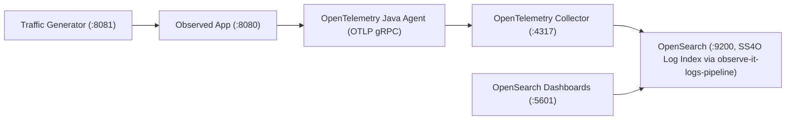

# Observe-It

[](https://github.com/PawelBalcerek/observe-it/actions/workflows/ci.yml)
[](https://github.com/PawelBalcerek/observe-it/actions/workflows/pages.yml)
[](https://github.com/PawelBalcerek/observe-it/actions/workflows/e2e.yml)
[](https://pawelbalcerek.github.io/observe-it/)

Observe-It is an open-source observability reference system and local sandbox for Kotlin/Spring Boot backend
applications using OpenTelemetry and OpenSearch. Rather than a toy "hello world" or a tutorial that duplicates vendor
documentation, it pairs a realistic multi-service system—an **Observed App** processing customer **Order** workflows
and a continuous **Traffic Generator** driving normal, warning, and failure **Checkout Scenario** paths across every
**Order State**—with zero-code OpenTelemetry instrumentation and an **SS4O Log Index** in OpenSearch.

Designed for production-minded JVM, Kotlin, and Spring Boot engineers seeking a realistic observability blueprint, as
well as developers new to observability who need a guided entry point through multi-service telemetry, Observe-It
distinguishes the core patterns that matter from supporting scaffolding and links directly to official upstream docs.

## System at a Glance



## 5-Minute Quick Start

### Prerequisites

- **Java Development Kit**: JDK 25 (or rely on Gradle toolchain auto-provisioning).
- **Container Runtime**: Docker with Compose v2 and at least ~3 GB available RAM.

### Build & Start

Compile the services, package container images with the Paketo OpenTelemetry Java Agent baked in, and boot the stack:

```bash
./gradlew bootBuildImage
docker compose up -d
```

### Explore Live Telemetry

Once the containers are healthy, open OpenSearch Dashboards at `http://localhost:5601`:

1. Navigate to **Discover** from the main menu.
2. Select **Open** to access pre-bootstrapped saved searches.
3. Choose any of the 4 pre-configured saved searches:
   - **All Order Logs**: Stream of all application and background traffic log records.
   - **Warnings & Business Rejections**: Filtered view of low stock, out of stock, and rejected state transitions.
   - **Gateway Timeouts & Stack Traces**: 504 Gateway Timeout errors with payment latency and full stack traces.
   - **Checkout Scenario Explorer**: Logs grouped and filtered across scenario lifecycles.

> [!TIP]
> To interactively trigger specific **Checkout Scenario** paths on demand or control workload rates, follow the
> [Checkout Scenarios & Dashboards Walkthrough](docs/guides/exploring-telemetry.md).

### Teardown

Stop all containers and purge persisted OpenSearch data volumes:

```bash
docker compose down -v
```

## How to Navigate This Repository

To help you get the most out of this reference architecture without getting lost in boilerplate, the codebase is
divided into the observability core you should focus on and supporting scaffolding you can safely treat as a black box:

### Start Here — The Observability Core

Focus on these key files and components to understand how OpenTelemetry, MDC correlation, and OpenSearch are wired:

- [`docker-compose.yml`](docker-compose.yml) — Container network topology, health check dependency chain, and
  OpenTelemetry Java Agent environment variable configuration.
- [`docker/otel-collector/config.yaml`](docker/otel-collector/config.yaml) — OpenTelemetry Collector pipeline: OTLP gRPC
  receiver, `memory_limiter` and `batch` processors, and OpenSearch `ss4o` log exporter.
- [`docker/opensearch/`](docker/opensearch/) — OpenSearch bootstrap artifacts: `bootstrap.sh`,
  `ingest-pipeline.json` (`observe-it-logs-pipeline`), `index-template.json` (the `ss4o_logs-*` SS4O Log Index), and
  `saved-objects.ndjson`.
- [`build-logic/conventions/src/main/kotlin/conventions/spring.gradle.kts`](build-logic/conventions/src/main/kotlin/conventions/spring.gradle.kts)
  — Spring Boot convention plugin configuring the Paketo OpenTelemetry buildpack to bake the Java Agent into images.
- [`CorrelationContext`](observed-app/src/main/kotlin/com/observeit/observedapp/correlation/CorrelationContext.kt) &
  [`MdcCorrelationFilter`](observed-app/src/main/kotlin/com/observeit/observedapp/correlation/api/MdcCorrelationFilter.kt)
  — Ingress HTTP filter establishing scoped MDC correlation (`checkout.scenario`, `order.id`, `customer.id`).
- [`OrderMdcInterceptor`](observed-app/src/main/kotlin/com/observeit/observedapp/order/api/OrderMdcInterceptor.kt),
  [`OrderTelemetry`](observed-app/src/main/kotlin/com/observeit/observedapp/order/domain/OrderTelemetry.kt), and
  [`OrderService`](observed-app/src/main/kotlin/com/observeit/observedapp/order/domain/OrderService.kt) — Domain
  correlation interceptors, SLF4J 2 fluent key-value structured logging, and lifecycle event logging.

### Safe to Treat as a Black Box — Supporting Scaffolding

These modules support the realistic runtime environment but are secondary to the observability architecture:

- [`observed-app/.../order/`](observed-app/src/main/kotlin/com/observeit/observedapp/order/) — In-memory **Order**
  domain and REST endpoints modeling the state machine (`CREATED` → `RESERVED` → `PAID` → `SHIPPED` / `FAILED` /
  `CANCELLED`) solely to emit realistic business telemetry.
- [`traffic-generator/`](traffic-generator/) — Synthetic workload generator driving continuous background traffic and
  weighted **Checkout Scenario** paths to populate OpenSearch automatically.
- `build-logic/`, `config/`, `.agents/`, `docs/agents/`, [`AGENTS.md`](AGENTS.md) — Gradle convention plugins,
  Detekt/Ktlint static analysis quality gates, and AI coding-assistant instructions.

## Observability Pillars & Roadmap

Observe-It is developed across three sequential milestones, each adding an observability signal to the shared domain:

| Milestone       | Pillar               | Status  | Scope & Capabilities                                                                                                                                                                                                                                                                                                |
| :-------------- | :------------------- | :------ | :------------------------------------------------------------------------------------------------------------------------------------------------------------------------------------------------------------------------------------------------------------------------------------------------------------------ |
| **Milestone 1** | Structured Logging   | Current | SLF4J 2 fluent `.addKeyValue()` API, scoped MDC correlation (`checkout.scenario`, `order.id`, `customer.id`), zero-code OpenTelemetry Java Agent log bridge, OpenTelemetry Collector `ss4o` export, OpenSearch `observe-it-logs-pipeline` normalization, and pre-bootstrapped OpenSearch Dashboards saved searches. |
| **Milestone 2** | Metrics & Dashboards | Planned | JVM, HTTP, and domain metrics (**Order** throughput, payment latency histograms, error rates) exported via OTLP and visualized in OpenSearch Dashboards.                                                                                                                                                            |
| **Milestone 3** | Distributed Tracing  | Planned | End-to-end W3C Trace Context propagation across the **Traffic Generator** and **Observed App**, custom domain spans, and cross-signal trace-to-log correlation.                                                                                                                                                     |

## Documentation & Official Upstream References

### Documentation Site & Narrative Guides

The complete documentation suite is published to the
[Observe-It Documentation Site](https://pawelbalcerek.github.io/observe-it/).
Browse the repository guides and Architecture Decision Records directly:

- [Guides Overview](docs/guides/index.md) — Map of all living narrative and operational guides.
- [Observability Stack & Telemetry Pipeline](docs/guides/observability-stack.md) — Container topology, Paketo
  OpenTelemetry Java Agent buildpack, OpenTelemetry Collector pipeline, and OpenSearch bootstrap.
- [Structured Logging in Kotlin & Spring Boot](docs/guides/structured-logging.md) — SLF4J 2 fluent key-value logging,
  scoped MDC correlation, Logback OTLP bridge, SS4O document normalization, and in-memory unit testing.
- [Checkout Scenarios & Dashboards Walkthrough](docs/guides/exploring-telemetry.md) — The 7 Checkout Scenario paths,
  interactive Traffic Generator REST API, and OpenSearch Dashboards / DQL investigation workflows.
- [Architecture Decision Records (ADRs)](docs/adr/index.md) — Living index of architectural choices and trade-offs.

### Official Upstream References

Observe-It focuses on how these components integrate in Kotlin and Spring Boot applications, delegating vendor
fundamentals to authoritative upstream manuals:

- [OpenTelemetry Java Zero-Code Instrumentation](https://opentelemetry.io/docs/zero-code/java/agent/) — Java Agent
  configuration, system properties, and supported libraries.
- [OpenTelemetry Collector Documentation](https://opentelemetry.io/docs/collector/) — Receivers, processors
  (`memory_limiter`, `batch`), and exporters.
- [Simple Schema for Observability (SS4O)](https://docs.opensearch.org/latest/observing-your-data/ss4o/) — OpenSearch
  schema conventions for `ss4o_logs-*` indices.
- [OpenSearch Dashboards Query Language (DQL)](https://docs.opensearch.org/latest/dashboards/dql/) — Filtering and
  querying structured fields in Discover.
- [SLF4J 2 Fluent Logging API](https://www.slf4j.org/manual.html#fluent) — Structured `.atInfo().addKeyValue(...)`
  logging on the JVM.

## Contributing

Contributions, issues, and discussions are welcome! Please review our project conventions before getting started:

- [Contributing & Git Workflow](CONTRIBUTING.md) — Ticket-driven workflow, branch conventions, and PR lifecycle.
- [Coding Standards](CODING_STANDARDS.md) — Kotlin coding conventions, architecture patterns, and testing guidelines.
