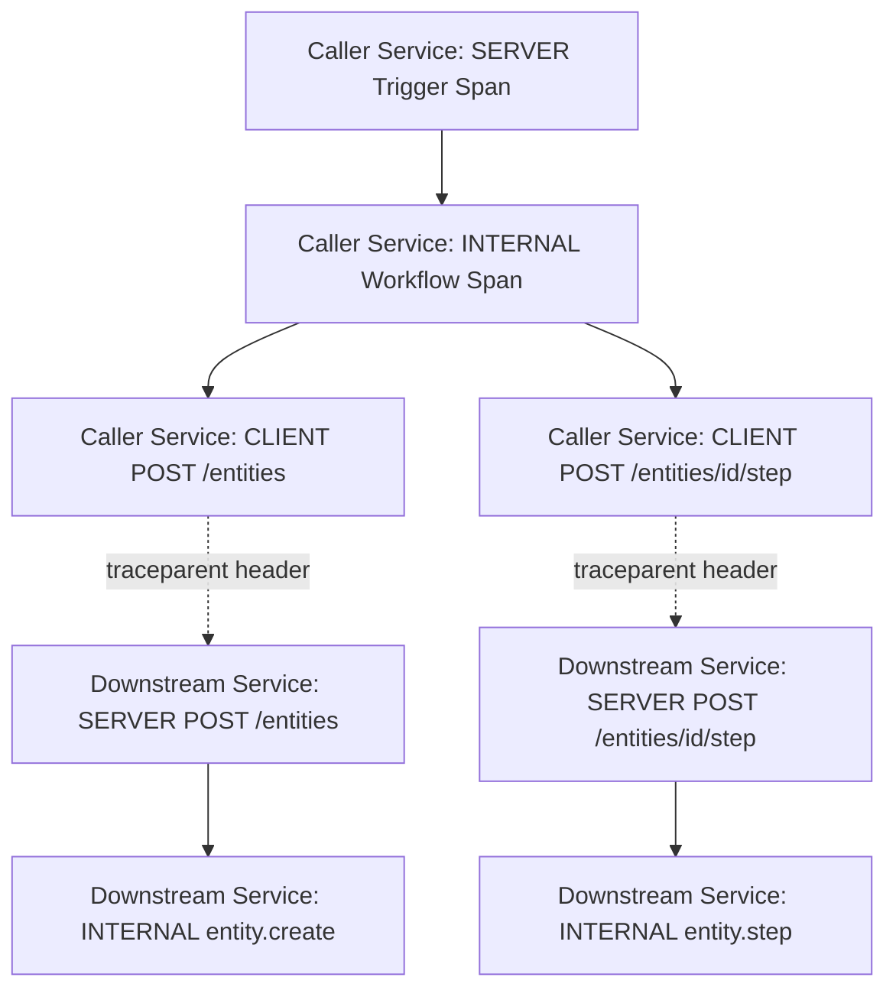
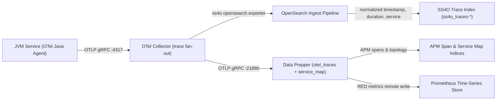

# Distributed Tracing & Cross-Signal Correlation in Kotlin & Spring Boot

## W3C Trace Context Propagation & Multi-Step Scenario Trace Trees

A single user workflow often spans multiple HTTP calls across service boundaries. Logs and metrics from individual
services tell you what happened locally, but reconstructing the end-to-end causal chain requires a shared `traceId` and
explicit parent-child `spanId`/`parentSpanId` links across every process hop.

The [W3C Trace Context](https://www.w3.org/TR/trace-context/) specification standardizes this linkage via two HTTP
headers—principally `traceparent` (`00-<trace-id>-<span-id>-<trace-flags>`). When an upstream **Caller Service**
starts an `INTERNAL` workflow span and dispatches outbound HTTP requests (`CLIENT` spans), the instrumentation injects
`traceparent` containing the active `traceId` and the `CLIENT` span's `spanId`. Each **Downstream Service** extracts
that header on ingress, starts a `SERVER` span whose `parentSpanId` matches the upstream `CLIENT` span, and attaches
its own `INTERNAL` or `CLIENT` child spans underneath:

Three design practices keep multi-step trace trees clean and navigable:

1. **One trace per end-to-end workflow**: Root the trace at the workflow entry point so every synchronous downstream
   request shares one `traceId` instead of fragmenting into disconnected single-hop traces.
2. **Scoped current-context activation**: Always bind each started span via `span.makeCurrent().use { ... }` and end it
   in a `finally` block so child `CLIENT` and `INTERNAL` spans inherit the right `parentSpanId` without leaking context
   across virtual threads.
3. **Dual correlation enrichment**: When a **Downstream Service** derives request-scoped identifiers (such as `entity.id`
   or `customer.id`) during request handling, write them to both SLF4J `MDC` and `Span.current()` so logs and spans
   carry identical correlation keys.

### External Sources & Ecosystem Practice

- [W3C Trace Context Specification](https://www.w3.org/TR/trace-context/) — Standard `traceparent` and `tracestate`
  HTTP header format for cross-process context propagation.
- [OpenTelemetry Java Instrumentation: Context Propagation](https://opentelemetry.io/docs/zero-code/java/agent/configuration/#propagators)
  — Default W3C `tracecontext,baggage` propagators injected and extracted automatically by the OpenTelemetry Java Agent
  across Spring WebMVC and `RestClient`.
- [OpenTelemetry Java API: Context & Span Scopes](https://opentelemetry.io/docs/languages/java/instrumentation/#context-propagation)
  — Using `Span.makeCurrent()` with try-with-resources to bind active spans safely on the executing thread.

### In Observe-It

When the **Traffic Generator** executes a **Checkout Scenario** (either on its background schedule or synchronously via
`POST /api/traffic/trigger/{scenario}`),
[`OtelTrafficTracer`](https://github.com/PawelBalcerek/observe-it/blob/main/traffic-generator/src/main/kotlin/com/observeit/trafficgenerator/traffic/infrastructure/OtelTrafficTracer.kt)
wraps the workflow in an `INTERNAL` `checkout.scenario` span (parented to the `POST /api/traffic/trigger/{scenario}`
`SERVER` span when triggered over HTTP). Each `RestClient` call to the **Observed App** (`POST /api/orders`, `reserve`,
`pay`, `ship`, `cancel`, `GET /api/orders/{orderId}`) creates a `CLIENT` span, and the OpenTelemetry Java Agent injects
the W3C `traceparent` header automatically.

On the **Observed App** side, the Java Agent extracts `traceparent` to create each `SERVER` span, and
[`CorrelationContext`](https://github.com/PawelBalcerek/observe-it/blob/main/observed-app/src/main/kotlin/com/observeit/observedapp/correlation/CorrelationContext.kt)
dual-enriches SLF4J `MDC` and `Span.current()` with `checkout.scenario`, `order.id`, and `customer.id`. Inside
[`OtelOrderTracer`](https://github.com/PawelBalcerek/observe-it/blob/main/observed-app/src/main/kotlin/com/observeit/observedapp/order/infrastructure/OtelOrderTracer.kt),
`inSpan` copies `checkout.scenario` onto every domain span and back-populates `customer.id` onto the parent HTTP
`SERVER` span so both `SERVER` and `INTERNAL` spans share full **Order** correlation.

## Custom Domain Spans, Span Events & Error Status Discipline

Auto-instrumented HTTP `SERVER` and `CLIENT` spans capture network boundaries, route templates, and status codes, but
they do not explain domain-level milestones inside a service call—such as an inventory check, a state transition, or a
simulated downstream payment gateway call. Wrapping domain use cases in pure `domain` tracing ports backed by
`opentelemetry-api` keeps business logic free of telemetry SDK imports while recording rich domain spans and events.

Two conventions prevent noisy trace error alerts and bloated span trees:

1. **Span events for point-in-time milestones**: Rather than creating micro-spans for sub-millisecond in-memory checks or
   state transitions, attach structured `span.addEvent(name, attributes)` entries directly to the enclosing domain span.
2. **Error status discipline (`Unset` vs. `ERROR`)**: Expected client or business-rule rejections (`4xx` responses)
   should record a bounded `error.type` attribute while leaving span status `Unset` (with no exception event). Reserve
   `StatusCode.ERROR` and `span.recordException(exception)` strictly for unexpected infrastructure failures (`5xx`
   timeouts or unhandled exceptions) so error-rate dashboards reflect genuine service degradation.

### External Sources & Ecosystem Practice

- [OpenTelemetry Trace Semantic Conventions: Span Status](https://opentelemetry.io/docs/specs/semconv/general/trace/#span-status)
  — Guidance on when to leave span status `Unset` versus setting `Error` on server and client operations.
- [OpenTelemetry Trace Semantic Conventions: Exceptions](https://opentelemetry.io/docs/specs/semconv/exceptions/exceptions-spans/)
  — Standard `exception` span event schema (`exception.type`, `exception.message`, `exception.stacktrace`).

### In Observe-It

[`OrderTracer`](https://github.com/PawelBalcerek/observe-it/blob/main/observed-app/src/main/kotlin/com/observeit/observedapp/order/domain/OrderTracer.kt)
and
[`TrafficTracer`](https://github.com/PawelBalcerek/observe-it/blob/main/traffic-generator/src/main/kotlin/com/observeit/trafficgenerator/traffic/domain/TrafficTracer.kt)
define pure Kotlin tracing ports in the `domain` layer (see
[ADR-0008](../adr/0008-otel-distributed-tracing-and-domain-span-ports.md)), implemented by `OtelOrderTracer` and
`OtelTrafficTracer`:

| Service               | Span Name           | Span Kind  | Key Attributes & Span Events                                                                                     | Status on Rejection / Failure                                         |
| :-------------------- | :------------------ | :--------- | :--------------------------------------------------------------------------------------------------------------- | :-------------------------------------------------------------------- |
| **Traffic Generator** | `checkout.scenario` | `INTERNAL` | `checkout.scenario`, `customer.id`, `order.id`, `order.state`                                                    | `ERROR` + `error.type=GATEWAY_TIMEOUT` on 504 (or uncaught exception) |
| **Observed App**      | `order.create`      | `INTERNAL` | `order.id`, `customer.id`, `order.state`, `order.total_amount`, `order.currency`, `order.item_count`             | `Unset`                                                               |
| **Observed App**      | `order.get`         | `INTERNAL` | `order.id`, `customer.id`, `order.state`, `error.type`                                                           | `Unset` (including `ORDER_NOT_FOUND`)                                 |
| **Observed App**      | `order.reserve`     | `INTERNAL` | `order.id`, `customer.id`, events `inventory.reservation` & `order.state.transitioned`                           | `Unset` (records `error.type=OUT_OF_STOCK` on 409)                    |
| **Observed App**      | `order.pay`         | `INTERNAL` | `order.id`, `customer.id`, `payment.method`, `payment.outcome`, `payment.latency_ms`, `order.state.transitioned` | `Unset` on `PAYMENT_DECLINED`; `ERROR` + `recordException` on 504     |
| **Observed App**      | `payment.process`   | `CLIENT`   | `order.id`, `customer.id`, `order.total_amount`, `order.currency`, `payment.method`, `payment.outcome`           | `Unset` on `PAYMENT_DECLINED`; `ERROR` + `recordException` on 504     |
| **Observed App**      | `order.ship`        | `INTERNAL` | `order.id`, `customer.id`, `shipping.method`, event `order.state.transitioned`                                   | `Unset` (records `error.type=INVALID_STATE_TRANSITION` on 409)        |
| **Observed App**      | `order.cancel`      | `INTERNAL` | `order.id`, `customer.id`, `cancellation.reason`, event `order.state.transitioned`                               | `Unset` (records `error.type=INVALID_STATE_TRANSITION` on 409)        |

## Database Client Spans, Stable Semantic Conventions & Noise Suppression

When a service persists entities in an external database, zero-code driver instrumentation automatically creates
`SpanKind.CLIENT` spans underneath the active `INTERNAL` domain span. Seeing every read and write command directly in
the trace waterfall isolates slow queries, lock contention, and unintended N+1 access patterns without hand-instrumenting
repository methods.

Enabling database telemetry cleanly in production requires addressing four practical pitfalls:

1. **Opting into stable database semantic conventions without schema collisions**: OpenTelemetry database instrumentation
   migrated from legacy attributes (`db.system`, `db.operation`, `db.statement`) to stable nested names (`db.system.name`,
   `db.namespace`, `db.collection.name`, `db.operation.name`, `db.query.text`) alongside the `db.client.operation.duration`
   histogram. Opting into stable-only mode avoids emitting both generations simultaneously—which otherwise causes search
   backends to reject documents where a dotted path is both a scalar string (`db.system`) and a nested object
   (`db.system.name`).
2. **Avoiding redundant ORM or repository proxy spans**: High-level repository proxy instrumentation can insert an
   extra `INTERNAL` span between the domain span and the database driver `CLIENT` span. Invoking the database template or
   driver directly—and disabling proxy auto-instrumentation—keeps the trace tree concise.
3. **Suppressing high-frequency background probes**: Periodic metric callbacks (such as a 1 Hz collection-size gauge) and
   container health checks (`ping`, `hello`, or `/health` HTTP probes) run outside any user request. Suppressing
   instrumentation in-process around internal gauge callbacks prevents unparented root spans from ever being allocated,
   while Collector `filter` rules drop periodic health-probe spans without disabling real readiness checks.
4. **Sizing query text mappings**: Sanitized multi-field commands in `db.query.text` can exceed default 1,024-byte
   keyword indexing limits in search backends; raising `ignore_above` preserves full query visibility in query
   interfaces.

### External Sources & Ecosystem Practice

- [OpenTelemetry Semantic Conventions for Database Spans](https://opentelemetry.io/docs/specs/semconv/database/database-spans/)
  — Stable `db.system.name`, `db.namespace`, `db.collection.name`, `db.operation.name`, and sanitized `db.query.text`
  span attributes and span naming (`{db.operation.name} {target}`).
- [OpenTelemetry Semantic Conventions for MongoDB](https://opentelemetry.io/docs/specs/semconv/database/mongodb/) —
  MongoDB-specific `db.collection.name`, `db.operation.name`, and sanitized command text rules.
- [OpenTelemetry Java Instrumentation: Database Stability Opt-In](https://opentelemetry.io/docs/zero-code/java/agent/configuration/#database-semantic-conventions)
  — Configuring `OTEL_SEMCONV_STABILITY_OPT_IN=database` to emit stable database spans and metrics.

### In Observe-It

In Observe-It, `observed-app` sets `OTEL_SEMCONV_STABILITY_OPT_IN=database` and
`OTEL_INSTRUMENTATION_SPRING_DATA_ENABLED=false` in
[`docker-compose.yml`](https://github.com/PawelBalcerek/observe-it/blob/main/docker-compose.yml) and talks to MongoDB
through `MongoTemplate` in
[`MongoOrderRepository`](https://github.com/PawelBalcerek/observe-it/blob/main/observed-app/src/main/kotlin/com/observeit/observedapp/order/infrastructure/MongoOrderRepository.kt)
(see [ADR-0010](../adr/0010-mongodb-order-persistence-and-ttl-retention.md) and
[ADR-0011](../adr/0011-otel-mongodb-client-telemetry-and-span-suppression.md)). Across a `HAPPY_PATH` **Checkout
Scenario**, every **Order** domain span parents its MongoDB `CLIENT` spans directly:

- `order.create` → `update orders` (`upsert: true`)
- `order.reserve`, `order.pay`, and `order.ship` → `find orders` followed by `update orders` (3 `find orders` + 4 `update
  orders` spans in total)

Background noise is eliminated at two boundaries:

- **In-process**:
  [`OtelOrderMetrics`](https://github.com/PawelBalcerek/observe-it/blob/main/observed-app/src/main/kotlin/com/observeit/observedapp/order/infrastructure/OtelOrderMetrics.kt)
  wraps `orderRepository.count()` inside `InstrumentationUtil.suppressInstrumentation { ... }` so the 1 Hz
  `order.repository.size` gauge callback emits zero unparented `count orders` spans.
- **Collector**:
  [`docker/otel-collector/config.yaml`](https://github.com/PawelBalcerek/observe-it/blob/main/docker/otel-collector/config.yaml)
  drops `/actuator/health` HTTP spans and MongoDB `hello`, `isMaster`, and `listDatabases` admin commands via
  `filter/traces`.

To preserve full sanitized multi-item **Order** BSON commands,
[`docker/opensearch/traces-index-template.json`](https://github.com/PawelBalcerek/observe-it/blob/main/docker/opensearch/traces-index-template.json)
maps `attributes.db.query.text` as `keyword` with `ignore_above: 8192`.

## Trace Fan-Out, SS4O Normalization & APM Service Map Ingestion

Routing OTLP spans from an OpenTelemetry Collector into an OpenSearch cluster using `ss4o` mode stores all three
telemetry signals—logs, metrics, and traces—under a unified Simple Schema for Observability naming convention. When a
platform also runs an APM engine (such as OpenSearch Data Prepper) for service-map topology synthesis, trace-group
enrichment, and span-derived RED metrics, the Collector can fan filtered spans out to both destinations in parallel:

On the SS4O branch, raw span documents carry `startTime` and `endTime` (`date_nanos`) without a top-level `@timestamp`
or precomputed duration fields, and nest service metadata under `resource['service.name']`. Normalizing SS4O spans at
ingest time makes trace documents queryable alongside logs and metrics:

1. **Populate a unified timestamp and precomputed duration**: Derive a top-level `@timestamp` from the span start
   time and precompute numeric duration fields in nanoseconds and milliseconds so time-picker filtering and latency
   percentile visualizations work without scripted fields.
2. **Align top-level cross-signal metadata**: Promote service name, version, and deployment environment from nested
   resource metadata to top-level fields matching the log and metric indices so a single `service` or `traceId`
   predicate works across all three signals.
3. **Map nested events and exceptions explicitly**: Define explicit `date_nanos` / `keyword` / `text` mappings for
   nested span events and exception attributes (`type`, `message`, `stacktrace`) so stack traces are full-text
   searchable while exact exception classes remain filterable.

### External Sources & Ecosystem Practice

- [OpenSearch Simple Schema for Observability (SS4O) Traces](https://docs.opensearch.org/latest/observing-your-data/ss4o/)
  — Standard SS4O trace span document fields (`traceId`, `spanId`, `parentSpanId`, `startTime`, `endTime`, `kind`,
  `status`, `events`).
- [OpenSearch Data Prepper Trace Analytics & APM](https://docs.opensearch.org/latest/data-prepper/pipelines/configuration/processors/otel-traces/)
  — `otel_traces` span enrichment and `otel_apm_service_map` topology and RED metric generation.
- [OpenTelemetry Collector Contrib: OpenSearch Exporter](https://github.com/open-telemetry/opentelemetry-collector-contrib/tree/main/exporter/opensearchdriver)
  — Collector `ss4o` mapping mode for exporting OTLP logs, metrics, and traces into `ss4o_*` indices.

### In Observe-It

[`docker-compose.yml`](https://github.com/PawelBalcerek/observe-it/blob/main/docker-compose.yml) enables OTLP trace
export on both services (`OTEL_TRACES_EXPORTER=otlp`, `OTEL_BSP_SCHEDULE_DELAY=1000`), and
[`docker/otel-collector/config.yaml`](https://github.com/PawelBalcerek/observe-it/blob/main/docker/otel-collector/config.yaml)
fans filtered spans out across two isolated pipelines:

- **`traces/opensearch`**: `otlp` → `memory_limiter` → `filter/traces` → `batch` → `opensearch` (`mapping.mode: ss4o`,
  `dataset: observe-it`, `namespace: local`) feeding the **SS4O Traces Index** (`ss4o_traces-observe-it-local`) for
  classic Discover saved searches and `Observe-It Traces Overview` (see
  [ADR-0009](../adr/0009-ss4o-traces-ingest-normalization-and-dashboards-exploration.md)).
- **`traces/dataprepper`**: `otlp` → `memory_limiter` → `filter/traces` → `batch` → `otlp/dataprepper`
  (`data-prepper:21890`) feeding traces-only Data Prepper
  ([`docker/data-prepper/pipelines.yaml`](https://github.com/PawelBalcerek/observe-it/blob/main/docker/data-prepper/pipelines.yaml)),
  which populates the **APM Span Index** (`otel-v1-apm-span-*`), the **APM Service Map Index**
  (`otel-v2-apm-service-map*` with `dependency_nodes.enabled: true` synthesizing the `mongodb` dependency node), and
  `span_derived` RED metrics in the **Prometheus Metrics Store** (see
  [ADR-0013](../adr/0013-data-prepper-apm-trace-fanout-and-service-map.md)).

Before the Collector starts,
[`docker/opensearch/bootstrap.sh`](https://github.com/PawelBalcerek/observe-it/blob/main/docker/opensearch/bootstrap.sh)
registers:

- [`observe-it-traces-pipeline`](https://github.com/PawelBalcerek/observe-it/blob/main/docker/opensearch/traces-ingest-pipeline.json):
  sets `@timestamp` from `startTime`, computes `durationInNanos` and `durationMs`, promotes `service`, `serviceName`,
  `version`, and `env`, and strips `attributes.data_stream`.
- [`observe-it-ss4o-traces`](https://github.com/PawelBalcerek/observe-it/blob/main/docker/opensearch/traces-index-template.json):
  matches `ss4o_traces-*` (priority 200, 1 shard, 0 replicas, `default_pipeline: observe-it-traces-pipeline`), mapping
  `traceId`, `spanId`, `parentSpanId`, `name`, `kind`, `status.code`, domain `attributes.*`, and stable
  `attributes.db.*` (`system.name`, `namespace`, `collection.name`, `operation.name`, `query.summary`,
  `response.status_code`) as `keyword`, `attributes.db.query.text` as `keyword` with `ignore_above: 8192`,
  `attributes.db.operation.batch.size` and `durationInNanos` as `long`, `durationMs` as `double`, and
  `events.attributes.exception.*` for 504 stack traces.

Because `ss4o_logs-*`, `ss4o_metrics-*`, and `ss4o_traces-*` share top-level `service`, `version`, `env`, and
`attributes.order.id`—and `bootstrap.sh` links `otel-v1-apm-span-*` to `ss4o_logs-*` via the
`trace-to-logs-otel-v1-apm-span` correlation—you can pivot seamlessly across **APM Span Index**, **APM Service Map
Index**, **SS4O Traces Index**, **SS4O Log Index**, and **SS4O Metrics Index** inside the **Observability Workspace**.

## In-Memory Trace Verification with SpanCapture

Verifying distributed tracing in unit and integration tests requires deterministic, zero-network span capture without
spinning up an OTLP collector. An in-memory `SdkTracerProvider` paired with `InMemorySpanExporter` and
`SimpleSpanProcessor` exports every finished span synchronously on `span.end()`, making span names, kinds, statuses,
attributes, span events, exception stack traces, and `parentSpanId` links immediately assertable in the same test
thread.

When an application also tests metrics in memory, combining `MeterProvider`, `TracerProvider`, and
`W3CTraceContextPropagator` into a single `@Primary` `OpenTelemetrySdk` test bean ensures that every domain metric and
trace adapter wired via `OpenTelemetry` shares one unified telemetry instance and resets cleanly between tests without
`@DirtiesContext`.

### External Sources & Ecosystem Practice

- [OpenTelemetry Java SDK Testing (`opentelemetry-sdk-testing`)](https://opentelemetry.io/docs/languages/java/testing/)
  — Using `InMemorySpanExporter` and `SimpleSpanProcessor` for synchronous in-memory span assertions in unit and
  integration tests.

### In Observe-It

Both `observed-app` and `traffic-generator` provide a `SpanCapture` JUnit 5 extension in `testFixtures` (for example,
[`SpanCapture.kt`](https://github.com/PawelBalcerek/observe-it/blob/main/observed-app/src/testFixtures/kotlin/com/observeit/observedapp/test/SpanCapture.kt))
exposing `assertSpanRecorded(...)`, `assertSpanEventRecorded(...)`, `assertExceptionRecorded(...)`, and
`assertNoExceptionRecorded(...)`.

In black-box Spring Boot integration tests,
[`TestOpenTelemetryConfiguration`](https://github.com/PawelBalcerek/observe-it/blob/main/observed-app/src/integration/kotlin/com/observeit/observedapp/test/TestOpenTelemetryConfiguration.kt)
wires `MetricCapture.meterProvider`, `SpanCapture.tracerProvider`, and `SpanCapture.propagators` into one `@Primary`
`OpenTelemetrySdk` bean, and `IntegrationTest` resets both captures in `@BeforeEach` and `@AfterEach`. For
**Traffic Generator** integration tests using `MockRestServiceServer`,
[`TestObservedAppClientConfiguration`](https://github.com/PawelBalcerek/observe-it/blob/main/traffic-generator/src/integration/kotlin/com/observeit/trafficgenerator/traffic/TestObservedAppClientConfiguration.kt)
injects W3C `traceparent` headers via `openTelemetry.propagators.textMapPropagator.inject(...)`, allowing
[`TrafficTriggerIntegrationTest`](https://github.com/PawelBalcerek/observe-it/blob/main/traffic-generator/src/integration/kotlin/com/observeit/trafficgenerator/traffic/TrafficTriggerIntegrationTest.kt)
to verify `checkout.scenario` spans alongside outbound `traceparent` headers, logs, and metrics in a single test.
