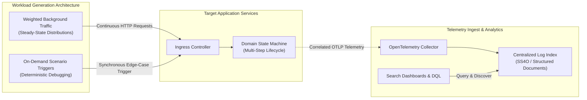
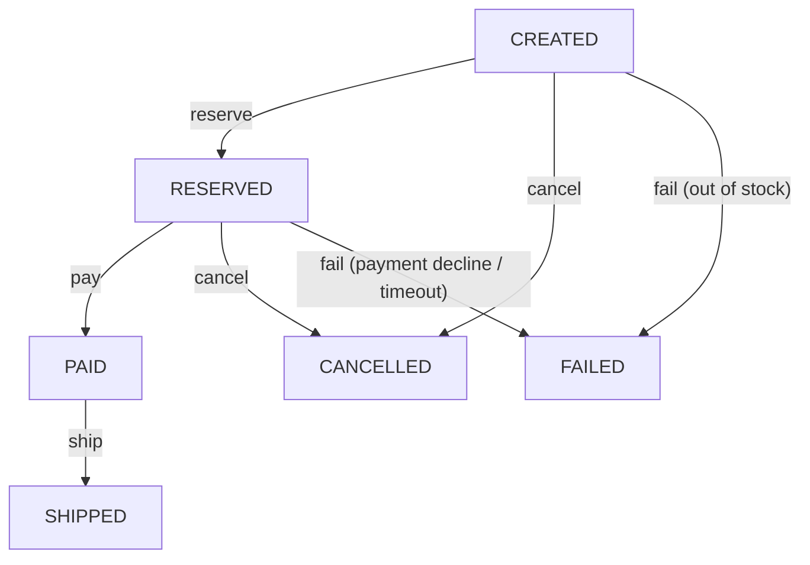

# Checkout Scenarios & Dashboards Walkthrough

## Synthetic Workload Generation & Scenario-Driven Telemetry

Validating observability pipelines, alerting rules, and incident diagnosis workflows requires realistic synthetic
workload across both steady-state operations and complex failure modes. In cloud-native distributed systems, relying on
sporadic ad-hoc manual testing or uncoordinated traffic bursts fails to provide predictable operational distributions.
Without continuous synthetic traffic, downstream aggregation pipelines and log indexes remain unexercised, leaving
mapping errors, ingest bottlenecks, and missing correlation keys undiscovered until production incidents occur.

Reliable telemetry validation pairs continuous, weighted background traffic with deterministic on-demand scenario
triggers:



Continuous background workload models realistic operational distributions by executing a weighted mix of normal
operations, recoverable client-side warnings, and transient infrastructure errors. This continuous flow exercises
telemetry processors, batch buffers, and dashboard aggregations under predictable load. Conversely, on-demand scenario
triggers enable engineers to synchronously execute specific edge cases on command, isolating reproduction steps and
immediately capturing generated correlation identifiers for targeted investigation.

Multi-step transactional workflows progress through discrete state machines where each transition represents an
observable lifecycle milestone. Synthetic workload runners drive these multi-step transitions, attaching contextual
correlation identifiers (`request.id`, `transaction.id`, `user.id`, `scenario.id`) alongside native numeric attributes
(monetary amounts, item counts, service latencies) and disciplined log severity levels (`INFO` for milestones, `WARN`
without stacktraces for expected business rejections, and `ERROR` with stacktraces for downstream system failures).

### External Sources & Ecosystem Practice

- [OpenTelemetry Demo Load Generator](https://opentelemetry.io/docs/demo/services/load-generator/) — Architectural
  reference implementation running continuous synthetic user sessions and scenario-driven edge cases to populate
  distributed traces, metrics, and logs across multi-service topologies.
- [OpenTelemetry Semantic Conventions for Exceptions](https://opentelemetry.io/docs/specs/semconv/exceptions/exceptions-logs/)
  — Standard conventions for recording errors, warnings, and exception stack traces on log events.

### In Observe-It

In Observe-It, the **Traffic Generator** operates as an independent out-of-process Spring Boot companion service driving
the **Observed App** over HTTP, as codified in
[ADR-0004: Out-of-Process Traffic Generator Service](../adr/0004-out-of-process-traffic-generator.md).

Customer **Order** processing follows a strict state transition lifecycle modeled in
[`Order.kt`](https://github.com/PawelBalcerek/observe-it/blob/main/observed-app/src/main/kotlin/com/observeit/observedapp/order/domain/Order.kt):



The **Traffic Generator** executes seven distinct **Checkout Scenario** paths defined in
[`CheckoutScenario.kt`](https://github.com/PawelBalcerek/observe-it/blob/main/traffic-generator/src/main/kotlin/com/observeit/trafficgenerator/traffic/domain/CheckoutScenario.kt)
using discrete inverse-transform sampling in
[`WeightedScenarioSelector.kt`](https://github.com/PawelBalcerek/observe-it/blob/main/traffic-generator/src/main/kotlin/com/observeit/trafficgenerator/traffic/domain/WeightedScenarioSelector.kt)
and multi-step execution in
[`CheckoutScenarioRunner.kt`](https://github.com/PawelBalcerek/observe-it/blob/main/traffic-generator/src/main/kotlin/com/observeit/trafficgenerator/traffic/domain/CheckoutScenarioRunner.kt):

| Checkout Scenario          | Weight | State Progression                                     | HTTP Status | Log Level       | Key Telemetry Attributes & Behavior                                                                                                |
| :------------------------- | :----- | :---------------------------------------------------- | :---------- | :-------------- | :--------------------------------------------------------------------------------------------------------------------------------- |
| `HAPPY_PATH`               | 55%    | `CREATED` → `RESERVED` → `PAID` → `SHIPPED`           | 200         | `INFO`          | `order.id`, `order.state`, `order.total_amount`, `payment.method: "CREDIT_CARD"`, `shipping.method: "STANDARD"`                    |
| `LOW_STOCK_WARNING`        | 15%    | `CREATED` → `RESERVED` → `PAID` → `SHIPPED`           | 200         | `WARN` / `INFO` | `inventory.sku: "SKU-LOW-STOCK"`, `inventory.available_quantity`, `inventory.requested_quantity` (business warning, no stacktrace) |
| `OUT_OF_STOCK`             | 10%    | `CREATED` → `FAILED`                                  | 422         | `WARN`          | `error.type: "OUT_OF_STOCK"`, `inventory.sku: "SKU-OUT-OF-STOCK"` (business rejection, no stacktrace)                              |
| `PAYMENT_DECLINED`         | 8%     | `CREATED` → `RESERVED` → `FAILED`                     | 422         | `WARN`          | `error.type: "PAYMENT_DECLINED"`, `payment.method: "DECLINED_CARD"` (business rejection, no stacktrace)                            |
| `PAYMENT_GATEWAY_TIMEOUT`  | 5%     | `CREATED` → `RESERVED` → `FAILED`                     | 504         | `ERROR`         | `error.type: "GATEWAY_TIMEOUT"`, `payment.method: "TIMEOUT_GATEWAY"`, `payment.latency_ms >= 1500`, Java exception stack trace     |
| `BUYER_CANCELLATION`       | 5%     | `CREATED` → `RESERVED` → `CANCELLED`                  | 200         | `INFO`          | `cancellation.reason: "BUYER_CANCELLATION"`, `order.previous_state: "RESERVED"`                                                    |
| `INVALID_STATE_TRANSITION` | 2%     | `CREATED` → `RESERVED` → `CANCELLED` → rejected `pay` | 409         | `WARN`          | `error.type: "INVALID_STATE_TRANSITION"`, `order.attempted_action: "pay"` (business rejection, no stacktrace)                      |

## Controlling Traffic & Triggering Scenarios On Demand

Production-grade observability testbeds require dynamic workload controls. When investigating an anomaly or inspecting
a specific log trail in analytical dashboards, continuous background load can inject excessive log volume that obscures
the event sequence under scrutiny. Conversely, validating throughput limits or load-shedding behaviors demands
adjusting generation rates without redeploying services.

Exposing an interactive runtime control plane provides three operational capabilities:

1. **Background Noise Management**: Pausing and resuming background workers dynamically allows engineers to quiet the
   environment during manual inspections and resume continuous load once debugging completes.
2. **Dynamic Workload Tuning**: Adjusting request rates (events per second) and worker concurrency on running instances
   enables performance calibration and backpressure verification without container restarts.
3. **Synchronous Scenario Execution**: Triggering a single scenario on demand executes the end-to-end workflow
   synchronously, immediately returning generated transaction and correlation tokens (such as entity IDs, tenant IDs,
   or trace context) to the caller for direct pivot queries in log exploration tools.

### In Observe-It

Observe-It provides an interactive REST control plane in
[`TrafficController.kt`](https://github.com/PawelBalcerek/observe-it/blob/main/traffic-generator/src/main/kotlin/com/observeit/trafficgenerator/traffic/api/TrafficController.kt)
exposed on the **Traffic Generator** at `http://localhost:8081/api/traffic`:

1. **Inspecting workload status (`GET /api/traffic/status`)**: Retrieve current generator execution state, configured
   request rate, worker concurrency, and aggregate execution counts across all seven scenarios:

   ```bash
   curl -s http://localhost:8081/api/traffic/status
   ```

   Sample JSON response (`TrafficStatusResponse`):

   ```json
   {
     "running": true,
     "paused": false,
     "ordersPerSecond": 1.0,
     "concurrency": 2,
     "scenarioExecutionCounts": {
       "HAPPY_PATH": 142,
       "LOW_STOCK_WARNING": 38,
       "OUT_OF_STOCK": 26,
       "PAYMENT_DECLINED": 21,
       "PAYMENT_GATEWAY_TIMEOUT": 13,
       "BUYER_CANCELLATION": 13,
       "INVALID_STATE_TRANSITION": 5
     }
   }
   ```

2. **Triggering a scenario synchronously (`POST /api/traffic/trigger/{scenario}`)**: Synchronously execute any of the
   seven **Checkout Scenario** paths (`HAPPY_PATH`, `LOW_STOCK_WARNING`, `OUT_OF_STOCK`, `PAYMENT_DECLINED`,
   `PAYMENT_GATEWAY_TIMEOUT`, `BUYER_CANCELLATION`, `INVALID_STATE_TRANSITION`). The endpoint returns the generated
   correlation keys and final **Order State**:

   ```bash
   curl -s -X POST http://localhost:8081/api/traffic/trigger/PAYMENT_GATEWAY_TIMEOUT
   ```

   Sample JSON response (`TriggerScenarioResponse`):

   ```json
   {
     "scenario": "PAYMENT_GATEWAY_TIMEOUT",
     "orderId": "ord-7f3b89a2-4c1e-42f0-91a5-8d1e23f0a1b2",
     "customerId": "cust-a91f3c82",
     "finalState": "FAILED",
     "success": true
   }
   ```

3. **Pausing background workload (`POST /api/traffic/pause`)**: Pause continuous virtual-thread background workers to
   inspect telemetry without new background entries:

   ```bash
   curl -s -X POST http://localhost:8081/api/traffic/pause
   ```

   Sample JSON response:

   ```json
   {
     "running": true,
     "paused": true,
     "ordersPerSecond": 1.0,
     "concurrency": 2,
     "scenarioExecutionCounts": { ... }
   }
   ```

4. **Resuming background workload (`POST /api/traffic/resume`)**: Resume background generation when investigation
   concludes:

   ```bash
   curl -s -X POST http://localhost:8081/api/traffic/resume
   ```

   Sample JSON response:

   ```json
   {
     "running": true,
     "paused": false,
     "ordersPerSecond": 1.0,
     "concurrency": 2,
     "scenarioExecutionCounts": { ... }
   }
   ```

5. **Adjusting workload rate and concurrency (`POST /api/traffic/rate`)**: Dynamically tune background target orders
   per second or worker concurrency:

   ```bash
   curl -s -X POST http://localhost:8081/api/traffic/rate \
     -H "Content-Type: application/json" \
     -d '{"ordersPerSecond": 5.0, "concurrency": 4}'
   ```

   Sample JSON response (`UpdateTrafficRateResponse`):

   ```json
   {
     "ordersPerSecond": 5.0,
     "concurrency": 4
   }
   ```

## Investigating Correlated Logs in OpenSearch Dashboards (DQL)

Log investigation in distributed architectures requires systematic exploration workflows. In systems emitting millions
of events, searching through raw, unindexed log streams or building queries from memory during an active outage is slow
and error-prone. Effective diagnostic workflows start from curated, high-level saved views and pivot down into specific
transaction timelines using correlation keys and typed query expressions.

A structured investigation workflow follows three principles:

1. **Curated Saved Views as Starting Points**: Pre-configured views provide instant visibility into broad categories of
   operational events—such as overall log streams, business warnings, server errors with stack traces, or scenario
   breakdowns—with pre-selected table columns tailored to that category.
2. **Correlation Key Pivots**: Ambient correlation identifiers (`entity.id`, `user.id`, `trace_id`) link log events
   across multiple decoupled services. Filtering by a single correlation key reconstructs the full chronological
   transaction narrative across service boundaries.
3. **Typed Numeric & Keyword Predicates**: Combining exact keyword terms (`service: "billing-service"`,
   `level: "WARN"`) with typed numeric comparisons (`http.server.duration_ms >= 1000`) isolates performance regressions
   and failure thresholds without full-text string matching ambiguities.

### External Sources & Ecosystem Practice

- [OpenSearch Dashboards Discover Guide](https://docs.opensearch.org/latest/dashboards/discover/index-discover/)
  — Inspecting documents, customizing table columns, applying filters, and saving search views in OpenSearch Dashboards.
- [OpenSearch Dashboards Query Language (DQL) Reference](https://docs.opensearch.org/latest/dashboards/dql/)
  — Syntax reference for boolean combinations, keyword equality, numeric range comparisons, and wildcard expressions.

### In Observe-It

Observe-It automatically provisions pre-configured saved searches into OpenSearch Dashboards at boot time via
[`docker/opensearch/saved-objects.ndjson`](https://github.com/PawelBalcerek/observe-it/blob/main/docker/opensearch/saved-objects.ndjson).
Navigating to **Discover** at `http://localhost:5601` under the **SS4O Log Index** (`ss4o_logs-*`) provides four
ready-to-use views:

| Saved Search                      | DQL Filter Predicate              | Selected Table Columns                                                                                                                                                                                | Primary Operational Purpose                                                         |
| :-------------------------------- | :-------------------------------- | :---------------------------------------------------------------------------------------------------------------------------------------------------------------------------------------------------- | :---------------------------------------------------------------------------------- |
| `All Order Logs`                  | *(none / match all)*              | `@timestamp`, `service`, `level`, `attributes.checkout.scenario`, `attributes.order.id`, `attributes.order.state`, `message`                                                                          | Live multi-service timeline across **Observed App** and **Traffic Generator**       |
| `Warnings & Business Rejections`  | `level: "WARN"`                   | `@timestamp`, `attributes.checkout.scenario`, `attributes.order.id`, `attributes.error.type`, `attributes.inventory.sku`, `attributes.payment.method`, `attributes.order.attempted_action`, `message` | Inspect expected business rule rejections without stacktraces                       |
| `Gateway Timeouts & Stack Traces` | `level: "ERROR"`                  | `@timestamp`, `attributes.order.id`, `attributes.error.type`, `attributes.payment.latency_ms`, `exception`, `message`                                                                                 | Triage downstream system timeouts, unhandled exceptions, and full Java stack traces |
| `Checkout Scenario Explorer`      | `attributes.checkout.scenario: *` | `@timestamp`, `attributes.checkout.scenario`, `service`, `level`, `attributes.order.id`, `attributes.order.state`, `attributes.order.total_amount`, `traceId`, `message`                              | Filter and slice telemetry by specific **Checkout Scenario** tags                   |

To experience end-to-end multi-service correlation in OpenSearch Dashboards, execute a deterministic failure scenario
and trace its logs across both services:

1. **Trigger the timeout scenario**: Send a request to trigger `PAYMENT_GATEWAY_TIMEOUT` using the **Traffic
   Generator** REST API:

   ```bash
   curl -s -X POST http://localhost:8081/api/traffic/trigger/PAYMENT_GATEWAY_TIMEOUT
   ```

   The response returns the generated correlation tokens:

   ```json
   {
     "scenario": "PAYMENT_GATEWAY_TIMEOUT",
     "orderId": "ord-7f3b89a2-4c1e-42f0-91a5-8d1e23f0a1b2",
     "customerId": "cust-a91f3c82",
     "finalState": "FAILED",
     "success": true
   }
   ```

   Copy the returned `orderId` value (for example, `ord-7f3b89a2-4c1e-42f0-91a5-8d1e23f0a1b2`).

2. **Open Dashboards and filter by order ID**: Open a browser to `http://localhost:5601`, select **Discover** from the
   side navigation menu, choose the `All Order Logs` saved search (or `ss4o_logs-*` index pattern), and enter the DQL
   predicate:

   ```text
   attributes.order.id: "ord-7f3b89a2-4c1e-42f0-91a5-8d1e23f0a1b2"
   ```

   Click **Refresh** to display the correlated multi-service timeline.

3. **Reconstruct the multi-service timeline**: Trace the chronological sequence of log records spanning both services:
   - `traffic-generator` emits an `INFO` log: `"Order created"` with `attributes.order.state: "CREATED"` and
     `attributes.order.id: "ord-7f3b89a2-4c1e-42f0-91a5-8d1e23f0a1b2"`.
   - `observed-app` receives `POST /orders` and emits an `INFO` log: `"Order created"` with `order.state: "CREATED"`
     and total monetary amount attributes.
   - `traffic-generator` emits an `INFO` log: `"Order reserved"` with `attributes.order.state: "RESERVED"`.
   - `observed-app` receives `POST /orders/{id}/reserve` and emits an `INFO` log: `"Order reserved"` confirming
     inventory allocation.
   - `observed-app` attempts payment processing via simulated gateway (`TIMEOUT_GATEWAY`). After simulated latency
     exceeding 1,500 ms, `PaymentGatewayClient` throws `PaymentGatewayTimeoutException`.
   - `observed-app` logs an `ERROR` event: `"Payment gateway timeout during payment processing"` with
     `attributes.error.type: "GATEWAY_TIMEOUT"`, `attributes.payment.latency_ms: 1512`, and the full Java stack trace
     stored in `exception`.
   - `observed-app` responds with HTTP 504 Gateway Timeout and transitions the **Order** to `FAILED`.
   - `traffic-generator` catches the timeout and logs an `ERROR` event: `"Payment gateway timed out"` with
     `attributes.error.type: "GATEWAY_TIMEOUT"`.
   - `traffic-generator` retrieves the final **Order** via `GET /orders/{id}` and logs an `INFO` event:
     `"Order retrieved"` with `attributes.order.state: "FAILED"`.

The following practical DQL queries against `ss4o_logs-*` isolate recurring operational patterns in Discover:

```text
# Isolate business warnings (no stacktraces) vs. system errors (with stacktraces)
level: "WARN" and attributes.error.type: *
level: "ERROR" and exception: *

# Find slow payments with latency >= 1000 ms
attributes.payment.latency_ms >= 1000

# Inspect a specific Checkout Scenario across all services
attributes.checkout.scenario: "PAYMENT_GATEWAY_TIMEOUT"

# Filter by a specific customer identifier
attributes.customer.id: "cust-a91f3c82"

# Filter out-of-stock rejections
attributes.error.type: "OUT_OF_STOCK" and attributes.inventory.sku: "SKU-OUT-OF-STOCK"

# Filter invalid state transitions
attributes.error.type: "INVALID_STATE_TRANSITION" and attributes.order.attempted_action: "pay"

# Filter buyer cancellations
attributes.cancellation.reason: "BUYER_CANCELLATION"

# Isolate a single HTTP request hop via W3C traceId
traceId: "4bf92f3577b34da6a3ce929d0e0e4736"
```
