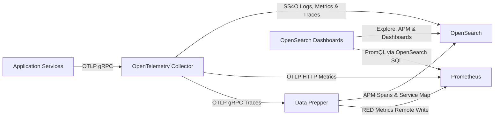
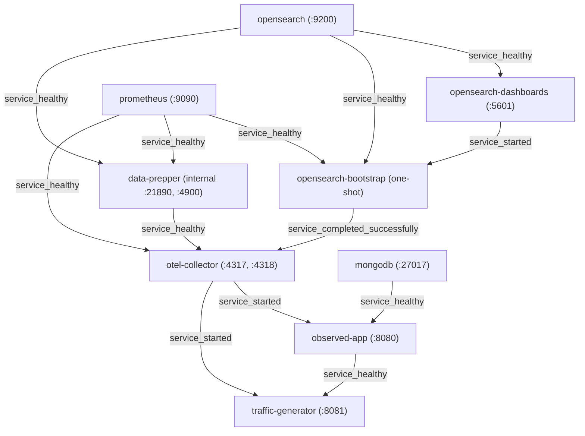

# Observability Stack & Telemetry Pipeline

## Decoupled Telemetry Architecture

Decoupling application services from telemetry storage backends is a foundational pattern in modern cloud-native
systems. Rather than transmitting log records directly from application runtimes to a storage backend, applications
emit telemetry to an out-of-process OpenTelemetry Collector pipeline:



Directly coupling application services to persistent telemetry backends introduces severe operational vulnerabilities.
Storage outages, indexing rate limits, or transient network partitions can propagate backpressure into core business
threads, causing application slowdowns, memory bloat, or thread starvation. Storing backend credentials, ingest tokens,
or cluster endpoints inside every application container widens security attack surfaces and complicates rotation.
Furthermore, updating storage destinations, telemetry schemas, or buffering policies would require redeploying all
application services.

An out-of-process telemetry collector resolves these risks by serving as a dedicated ingestion buffer and routing
layer. Applications stream standard OpenTelemetry Protocol (OTLP) payloads over lightweight, local network hops. The
collector absorbs traffic surges, enforces memory safety boundaries, aggregates individual events into efficient
network batches, manages retry queues with exponential backoff, and routes normalized records to destination stores.

### External Sources & Ecosystem Practice

- [OpenTelemetry Collector Deployment Patterns](https://opentelemetry.io/docs/collector/deployment/) — Architectural
  trade-offs between local agent sidecars, centralized gateway collectors, and hybrid topologies.
- [OpenTelemetry Official Demo (opentelemetry-demo)](https://github.com/open-telemetry/opentelemetry-demo)
  — Production reference architecture demonstrating OTLP emission across heterogeneous microservices into a unified
  collector and storage pipeline.

### In Observe-It

Observe-It implements this decoupled pipeline locally using eight continuous runtime containers and one transient
bootstrap container (nine containers total) declared in
[`docker-compose.yml`](https://github.com/PawelBalcerek/observe-it/blob/main/docker-compose.yml):

- `opensearch`: Distributed search and analytics datastore holding the **SS4O Log Index**, **SS4O Metrics Index**,
  **SS4O Traces Index**, **APM Span Index**, and **APM Service Map Index** (`:9200`), configured with a static 24-char
  local dev `plugins.query.datasources.encryption.masterkey` for OpenSearch SQL Prometheus datasources.
- `opensearch-dashboards`: Browser-based interface (`:5601`) running with
  [`docker/opensearch-dashboards/observe-it.yml`](https://github.com/PawelBalcerek/observe-it/blob/main/docker/opensearch-dashboards/observe-it.yml)
  to enable the `observe-it` **Observability Workspace** (Explore Logs/Metrics/Traces, APM Services & Service Map, and
  classic Dashboards).
- `opensearch-bootstrap`: Transient initialization container that installs OpenSearch ingest pipelines, index
  templates, the `observe_it_prometheus` SQL datasource, the `observe-it` **Observability Workspace**, workspace-scoped
  saved objects, and cross-signal `correlations` before exiting cleanly.
- `prometheus`: **Prometheus Metrics Store** (`prom/prometheus:v3.16.0`, `:9090`, `mem_limit: 256m`) ingesting
  cumulative OTLP metrics via `--web.enable-otlp-receiver` and Data Prepper RED metrics via
  `--web.enable-remote-write-receiver`, backed by the `prometheus-data` volume (`1d` / `256MB` retention).
- `data-prepper`: Traces-only OpenSearch Data Prepper (`opensearchproject/data-prepper:2.17.0`, internal-only on
  `observe-it-net`, `mem_limit: 768m` with `JAVA_OPTS="-Xms256m -Xmx384m"` and `1g` / `-Xms512m -Xmx512m` fallback)
  producing the **APM Span Index** (`otel-v1-apm-span-*`), **APM Service Map Index** (`otel-v2-apm-service-map*`), and
  `span_derived` RED metrics in Prometheus.
- `otel-collector`: OpenTelemetry Collector Contrib container receiving OTLP over gRPC (`:4317`) and HTTP (`:4318`),
  protecting memory limits, filtering health-probe noise, splitting metrics across Prometheus and OpenSearch, and
  fanning traces out to OpenSearch and Data Prepper.
- `mongodb`: Single-node MongoDB `8.0.38` datastore (`:27017`) persisting **Order** aggregates with 1-hour TTL retention
  and a 0.25 GB WiredTiger cache (`mem_limit: 512m`).
- `observed-app`: Kotlin/Spring Boot backend service (`:8080`) handling customer **Order** processing against MongoDB
  with zero-code instrumentation.
- `traffic-generator`: Kotlin/Spring Boot companion service (`:8081`) continuously driving synthetic customer
  **Checkout Scenario** paths against the **Observed App**.

## Container Topology & Deterministic Startup Ordering

Distributed telemetry pipelines require strict startup synchronization. Storage backends, index templates, ingest
processors, and collector endpoints must be fully operational and receptive before application services emit their
first log events.

Launching containers concurrently without dependency gates produces race conditions. When application services boot
before storage or indexing configurations are active, early log events emitted during application startup risk being
dropped, rejected due to missing connection handlers, or routed to unmapped indices. In dynamic search engines like
OpenSearch, writing documents to an index before its template is registered triggers dynamic type inference, which
assigns unoptimized mappings and breaks downstream dashboard visualizations.

Modern container orchestration resolves this by gating container lifecycles behind explicit health checks and exit
conditions (`service_healthy` and `service_completed_successfully`), ensuring each component activates only after its
prerequisites are verified.

### External Sources & Ecosystem Practice

- [Docker Compose Startup Order & Healthchecks](https://docs.docker.com/compose/how-tos/startup-order/) — Managing
  initialization dependencies using `condition: service_healthy` and `condition: service_completed_successfully`.

### In Observe-It

Observe-It orchestrates container startup through a deterministic dependency DAG defined in
[`docker-compose.yml`](https://github.com/PawelBalcerek/observe-it/blob/main/docker-compose.yml):



The orchestration proceeds through five sequential stages:

1. **Storage initialization**: `opensearch`, `prometheus`, and `mongodb` boot in parallel. `opensearch` polls
   `http://localhost:9200/_cluster/health` until `green` or `yellow`, `prometheus` checks
   `http://localhost:9090/-/healthy`, and `mongodb` runs `mongosh --quiet --eval "db.adminCommand('ping').ok"`.
2. **Dashboards, bootstrap, and Data Prepper launch**: Once `opensearch` reports `service_healthy`,
   `opensearch-dashboards` starts. Once both `opensearch` and `prometheus` are `service_healthy`, `data-prepper` boots
   (healthchecked on `http://localhost:4900/list`) and `opensearch-bootstrap` begins executing alongside
   `opensearch-dashboards`.
3. **Templates, pipelines, workspace & saved objects**: `opensearch-bootstrap` registers SS4O ingest pipelines and index
   templates, upserts the `observe_it_prometheus` OpenSearch SQL datasource, waits for `opensearch-dashboards`, creates
   the `observe-it` **Observability Workspace**, links the `observe-it-prometheus` `data-connection`, imports all
   workspace-scoped saved objects, upserts the **Traces → Logs** and **APM Config** `correlations`, and exits `0`
   (`restart: "no"`).
4. **Collector activation**: `otel-collector` starts only after `opensearch-bootstrap` finishes with
   `service_completed_successfully` and both `prometheus` and `data-prepper` report `service_healthy`, guaranteeing
   every downstream store, template, and APM pipeline is ready before telemetry flows.
5. **Application & traffic launch**: `observed-app` starts once `otel-collector` is listening and `mongodb` reports
   `service_healthy`. Finally, `traffic-generator` waits for `observed-app` to achieve `service_healthy` readiness
   before dispatching synthetic **Checkout Scenario** workloads.

The entire local sandbox operates within a bounded memory footprint totaling **4.25 GB** baseline across eight
continuous containers (**4.75 GB** hard ceiling):

| Service                 | Container Name          | Host Port        | Memory Limit | Startup Condition / Role                                                        |
| :---------------------- | :---------------------- | :--------------- | :----------- | :------------------------------------------------------------------------------ |
| `opensearch`            | `opensearch`            | `:9200`          | `1g`         | Root telemetry store; healthcheck polls cluster green/yellow health             |
| `opensearch-dashboards` | `opensearch-dashboards` | `:5601`          | `512m`       | Visual UI & **Observability Workspace**; waits for `opensearch` healthy         |
| `opensearch-bootstrap`  | `opensearch-bootstrap`  | None             | None         | One-shot init; waits for `opensearch`, `prometheus`, & Dashboards               |
| `prometheus`            | `prometheus`            | `:9090`          | `256m`       | **Prometheus Metrics Store** (`prom/prometheus:v3.16.0`); `/-/healthy` probe    |
| `data-prepper`          | `data-prepper`          | None (internal)  | `768m`       | Traces-only APM & service map (`2.17.0`, `-Xmx384m`, `1g` fallback); `:4900`    |
| `otel-collector`        | `otel-collector`        | None (internal)  | `256m`       | Dual-metrics & trace fan-out; waits for bootstrap, `prometheus`, `data-prepper` |
| `mongodb`               | `mongodb`               | `:27017`         | `512m`       | Order datastore (`mongo:8.0.38`, `0.25 GB` WiredTiger cache); `ping` probe      |
| `observed-app`          | `observed-app`          | `:8080`          | `512m`       | Backend order service; waits for `otel-collector` & `mongodb` healthy           |
| `traffic-generator`     | `traffic-generator`     | `:8081`          | `512m`       | Workload runner; waits for `observed-app` `service_healthy`                     |

For detailed architectural rationale on out-of-process workload generation, MongoDB sizing, and TTL retention, see
[ADR-0004: Out-of-Process Traffic Generator Service](../adr/0004-out-of-process-traffic-generator.md) and
[ADR-0010: MongoDB Order Persistence, TTL Retention, and Testcontainers Integration Testing](../adr/0010-mongodb-order-persistence-and-ttl-retention.md).

## Zero-Code OpenTelemetry Java Agent via Cloud Native Buildpacks

Traditional Java telemetry instrumentation required embedding vendor monitoring libraries into application source
trees, configuring external startup scripts, or writing complex Dockerfile layers. This approach couples application
build lifecycles to telemetry SDK release cadence and risks classpath version conflicts with application dependencies.

Cloud Native Buildpacks (CNB) provide a transparent mechanism for injecting the OpenTelemetry Java Agent into OCI
container images at build time. Application source code and build definitions remain completely decoupled from
`io.opentelemetry.*` dependencies, while runtime behavior is configured entirely through standardized `OTEL_*`
environment variables.

### External Sources & Ecosystem Practice

- [OpenTelemetry Zero-Code Java Agent](https://opentelemetry.io/docs/zero-code/java/agent/) — Bytecode instrumentation,
  extension hooks, and runtime configuration properties.
- [Paketo OpenTelemetry Buildpack](https://paketo.io/docs/howto/java/#use-opentelemetry) — Buildpack specification for
  injecting the Java Agent layer into containerized Java applications.
- [Spring Boot bootBuildImage OCI Packaging](https://docs.spring.io/spring-boot/gradle-plugin/packaging-oci-image.html)
  — Native Gradle tasks for building production-ready OCI images using Paketo builders.

### In Observe-It

Observe-It configures the Paketo OpenTelemetry buildpack in its OpenTelemetry convention plugin at
[`build-logic/conventions/src/main/kotlin/conventions/opentelemetry.gradle.kts`](https://github.com/PawelBalcerek/observe-it/blob/main/build-logic/conventions/src/main/kotlin/conventions/opentelemetry.gradle.kts)
(building on the base Paketo Java image configuration in
[`spring.gradle.kts`](https://github.com/PawelBalcerek/observe-it/blob/main/build-logic/conventions/src/main/kotlin/conventions/spring.gradle.kts)):

```kotlin
pluginManager.withPlugin("org.springframework.boot") {
    tasks.named<BootBuildImage>("bootBuildImage") {
        buildpacks.add("docker.io/paketobuildpacks/opentelemetry:${libs.versions.paketo.opentelemetry.get()}")
        environment.put("BP_OPENTELEMETRY_ENABLED", "true")
    }
}
```

This configuration ensures that both `observed-app` and `traffic-generator` build images containing the OpenTelemetry
Java Agent while depending strictly on `io.opentelemetry:opentelemetry-api` at compile time, keeping the SDK and
instrumentation agent out of the application runtime classpath. The verification suite enforces this boundary:
`make verify` Gate 1 asserts that the `runtimeClasspath` of each service contains only
`io.opentelemetry:opentelemetry-api` (and its transitive context) with zero SDK or instrumentation artifacts.

At runtime, [`docker-compose.yml`](https://github.com/PawelBalcerek/observe-it/blob/main/docker-compose.yml) activates
the agent and configures OTLP export for logs, 1-second default `CUMULATIVE` metrics, and 1-second batched traces via
environment variables:

```yaml
environment:
  - SPRING_MONGODB_URI=mongodb://mongodb:27017/observe_it
  - BPL_JVM_THREAD_COUNT=50
  - OTEL_JAVAAGENT_ENABLED=true
  - OTEL_SERVICE_NAME=observed-app
  - OTEL_RESOURCE_ATTRIBUTES=service.version=${OBSERVE_IT_IMAGE_TAG:-0.5.0},deployment.environment.name=local
  - OTEL_SEMCONV_STABILITY_OPT_IN=database
  - OTEL_INSTRUMENTATION_SPRING_DATA_ENABLED=false
  - OTEL_LOGS_EXPORTER=otlp
  - OTEL_TRACES_EXPORTER=otlp
  - OTEL_BSP_SCHEDULE_DELAY=1000
  - OTEL_METRICS_EXPORTER=otlp
  - OTEL_METRIC_EXPORT_INTERVAL=1000
  - OTEL_EXPORTER_OTLP_ENDPOINT=http://otel-collector:4317
  - OTEL_EXPORTER_OTLP_PROTOCOL=grpc
  - OTEL_INSTRUMENTATION_LOGBACK_APPENDER_EXPERIMENTAL_CAPTURE_MDC_ATTRIBUTES=*
  - OTEL_INSTRUMENTATION_LOGBACK_APPENDER_EXPERIMENTAL_CAPTURE_KEY_VALUE_PAIR_ATTRIBUTES=true
  - OTEL_INSTRUMENTATION_LOGBACK_APPENDER_EXPERIMENTAL_CAPTURE_CODE_ATTRIBUTES=true
  - OTEL_INSTRUMENTATION_LOGBACK_APPENDER_EXPERIMENTAL_LOG_ATTRIBUTES=true
```

To prevent the agent from instrumenting transient healthcheck probes, both services execute health checks using a
direct Java probe with the agent explicitly disabled:

```yaml
healthcheck:
  test: ["CMD", "/cnb/lifecycle/launcher", "--", "java", "-Dotel.javaagent.enabled=false", "-cp", "/workspace/BOOT-INF/classes:/workspace/BOOT-INF/lib/*", "com.observeit.observedapp.HealthCheck"]
  interval: 10s
  timeout: 5s
  retries: 12
  start_period: 20s
```

> [!TIP]
> Always disable the OpenTelemetry Java Agent (`-Dotel.javaagent.enabled=false`) when executing in-container JVM health
> check probes. Attaching the agent to short-lived probe processes incurs substantial JVM startup overhead, inflates
> CPU consumption, and pollutes your telemetry collector with spurious probe events.

For complete architectural details on zero-code bytecode instrumentation and the `opentelemetry-api` metrics boundary,
see [ADR-0001: Zero-Code OpenTelemetry Java Agent and Logback OTLP Bridge](../adr/0001-zero-code-otel-javaagent-and-logback-bridge.md)
and
[ADR-0006: OpenTelemetry API Domain Metrics Port Boundary and In-Memory Testing](../adr/0006-otel-api-domain-metrics-port-and-in-memory-testing.md).

## OpenTelemetry Collector Pipelines (Dual-Metrics & Trace Fan-Out)

The OpenTelemetry Collector routes telemetry through modular pipelines composed of three distinct component stages:
**Receivers** (how telemetry enters the collector), **Processors** (how telemetry is buffered, filtered, validated, and
transformed), and **Exporters** (how telemetry is translated and delivered to downstream destinations). Because multiple
pipelines can subscribe to the same OTLP receiver independently, a single collector can fan out telemetry to
specialized backends—for example, forwarding cumulative metrics directly to a Prometheus OTLP endpoint while converting
a parallel branch to `DELTA` temporality via `cumulative_to_delta` for a search index, or fanning traces out to both a
search index and an APM topology engine.

In production systems, collectors must be hardened against high-throughput bursts that could trigger Out-Of-Memory
(OOM) crashes. The `memory_limiter` processor provides this protection by monitoring garbage collector statistics and
heap consumption at fixed intervals. When usage crosses a configured threshold, the processor drops incoming data or
returns retryable backpressure to clients until memory returns to safe levels.

A `filter` processor placed between `memory_limiter` and `batch` drops low-value operational noise—such as periodic
liveness probes (`/health`) and database driver heartbeat or topology-discovery commands—before batching and storage,
keeping dashboards focused on user-facing requests without disabling genuine container health checks.

Downstream backends benefit significantly from request batching. Emitting each record individually over HTTP/REST
imposes severe network overhead and index contention. The `batch` processor aggregates records into configured batch
sizes or time intervals, maximizing throughput and index compression. Furthermore, exporters must include retry
buffers (`sending_queue` and `retry_on_failure`) to withstand transient backend unavailability without dropping
telemetry.

### External Sources & Ecosystem Practice

- [OpenTelemetry Collector memory_limiter Processor Best Practices](https://github.com/open-telemetry/opentelemetry-collector/blob/main/processor/memorylimiterprocessor/README.md)
  — Guidelines for configuring `check_interval`, `limit_mib`, and `spike_limit_mib`.
- [OpenTelemetry Collector Filter Processor (filterprocessor)](https://github.com/open-telemetry/opentelemetry-collector-contrib/tree/main/processor/filterprocessor)
  — Dropping spans and metric datapoints using OTTL conditions before export.
- [OpenTelemetry Collector Cumulative-to-Delta Processor (`cumulativetodeltaprocessor`)](https://github.com/open-telemetry/opentelemetry-collector-contrib/tree/main/processor/cumulativetodeltaprocessor)
  — Converting cumulative OTLP counters and histograms to delta points on a dedicated pipeline branch.
- [OpenSearch Exporter for OpenTelemetry Collector (opensearchexporter)](https://github.com/open-telemetry/opentelemetry-collector-contrib/tree/main/exporter/opensearchexporter)
  — Exporter configuration for data stream indexing, OpenSearch schema mapping, and HTTP retry options.

### In Observe-It

Observe-It configures its five collector pipelines in
[`docker/otel-collector/config.yaml`](https://github.com/PawelBalcerek/observe-it/blob/main/docker/otel-collector/config.yaml):

```yaml
processors:
  memory_limiter:
    check_interval: 1s
    limit_mib: 200
    spike_limit_mib: 50
  filter/traces:
    error_mode: ignore
    trace_conditions:
      - span.attributes["http.route"] == "/actuator/health"
      - span.attributes["url.path"] == "/actuator/health"
      - span.attributes["db.operation.name"] == "hello"
      - span.attributes["db.operation.name"] == "isMaster"
      - span.attributes["db.operation.name"] == "listDatabases"
  filter/metrics:
    error_mode: ignore
    metric_conditions:
      - datapoint.attributes["http.route"] == "/actuator/health"
      - datapoint.attributes["url.path"] == "/actuator/health"
      - metric.name == "db.client.operation.duration" and datapoint.attributes["db.operation.name"] == "hello"
      - metric.name == "db.client.operation.duration" and datapoint.attributes["db.operation.name"] == "isMaster"
      - metric.name == "db.client.operation.duration" and datapoint.attributes["db.operation.name"] == "listDatabases"
  cumulative_to_delta:
    initial_value: auto
    max_staleness: 1h
  batch:
    send_batch_size: 100
    timeout: 1s

service:
  pipelines:
    logs:
      receivers: [otlp]
      processors: [memory_limiter, batch]
      exporters: [opensearch]
    metrics/prometheus:
      receivers: [otlp]
      processors: [memory_limiter, filter/metrics, batch]
      exporters: [otlp_http/prometheus]
    metrics/opensearch:
      receivers: [otlp]
      processors: [memory_limiter, filter/metrics, cumulative_to_delta, batch]
      exporters: [opensearch]
    traces/opensearch:
      receivers: [otlp]
      processors: [memory_limiter, filter/traces, batch]
      exporters: [opensearch]
    traces/dataprepper:
      receivers: [otlp]
      processors: [memory_limiter, filter/traces, batch]
      exporters: [otlp/dataprepper]
```

The pipelines operate with specific safeguards and fan-out routes:

- **Receiver ingress**: Receives OTLP log, metric, and trace streams over high-performance gRPC (`:4317`) from the
  application Java Agents and exposes HTTP (`:4318`) for standard web hooks.
- **Memory protection**: `limit_mib: 200` and `spike_limit_mib: 50` ensure the collector process never breaches its
  256 MB Docker container memory limit (`mem_limit: 256m`).
- **Health-probe noise filtering**: `filter/traces` and `filter/metrics` drop `/actuator/health` HTTP probes and
  MongoDB `hello`, `isMaster`, and `listDatabases` admin commands before fan-out and batching (see
  [ADR-0011](../adr/0011-otel-mongodb-client-telemetry-and-span-suppression.md)).
- **Dual-metrics temporality split**: `metrics/prometheus` forwards cumulative points statelessly over
  `otlp_http/prometheus` to `http://prometheus:9090/api/v1/otlp` (where
  [`docker/prometheus/prometheus.yml`](https://github.com/PawelBalcerek/observe-it/blob/main/docker/prometheus/prometheus.yml)
  promotes `service.name`, `service.version`, and `deployment.environment.name`), while `metrics/opensearch` converts
  cumulative points via `cumulative_to_delta` (`initial_value: auto`, `max_staleness: 1h`) for `ss4o_metrics-*` (see
  [ADR-0012](../adr/0012-prometheus-metrics-store-and-collector-temporality-split.md)).
- **Trace fan-out to OpenSearch and Data Prepper**: `traces/opensearch` exports SS4O spans to `ss4o_traces-*` for
  classic dashboards, while `traces/dataprepper` forwards spans over gRPC (`otlp/dataprepper`) to `data-prepper:21890`
  where [`docker/data-prepper/pipelines.yaml`](https://github.com/PawelBalcerek/observe-it/blob/main/docker/data-prepper/pipelines.yaml)
  produces the **APM Span Index**, **APM Service Map Index**, and `span_derived` RED metrics in Prometheus (see
  [ADR-0013](../adr/0013-data-prepper-apm-trace-fanout-and-service-map.md)).
- **Batching efficiency & retries**: Aggregates records into chunks of 100 entries or flushes every 1 second; the
  `opensearch` exporter enables `sending_queue` and `retry_on_failure` to safeguard delivery during transient load.

For in-depth analysis of collector export modes and fan-out trade-offs, see
[ADR-0002](../adr/0002-otel-collector-ss4o-and-opensearch-ingest-pipeline.md),
[ADR-0012](../adr/0012-prometheus-metrics-store-and-collector-temporality-split.md), and
[ADR-0013](../adr/0013-data-prepper-apm-trace-fanout-and-service-map.md).

## OpenSearch Bootstrap, SS4O Index Templates & Ingest Normalization

The OpenTelemetry log data model encapsulates attributes in deeply nested JSON structures (`body`, `severity.text`,
`instrumentationScope.name`, `resource.attributes`, and `attributes.*`). Querying deeply nested fields in search
dashboards requires cumbersome DQL syntax and clutters data exploration views.

While the Simple Schema for Observability (SS4O) establishes standardized naming conventions for log, metric, and trace
documents in OpenSearch, OpenSearch does not automatically flatten or deduplicate incoming OTLP fields by default. To
produce clean documents for exploration, search backends pair target schema conventions with an Ingest Pipeline
(`_ingest/pipeline`) and an Index Template (`_index_template` with `default_pipeline`) at ingestion time:

- Extracts frequently queried nested payload fields into concise top-level document attributes so queries and table
  columns do not require deep path prefixes.
- Removes redundant nested copies of extracted fields, saving storage space and reducing document parsing overhead.
- Enforces explicit index mappings (`keyword` for identifiers, `double` / `long` for numeric metrics) to prevent
  dynamic mapping explosion and guarantee query performance.
- Automates environment bootstrap so index templates, ingest pipelines, and pre-configured dashboards are provisioned
  before user interaction.

### External Sources & Ecosystem Practice

- [OpenSearch Simple Schema for Observability (SS4O)](https://docs.opensearch.org/latest/observing-your-data/ss4o/)
  — Canonical schema reference for structured log records.
- [OpenSearch Ingest Pipelines](https://docs.opensearch.org/latest/ingest-pipelines/) — Pre-processing and transforming
  documents before indexing via Painless script processors.
- [OpenSearch Index Templates](https://docs.opensearch.org/latest/im-plugin/index-templates/) — Managing settings,
  sharding, and explicit field mappings for matching index patterns.

### In Observe-It

Observe-It coordinates storage provisioning through configuration files in
[`docker/opensearch/`](https://github.com/PawelBalcerek/observe-it/blob/main/docker/opensearch/):

1. **Bootstrap orchestrator** ([`docker/opensearch/bootstrap.sh`](https://github.com/PawelBalcerek/observe-it/blob/main/docker/opensearch/bootstrap.sh)):
   A one-shot Bash script executed by the `opensearch-bootstrap` container. It verifies cluster availability, installs
   the SS4O ingest pipelines (`observe-it-logs-pipeline`, `observe-it-metrics-pipeline`, `observe-it-traces-pipeline`)
   and index templates (`observe-it-ss4o-logs`, `observe-it-ss4o-metrics`, `observe-it-ss4o-traces`), upserts the
   `observe_it_prometheus` OpenSearch SQL Prometheus datasource (`http://prometheus:9090`), waits for
   `opensearch-dashboards`, upserts the `observe-it` **Observability Workspace** (`features:
   ["use-case-observability"]`), registers and associates the `observe-it-prometheus` `data-connection`, imports
   workspace-scoped saved objects into `/w/observe-it/api/saved_objects/_import`, sets `ss4o_logs` as the workspace
   default index pattern, and upserts the `trace-to-logs-otel-v1-apm-span` (**Traces → Logs**) and
   `apm-config-observe-it` (**APM Config**) `correlations`.
2. **Dashboards workspace configuration & datasource master key**:
   [`docker/opensearch-dashboards/observe-it.yml`](https://github.com/PawelBalcerek/observe-it/blob/main/docker/opensearch-dashboards/observe-it.yml)
   enables `workspace.enabled`, `data_source.enabled`, `explore.enabled`, `explore.discoverTraces.enabled`,
   `explore.discoverMetrics.enabled`, and `datasetManagement.enabled`, while `opensearch` sets a static 24-character
   local development `plugins.query.datasources.encryption.masterkey` in
   [`docker-compose.yml`](https://github.com/PawelBalcerek/observe-it/blob/main/docker-compose.yml) so OpenSearch SQL
   can encrypt and store the `observe_it_prometheus` datasource definition.
3. **Log ingest pipeline** ([`docker/opensearch/ingest-pipeline.json`](https://github.com/PawelBalcerek/observe-it/blob/main/docker/opensearch/ingest-pipeline.json)):
   A Painless script processor registered as `observe-it-logs-pipeline` that promotes top-level fields (`body` →
   `message`, `severity.text` → `level`, `instrumentationScope.name` → `logger`, `resource['service.name']` → `service`,
   `resource['service.version']` → `version`, `resource['deployment.environment.name']` → `env`,
   `attributes['exception.stacktrace']` → `exception`) and removes duplicate nested attributes.
4. **Log index template** ([`docker/opensearch/index-template.json`](https://github.com/PawelBalcerek/observe-it/blob/main/docker/opensearch/index-template.json)):
   An index template registered as `observe-it-ss4o-logs` matching pattern `ss4o_logs-*` with priority 200. It attaches
   `observe-it-logs-pipeline` as the `default_pipeline`, applies the `strings_as_keywords` dynamic template, and
   enforces explicit property mappings for top-level keys (`message`, `level`, `service`, `logger`, `exception`,
   `traceId`, `spanId`) and typed domain keys under `attributes.order.*`, `attributes.customer.*`,
   `attributes.checkout.*`, `attributes.inventory.*`, and `attributes.payment.*`.
5. **Metrics ingest pipeline & index template**
   ([`metrics-ingest-pipeline.json`](https://github.com/PawelBalcerek/observe-it/blob/main/docker/opensearch/metrics-ingest-pipeline.json)
   and
   [`metrics-index-template.json`](https://github.com/PawelBalcerek/observe-it/blob/main/docker/opensearch/metrics-index-template.json)):
   Registers `observe-it-metrics-pipeline` and `observe-it-ss4o-metrics` (`ss4o_metrics-*`, priority 200) to promote
   `service`, `version`, and `env`, unify `value@int` / `value@double` into `value`, map `value@int` as 64-bit `long`,
   and map stable `attributes.db.*` and `attributes.network.peer.*` fields (see
   [ADR-0007](../adr/0007-ss4o-metrics-delta-temporality-and-opensearch-normalization.md),
   [ADR-0011](../adr/0011-otel-mongodb-client-telemetry-and-span-suppression.md), and
   [ADR-0012](../adr/0012-prometheus-metrics-store-and-collector-temporality-split.md)).
6. **Traces ingest pipeline & index template**
   ([`traces-ingest-pipeline.json`](https://github.com/PawelBalcerek/observe-it/blob/main/docker/opensearch/traces-ingest-pipeline.json)
   and
   [`traces-index-template.json`](https://github.com/PawelBalcerek/observe-it/blob/main/docker/opensearch/traces-index-template.json)):
   Registers `observe-it-traces-pipeline` and `observe-it-ss4o-traces` (`ss4o_traces-*`, priority 200) to set
   `@timestamp` from `startTime`, compute `durationInNanos` and `durationMs`, promote `service`, `serviceName`,
   `version`, and `env`, map `events.attributes.exception.*`, and map stable `attributes.db.*` fields including
   `attributes.db.query.text` with `ignore_above: 8192` (see
   [ADR-0009](../adr/0009-ss4o-traces-ingest-normalization-and-dashboards-exploration.md),
   [ADR-0011](../adr/0011-otel-mongodb-client-telemetry-and-span-suppression.md), and
   [ADR-0013](../adr/0013-data-prepper-apm-trace-fanout-and-service-map.md)).
7. **Pre-configured workspace saved objects & correlations**
   ([`docker/opensearch/saved-objects.ndjson`](https://github.com/PawelBalcerek/observe-it/blob/main/docker/opensearch/saved-objects.ndjson)):
   Imports all 34 classic saved objects (`ss4o_logs-*` configured with `signalType: "logs"` and `schemaMappings`,
   `ss4o_metrics-*`, `ss4o_traces-*`, four log saved searches, two metric saved searches, five trace saved searches
   including `MongoDB Client Spans`, eighteen visualizations, and the `Observe-It Metrics Overview` and `Observe-It
   Traces Overview` dashboards) plus the `otel-v1-apm-span` (**APM Span Index**) and `otel-v2-apm-service-map` (**APM
   Service Map Index**) datasets into the `observe-it` **Observability Workspace**, alongside the `observe-it-prometheus`
   `data-connection` and both `correlations` created by `bootstrap.sh`.

## Stack Lifecycle Commands

Managing multi-container observability environments during local development requires standardized, idempotent
lifecycle targets. Developers need predictable commands to build container images, boot services in the correct
dependency order, follow aggregated logs across services, gracefully stop background processes, and reset persistent
storage to a pristine state when testing clean bootstrap behavior.

### In Observe-It

The [`Makefile`](https://github.com/PawelBalcerek/observe-it/blob/main/Makefile) encapsulates these lifecycle
operations:

- `make up`: Packages OCI container images with the Paketo OpenTelemetry Java Agent (via `./gradlew bootBuildImage`)
  and starts all nine Docker Compose containers in detached mode (`docker compose up -d`).
- `make logs`: Streams aggregate follow logs across all active containers (`docker compose logs -f`).
- `make down`: Gracefully stops and removes running containers (`docker compose down`).
- `make reset`: Tears down running containers and deletes all persistent volumes (`docker compose down -v`), resetting
  the OpenSearch (`opensearch-data`), MongoDB (`mongodb-data`), and Prometheus (`prometheus-data`) volumes to a blank
  slate.
- `make verify`: Executes `./gradlew check` (including `verifyOtelApiBoundary` and singleton Testcontainers MongoDB
  integration tests) and the Kotlin `:e2e:e2eTest` verification suite
  ([`e2e/`](https://github.com/PawelBalcerek/observe-it/tree/main/e2e)) to validate API-only OpenTelemetry runtime
  classpaths, container health and zero `OOMKilled` events across all eight continuous containers (including
  `prometheus` and `data-prepper`), 7-scenario execution, OpenSearch SS4O and APM indexing (`ss4o_*`,
  `otel-v1-apm-span-*`, `otel-v2-apm-service-map*`), Prometheus OTLP and `span_derived` RED metrics, noise suppression,
  and `observe-it` **Observability Workspace** saved objects, datasource, and live PromQL pass-through.

#### Dual-Mode Docker Compose Workflow

Docker Compose supports variable parameterization for image coordinates and pull policies:

- `image: ${OBSERVE_IT_IMAGE_PREFIX:-ghcr.io/pawelbalcerek/observe-it}/<service>:${OBSERVE_IT_IMAGE_TAG:-0.5.0}`
- `pull_policy: ${OBSERVE_IT_PULL_POLICY:-missing}`
- `OTEL_RESOURCE_ATTRIBUTES: service.version=${OBSERVE_IT_IMAGE_TAG:-0.5.0},deployment.environment.name=local`

This dual-mode design enables two core development workflows:

1. **Pre-built GHCR images (Zero-build evaluation)**: Running `docker compose up -d` pulls multi-architecture
   (`linux/amd64` and `linux/arm64`) OCI container images from GitHub Container Registry out of the box when no local
   image exists (`pull_policy: missing`).
2. **Local source builds (`make up` / Gradle)**: Running `./gradlew bootBuildImage` tags both `observe-it/<service>:0.5.0`
   and `ghcr.io/pawelbalcerek/observe-it/<service>:0.5.0` into the local Docker daemon. Subsequent `docker compose up -d`
   commands use the locally built images without network requests.
3. **Strict offline / CI verification**: Passing `OBSERVE_IT_PULL_POLICY=never` ensures pull request and branch builds
   strictly verify locally built container images and fail fast if images are missing.
