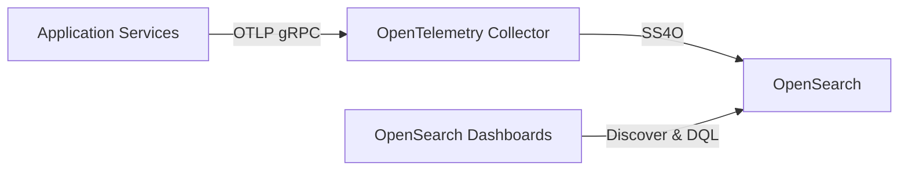
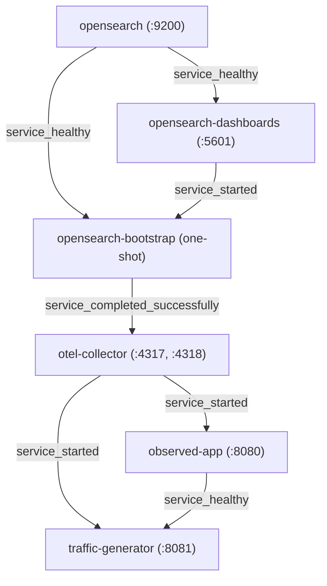

# Observability Stack & Telemetry Pipeline

## Decoupled Telemetry Architecture

Decoupling application services from telemetry storage backends is a foundational pattern in modern cloud-native
systems. Rather than transmitting log records directly from application runtimes to a storage backend, applications
emit telemetry to an out-of-process OpenTelemetry Collector pipeline:



Directly coupling application services to persistent telemetry backends introduces severe operational vulnerabilities.
Storage outages, indexing rate limits, or transient network partitions can propagate backpressure into core business
threads, causing application slowdowns, memory bloat, or thread starvation. Storing backend credentials, ingest tokens,
or cluster endpoints inside every application container widens security attack surfaces and complicates rotation.
Furthermore, updating storage destinations, telemetry schemas, or buffering policies would require redeploying all
application services.

An out-of-process telemetry collector resolves these risks by serving as a dedicated ingestion buffer and routing
layer. Applications stream standard OpenTelemetry Protocol (OTLP) payloads over lightweight, local network hops. The
collector absorbs traffic surges, enforces memory safety boundaries, aggregates individual events into efficient
network batches, manages retry queues with exponential backoff, and routes normalized records to destination stores.

### External Sources & Ecosystem Practice

- [OpenTelemetry Collector Deployment Patterns](https://opentelemetry.io/docs/collector/deployment/) — Architectural
  trade-offs between local agent sidecars, centralized gateway collectors, and hybrid topologies.
- [OpenTelemetry Official Demo (opentelemetry-demo)](https://github.com/open-telemetry/opentelemetry-demo)
  — Production reference architecture demonstrating OTLP emission across heterogeneous microservices into a unified
  collector and storage pipeline.

### In Observe-It

Observe-It implements this decoupled pipeline locally using five continuous runtime containers and one transient
bootstrap container declared in
[`docker-compose.yml`](https://github.com/PawelBalcerek/observe-it/blob/main/docker-compose.yml):

- `opensearch`: Distributed search and analytics datastore holding the **SS4O Log Index** (`:9200`).
- `opensearch-dashboards`: Browser-based interface for log exploration, visualization, and DQL query execution
  (`:5601`).
- `opensearch-bootstrap`: Transient initialization container that installs the OpenSearch ingest pipeline, index
  template, and pre-built saved searches before exiting cleanly.
- `otel-collector`: OpenTelemetry Collector Contrib container receiving OTLP over gRPC (`:4317`) and HTTP (`:4318`),
  protecting memory limits, batching records, and exporting to OpenSearch.
- `observed-app`: Kotlin/Spring Boot backend service (`:8080`) handling customer **Order** processing with zero-code
  instrumentation.
- `traffic-generator`: Kotlin/Spring Boot companion service (`:8081`) continuously driving synthetic customer
  **Checkout Scenario** paths against the **Observed App**.

## Container Topology & Deterministic Startup Ordering

Distributed telemetry pipelines require strict startup synchronization. Storage backends, index templates, ingest
processors, and collector endpoints must be fully operational and receptive before application services emit their
first log events.

Launching containers concurrently without dependency gates produces race conditions. When application services boot
before storage or indexing configurations are active, early log events emitted during application startup risk being
dropped, rejected due to missing connection handlers, or routed to unmapped indices. In dynamic search engines like
OpenSearch, writing documents to an index before its template is registered triggers dynamic type inference, which
assigns unoptimized mappings and breaks downstream dashboard visualizations.

Modern container orchestration resolves this by gating container lifecycles behind explicit health checks and exit
conditions (`service_healthy` and `service_completed_successfully`), ensuring each component activates only after its
prerequisites are verified.

### External Sources & Ecosystem Practice

- [Docker Compose Startup Order & Healthchecks](https://docs.docker.com/compose/how-tos/startup-order/) — Managing
  initialization dependencies using `condition: service_healthy` and `condition: service_completed_successfully`.

### In Observe-It

Observe-It orchestrates container startup through a deterministic dependency DAG defined in
[`docker-compose.yml`](https://github.com/PawelBalcerek/observe-it/blob/main/docker-compose.yml):



The orchestration proceeds through five sequential stages:

1. **Storage initialization**: `opensearch` boots first. Its container healthcheck polls the cluster health endpoint
   (`http://localhost:9200/_cluster/health`) until the cluster health reaches `green` or `yellow`.
2. **Dashboard and bootstrap launch**: Once `opensearch` reports `service_healthy`, `opensearch-dashboards` begins
   booting. Concurrently, `opensearch-bootstrap` executes its initialization script.
3. **Template, pipeline & saved object configuration**: `opensearch-bootstrap` applies the ingest pipeline and index
   template to `opensearch`, waits for `opensearch-dashboards` to become responsive, imports pre-configured saved
   searches, and terminates with exit code 0 (`restart: "no"`).
4. **Collector activation**: `otel-collector` starts only when `opensearch-bootstrap` completes with
   `condition: service_completed_successfully`. This guarantees that the target index template and ingest pipeline are
   in place before the collector can forward any logs.
5. **Application & traffic launch**: `observed-app` starts as soon as `otel-collector` is listening. Finally,
   `traffic-generator` waits for `observed-app` to achieve `service_healthy` readiness before dispatching synthetic
   **Checkout Scenario** workloads.

The entire local sandbox operates within a bounded memory footprint totaling ~2.75 GB of RAM:

| Service                 | Container Name          | Host Port        | Memory Limit | Startup Condition / Role                                      |
| :---------------------- | :---------------------- | :--------------- | :----------- | :------------------------------------------------------------ |
| `opensearch`            | `opensearch`            | `:9200`          | `1g`         | Root storage; healthcheck polls cluster green/yellow health   |
| `opensearch-dashboards` | `opensearch-dashboards` | `:5601`          | `512m`       | Visual UI; waits for `opensearch` `service_healthy`           |
| `opensearch-bootstrap`  | `opensearch-bootstrap`  | None             | None         | One-shot init; waits for `opensearch` & Dashboards            |
| `otel-collector`        | `otel-collector`        | `:4317`, `:4318` | `256m`       | Telemetry pipeline; waits for bootstrap successful completion |
| `observed-app`          | `observed-app`          | `:8080`          | `512m`       | Backend order service; waits for `otel-collector`             |
| `traffic-generator`     | `traffic-generator`     | `:8081`          | `512m`       | Workload runner; waits for `observed-app` `service_healthy`   |

For detailed architectural rationale on out-of-process workload generation and memory containment, see
[ADR-0004: Out-of-Process Traffic Generator Service](../adr/0004-out-of-process-traffic-generator.md) and
[ADR-0005: Bounded Lock-Free In-Memory Order Repository](../adr/0005-bounded-in-memory-order-repository.md).

## Zero-Code OpenTelemetry Java Agent via Cloud Native Buildpacks

Traditional Java telemetry instrumentation required embedding vendor monitoring libraries into application source
trees, configuring external startup scripts, or writing complex Dockerfile layers. This approach couples application
build lifecycles to telemetry SDK release cadence and risks classpath version conflicts with application dependencies.

Cloud Native Buildpacks (CNB) provide a transparent mechanism for injecting the OpenTelemetry Java Agent into OCI
container images at build time. Application source code and build definitions remain completely decoupled from
`io.opentelemetry.*` dependencies, while runtime behavior is configured entirely through standardized `OTEL_*`
environment variables.

### External Sources & Ecosystem Practice

- [OpenTelemetry Zero-Code Java Agent](https://opentelemetry.io/docs/zero-code/java/agent/) — Bytecode instrumentation,
  extension hooks, and runtime configuration properties.
- [Paketo OpenTelemetry Buildpack](https://paketo.io/docs/howto/java/#use-opentelemetry) — Buildpack specification for
  injecting the Java Agent layer into containerized Java applications.
- [Spring Boot bootBuildImage OCI Packaging](https://docs.spring.io/spring-boot/gradle-plugin/packaging-oci-image.html)
  — Native Gradle tasks for building production-ready OCI images using Paketo builders.

### In Observe-It

Observe-It configures the Paketo OpenTelemetry buildpack in its convention plugin at
[`build-logic/conventions/src/main/kotlin/conventions/spring.gradle.kts`](https://github.com/PawelBalcerek/observe-it/blob/main/build-logic/conventions/src/main/kotlin/conventions/spring.gradle.kts):

```kotlin
tasks.named<BootBuildImage>("bootBuildImage") {
    imageName.set("observe-it/${project.name}:${project.version}")
    tags.set(
        listOf(
            "ghcr.io/pawelbalcerek/observe-it/${project.name}:${project.version}"
        )
    )
    buildpacks.set(
        listOf(
            "urn:cnb:builder:paketo-buildpacks/java",
            "docker.io/paketobuildpacks/opentelemetry:${libs.versions.paketo.opentelemetry.get()}"
        )
    )
    environment.putAll(
        mapOf(
            "BP_JVM_VERSION" to "25",
            "BP_OPENTELEMETRY_ENABLED" to "true"
        )
    )
}
```

This configuration ensures that both `observed-app` and `traffic-generator` build images containing the OpenTelemetry
Java Agent while depending strictly on `io.opentelemetry:opentelemetry-api` at compile time, keeping the SDK and
instrumentation agent out of the application runtime classpath. The verification suite enforces this boundary:
`make verify` Gate 1 asserts that the `runtimeClasspath` of each service contains only
`io.opentelemetry:opentelemetry-api` (and its transitive context) with zero SDK or instrumentation artifacts.

At runtime, [`docker-compose.yml`](https://github.com/PawelBalcerek/observe-it/blob/main/docker-compose.yml) activates
the agent and configures the Logback OTLP bridge via environment variables:

```yaml
environment:
  - BPL_JVM_THREAD_COUNT=50
  - OTEL_JAVAAGENT_ENABLED=true
  - OTEL_SERVICE_NAME=observed-app
  - OTEL_RESOURCE_ATTRIBUTES=service.version=${OBSERVE_IT_IMAGE_TAG:-0.2.0},deployment.environment.name=local
  - OTEL_LOGS_EXPORTER=otlp
  - OTEL_TRACES_EXPORTER=none
  - OTEL_METRICS_EXPORTER=none
  - OTEL_EXPORTER_OTLP_ENDPOINT=http://otel-collector:4317
  - OTEL_EXPORTER_OTLP_PROTOCOL=grpc
  - OTEL_INSTRUMENTATION_LOGBACK_APPENDER_EXPERIMENTAL_CAPTURE_MDC_ATTRIBUTES=*
  - OTEL_INSTRUMENTATION_LOGBACK_APPENDER_EXPERIMENTAL_CAPTURE_KEY_VALUE_PAIR_ATTRIBUTES=true
  - OTEL_INSTRUMENTATION_LOGBACK_APPENDER_EXPERIMENTAL_CAPTURE_CODE_ATTRIBUTES=true
  - OTEL_INSTRUMENTATION_LOGBACK_APPENDER_EXPERIMENTAL_LOG_ATTRIBUTES=true
```

To prevent the agent from instrumenting transient healthcheck probes, both services execute health checks using a
direct Java probe with the agent explicitly disabled:

```yaml
healthcheck:
  test: ["CMD", "/cnb/lifecycle/launcher", "--", "java", "-Dotel.javaagent.enabled=false", "-cp", "/workspace/BOOT-INF/classes:/workspace/BOOT-INF/lib/*", "com.observeit.observedapp.HealthCheck"]
  interval: 10s
  timeout: 5s
  retries: 12
  start_period: 20s
```

> [!TIP]
> Always disable the OpenTelemetry Java Agent (`-Dotel.javaagent.enabled=false`) when executing in-container JVM health
> check probes. Attaching the agent to short-lived probe processes incurs substantial JVM startup overhead, inflates
> CPU consumption, and pollutes your telemetry collector with spurious probe events.

For complete architectural details on zero-code bytecode instrumentation versus compile-time appenders, see
[ADR-0001: Zero-Code OpenTelemetry Java Agent and Logback OTLP Bridge](../adr/0001-zero-code-otel-javaagent-and-logback-bridge.md).

## OpenTelemetry Collector Pipeline (otlp → memory_limiter → batch → opensearch)

The OpenTelemetry Collector routes telemetry through modular pipelines composed of three distinct component stages:
**Receivers** (how telemetry enters the collector), **Processors** (how telemetry is buffered, validated, and
transformed), and **Exporters** (how telemetry is translated and delivered to downstream destinations).

In production systems, collectors must be hardened against high-throughput bursts that could trigger Out-Of-Memory
(OOM) crashes. The `memory_limiter` processor provides this protection by monitoring garbage collector statistics and
heap consumption at fixed intervals. When usage crosses a configured threshold, the processor drops incoming data or
returns retryable backpressure to clients until memory returns to safe levels.

Downstream backends benefit significantly from request batching. Emitting each log record individually over HTTP/REST
imposes severe network overhead and index contention. The `batch` processor aggregates records into configured batch
sizes or time intervals, maximizing throughput and index compression. Furthermore, exporters must include retry
buffers (`sending_queue` and `retry_on_failure`) to withstand transient backend unavailability without dropping
telemetry.

### External Sources & Ecosystem Practice

- [OpenTelemetry Collector memory_limiter Processor Best Practices](https://github.com/open-telemetry/opentelemetry-collector/blob/main/processor/memorylimiterprocessor/README.md)
  — Guidelines for configuring `check_interval`, `limit_mib`, and `spike_limit_mib`.
- [OpenSearch Exporter for OpenTelemetry Collector (opensearchexporter)](https://github.com/open-telemetry/opentelemetry-collector-contrib/tree/main/exporter/opensearchexporter)
  — Exporter configuration for data stream indexing, OpenSearch schema mapping, and HTTP retry options.

### In Observe-It

Observe-It configures its collector pipeline in
[`docker/otel-collector/config.yaml`](https://github.com/PawelBalcerek/observe-it/blob/main/docker/otel-collector/config.yaml):

```yaml
receivers:
  otlp:
    protocols:
      grpc:
        endpoint: 0.0.0.0:4317
      http:
        endpoint: 0.0.0.0:4318

processors:
  memory_limiter:
    check_interval: 1s
    limit_mib: 200
    spike_limit_mib: 50
  batch:
    send_batch_size: 100
    timeout: 1s

exporters:
  opensearch:
    http:
      endpoint: "http://opensearch:9200"
      tls:
        insecure: true
    mapping:
      mode: ss4o
    dataset: observe-it
    namespace: local
    sending_queue:
      enabled: true
    retry_on_failure:
      enabled: true

service:
  pipelines:
    logs:
      receivers: [otlp]
      processors: [memory_limiter, batch]
      exporters: [opensearch]
```

The pipeline operates with specific safeguards:

- **Receiver ingress**: Receives OTLP log streams over high-performance gRPC (`:4317`) from the application Java
  Agents and exposes HTTP (`:4318`) for standard web hooks.
- **Memory protection**: `limit_mib: 200` and `spike_limit_mib: 50` ensure the collector process never breaches its
  256 MB Docker container memory limit (`mem_limit: 256m`).
- **Batching efficiency**: Aggregates records into chunks of 100 entries or flushes every 1 second, reducing HTTP
  connection overhead against OpenSearch.
- **SS4O mapping & retries**: Uses `mapping.mode: ss4o` with dataset `observe-it` and namespace `local`, routing log
  records directly to the index `ss4o_logs-observe-it-local`. Persistent queues and backoff retries safeguard log
  delivery during transient storage load.

For in-depth analysis of collector export modes and rejected OTTL transform alternatives, see
[ADR-0002: Direct OpenTelemetry Collector ss4o Export and OpenSearch Ingest Pipeline](../adr/0002-otel-collector-ss4o-and-opensearch-ingest-pipeline.md).

## OpenSearch Bootstrap, SS4O Index Templates & Ingest Normalization

The OpenTelemetry log data model encapsulates attributes in deeply nested JSON structures (`body`, `severity.text`,
`instrumentationScope.name`, `resource.attributes`, and `attributes.*`). Querying deeply nested fields in search
dashboards requires cumbersome DQL syntax and clutters data exploration views.

While the Simple Schema for Observability (SS4O) establishes standardized naming conventions for log, metric, and trace
documents in OpenSearch, OpenSearch does not automatically flatten or deduplicate incoming OTLP fields by default. To
produce clean documents for exploration, search backends pair target schema conventions with an Ingest Pipeline
(`_ingest/pipeline`) and an Index Template (`_index_template` with `default_pipeline`) at ingestion time:

- Extracts frequently queried nested payload fields into concise top-level document attributes so queries and table
  columns do not require deep path prefixes.
- Removes redundant nested copies of extracted fields, saving storage space and reducing document parsing overhead.
- Enforces explicit index mappings (`keyword` for identifiers, `double` / `long` for numeric metrics) to prevent
  dynamic mapping explosion and guarantee query performance.
- Automates environment bootstrap so index templates, ingest pipelines, and pre-configured dashboards are provisioned
  before user interaction.

### External Sources & Ecosystem Practice

- [OpenSearch Simple Schema for Observability (SS4O)](https://docs.opensearch.org/latest/observing-your-data/ss4o/)
  — Canonical schema reference for structured log records.
- [OpenSearch Ingest Pipelines](https://docs.opensearch.org/latest/ingest-pipelines/) — Pre-processing and transforming
  documents before indexing via Painless script processors.
- [OpenSearch Index Templates](https://docs.opensearch.org/latest/im-plugin/index-templates/) — Managing settings,
  sharding, and explicit field mappings for matching index patterns.

### In Observe-It

Observe-It coordinates storage provisioning through four configuration files in
[`docker/opensearch/`](https://github.com/PawelBalcerek/observe-it/blob/main/docker/opensearch/):

1. **Bootstrap orchestrator** ([`docker/opensearch/bootstrap.sh`](https://github.com/PawelBalcerek/observe-it/blob/main/docker/opensearch/bootstrap.sh)):
   A one-shot Bash script executed by the `opensearch-bootstrap` container. It verifies cluster availability, installs
   the ingest pipeline and index template, waits for `opensearch-dashboards` HTTP availability, imports pre-built saved
   objects, and sets `ss4o_logs` as the default index pattern.
2. **Ingest pipeline** ([`docker/opensearch/ingest-pipeline.json`](https://github.com/PawelBalcerek/observe-it/blob/main/docker/opensearch/ingest-pipeline.json)):
   A Painless script processor registered as `observe-it-logs-pipeline` that promotes top-level fields (`body` →
   `message`, `severity.text` → `level`, `instrumentationScope.name` → `logger`, `resource['service.name']` → `service`,
   `resource['service.version']` → `version`, `resource['deployment.environment.name']` → `env`,
   `attributes['exception.stacktrace']` → `exception`) and removes duplicate nested attributes:

   ```json
   {
     "description": "Observe-it log deduplication, field normalization, and alias pipeline",
     "processors": [
       {
         "script": {
           "description": "Extract clean fields (message, level, logger, env, service, version, exception) and remove duplicates",
           "source": "if (ctx.body != null) { ctx.message = ctx.remove('body'); } if (ctx.severity != null && ctx.severity.text != null) { ctx.level = ctx.severity.text; ctx.remove('severity'); } if (ctx.instrumentationScope != null) { ctx.logger = ctx.instrumentationScope.name; ctx.remove('instrumentationScope'); } if (ctx.resource != null) { if (ctx.resource['service.name'] != null) { ctx.service = ctx.resource.remove('service.name'); } if (ctx.resource['service.version'] != null) { ctx.version = ctx.resource.remove('service.version'); } if (ctx.resource['deployment.environment.name'] != null) { ctx.env = ctx.resource['deployment.environment.name']; } } if (ctx.attributes != null) { ctx.attributes.remove('data_stream'); if (ctx.attributes['exception.stacktrace'] != null) { ctx.exception = ctx.attributes.remove('exception.stacktrace'); } ctx.attributes.remove('exception.message'); ctx.attributes.remove('exception.type'); }"
         }
       }
     ]
   }
   ```

3. **Index template** ([`docker/opensearch/index-template.json`](https://github.com/PawelBalcerek/observe-it/blob/main/docker/opensearch/index-template.json)):
   An index template registered as `observe-it-ss4o-logs` matching pattern `ss4o_logs-*` with priority 200. It attaches
   the `observe-it-logs-pipeline` as the `default_pipeline`, applies the `strings_as_keywords` dynamic template, and
   enforces explicit property mappings for top-level keys (`message`, `level`, `service`, `logger`, `exception`,
   `traceId`, `spanId`) and typed domain keys under `attributes.order.*`, `attributes.customer.*`,
   `attributes.checkout.*`, `attributes.inventory.*`, and `attributes.payment.*`.
4. **Pre-configured dashboards** ([`docker/opensearch/saved-objects.ndjson`](https://github.com/PawelBalcerek/observe-it/blob/main/docker/opensearch/saved-objects.ndjson)):
   Imports the `ss4o_logs` index pattern and four ready-to-use Discover saved searches: `All Order Logs`,
   `Warnings & Business Rejections`, `Gateway Timeouts & Stack Traces`, and `Checkout Scenario Explorer`.

## Stack Lifecycle Commands

Managing multi-container observability environments during local development requires standardized, idempotent
lifecycle targets. Developers need predictable commands to build container images, boot services in the correct
dependency order, follow aggregated logs across services, gracefully stop background processes, and reset persistent
storage to a pristine state when testing clean bootstrap behavior.

### In Observe-It

The [`Makefile`](https://github.com/PawelBalcerek/observe-it/blob/main/Makefile) encapsulates these lifecycle
operations:

- `make up`: Packages OCI container images with the Paketo OpenTelemetry Java Agent (via `./gradlew bootBuildImage`)
  and starts all six Docker Compose containers in detached mode (`docker compose up -d`).
- `make logs`: Streams aggregate follow logs across all active containers (`docker compose logs -f`).
- `make down`: Gracefully stops and removes running containers (`docker compose down`).
- `make reset`: Tears down running containers and deletes all persistent volumes (`docker compose down -v`), resetting
  the OpenSearch data volume (`opensearch-data`) to a blank slate.
- `make verify`: Executes automated end-to-end smoke verification
  ([`scripts/verify.sh`](https://github.com/PawelBalcerek/observe-it/blob/main/scripts/verify.sh)) to validate
  container health, scenario execution, and OpenSearch log indexing without manual intervention.

#### Dual-Mode Docker Compose Workflow

Docker Compose supports variable parameterization for image coordinates and pull policies:

- `image: ${OBSERVE_IT_IMAGE_PREFIX:-ghcr.io/pawelbalcerek/observe-it}/<service>:${OBSERVE_IT_IMAGE_TAG:-0.2.0}`
- `pull_policy: ${OBSERVE_IT_PULL_POLICY:-missing}`
- `OTEL_RESOURCE_ATTRIBUTES: service.version=${OBSERVE_IT_IMAGE_TAG:-0.2.0},deployment.environment.name=local`

This dual-mode design enables two core development workflows:

1. **Pre-built GHCR images (Zero-build evaluation)**: Running `docker compose up -d` pulls multi-architecture
   (`linux/amd64` and `linux/arm64`) OCI container images from GitHub Container Registry out of the box when no local
   image exists (`pull_policy: missing`).
2. **Local source builds (`make up` / Gradle)**: Running `./gradlew bootBuildImage` tags both `observe-it/<service>:0.2.0`
   and `ghcr.io/pawelbalcerek/observe-it/<service>:0.2.0` into the local Docker daemon. Subsequent `docker compose up -d`
   commands use the locally built images without network requests.
3. **Strict offline / CI verification**: Passing `OBSERVE_IT_PULL_POLICY=never` ensures pull request and branch builds
   strictly verify locally built container images and fail fast if images are missing.
