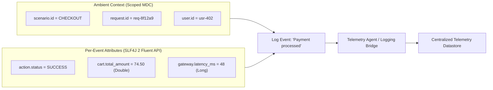
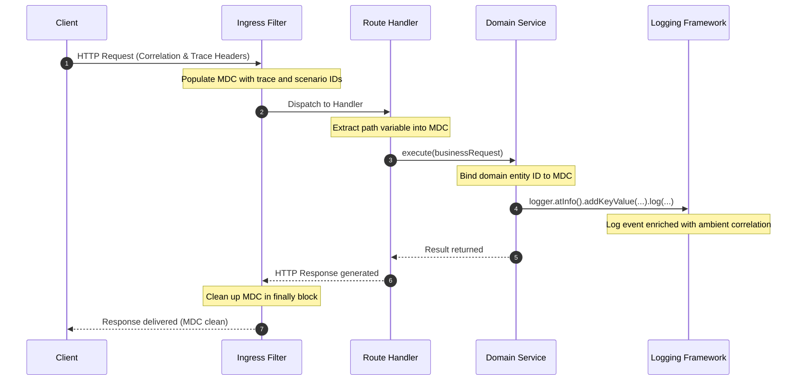

# Structured Logging in Kotlin & Spring Boot

## Introduction & Operational Scopes

Modern production JVM services must emit machine-queryable, structured telemetry rather than arbitrary text strings.
When applications output unstructured strings using string concatenation or template interpolation, downstream log
aggregators are forced to execute brittle regular expressions to extract operational fields. A minor wording change or
reordered phrase can silently break parsing rules, fragment index mappings, and blind alerting pipelines. Furthermore,
unstructured logging strips data of its native types: numbers, timestamps, and boolean flags are flattened into raw
strings, preventing search engines from running numeric range queries, latency percentiles, or mathematical
aggregations.

Structured logging replaces unstructured log text with explicit key-value pairs attached directly to each log event.
To maintain high performance and clean architecture, structured metadata divides into two distinct operational scopes:



1. **Ambient Request Correlation (Scoped MDC)**: Contextual metadata that remains constant across an entire execution
   context—such as request identifiers, workflow scenarios, tenant IDs, or W3C distributed trace context (`trace_id`
   and `span_id`). Ambient correlation is populated once upon request entry and automatically enriches every log event
   emitted during that request across all application layers, including framework filters and global exception handlers.
2. **Per-Event Attributes (SLF4J 2 Fluent API)**: Localized operational parameters describing a specific state
   transition, operational step, or external call—such as monetary amounts, item quantities, or external latency
   measurements. These attributes belong strictly to a single log statement and do not apply to subsequent events on the
   thread.

Mixing these two scopes causes practical problems:

- Putting per-event attributes into thread-local MDC risks leaking stale data across later log statements or recycled
  worker threads.
- Manually passing correlation IDs into every log statement adds repetitive boilerplate and misses unhandled exceptions
  caught by framework advice.

### External Sources & Ecosystem Practice

- [SLF4J 2.0 Fluent Logging API Manual](https://www.slf4j.org/manual.html#fluent) — Specification of the fluent builder
  pattern introduced in SLF4J 2.0, providing native `.addKeyValue()` support without string serialization overhead.
- [Spring Boot Structured Logging Reference](https://docs.spring.io/spring-boot/reference/features/logging.html#features.logging.structured)
  — Spring Boot's built-in structured logging configuration and common schema formats (such as Elastic Common Schema and
  Logstash) for console and file output.

### In Observe-It

Observe-It divides logging metadata strictly between scoped Mapped Diagnostic Context correlation and fluent key-value
pairs, as codified in
[ADR-0003: SLF4J 2 Fluent Key-Value API and Scoped MDC Correlation](../adr/0003-slf4j-fluent-key-values-and-scoped-mdc-correlation.md).
Both the **Observed App** and **Traffic Generator** emit structured logs that combine ambient MDC correlation with
per-event domain keys, bridged automatically to the **SS4O Log Index** by the OpenTelemetry Java Agent without vendor
SDK dependencies on the application classpath.

## Per-Event Attributes & Log Severity Discipline

Emitting structured telemetry requires rigorous field naming conventions, preservation of native types, and clear log
severity discipline. Without standard attribute keys, different engineers or teams inevitably introduce subtle typos or
naming collisions (such as `userId`, `user_id`, and `user.id`), resulting in fragmented index mappings and incomplete
query results in downstream storage engines.

Similarly, converting numeric measurements (such as prices, inventory counts, or network latencies) to strings destroys
their mathematical utility in analytical backends. Passing native numbers (`Double`, `Long`) directly to the logging API
preserves their typed representation, enabling search engines to execute range filters (for example, querying
`http.request.duration_ms >= 500`) and statistical aggregations.

Log severity levels must adhere to consistent operational discipline so on-call engineers can distinguish between
routine lifecycle events, expected business rejections, and critical infrastructure outages:

- `DEBUG`: High-volume internal step details, loop iterations, and diagnostic state checks. Typically disabled in
  production to control log volume and processing costs.
- `INFO`: Significant domain lifecycle milestones and state transitions (for example, an entity state transitioning
  from `PENDING` to `ACTIVE`).
- `WARN`: Expected business rule violations, client-side rejections, or recoverable boundary failures (such as invalid
  inputs, rate-limited requests, or business rule rejections). Crucially, these events should be logged **without a
  stacktrace**: stacktraces are expensive to generate, inflate storage volumes, and flood error trackers with false
  alerts for expected business flows.
- `ERROR`: Unexpected system failures, unhandled exceptions, or downstream infrastructure timeouts (such as database
  connectivity failures or third-party service timeouts). These events must be logged **with a stacktrace** via
  `.setCause(exception)` to enable rapid root-cause diagnosis.

### External Sources & Ecosystem Practice

- [OpenTelemetry Semantic Conventions — Exceptions on Logs](https://opentelemetry.io/docs/specs/semconv/exceptions/exceptions-logs/)
  — Standard conventions for capturing exception details (`exception.type`, `exception.message`, and
  `exception.stacktrace`) on structured log records.
- [SLF4J LoggingEventBuilder Javadoc](https://www.slf4j.org/api/org/slf4j/spi/LoggingEventBuilder.html) — API contract
  for `.addKeyValue(String key, Object value)` and `.setCause(Throwable cause)`.

### In Observe-It

Attribute keys and error type constants are declared in
[`OrderTelemetry.kt`](https://github.com/PawelBalcerek/observe-it/blob/main/observed-app/src/main/kotlin/com/observeit/observedapp/order/domain/OrderTelemetry.kt)
using canonical dot-namespaced constants:

```kotlin
object OrderTelemetry {
    object Key {
        const val ORDER_STATE = "order.state"
        const val ORDER_PREVIOUS_STATE = "order.previous_state"
        const val ORDER_TOTAL_AMOUNT = "order.total_amount"
        const val ORDER_CURRENCY = "order.currency"
        const val ORDER_ITEM_COUNT = "order.item_count"
        const val ORDER_ATTEMPTED_ACTION = "order.attempted_action"
        const val INVENTORY_SKU = "inventory.sku"
        const val INVENTORY_REQUESTED_QUANTITY = "inventory.requested_quantity"
        const val INVENTORY_AVAILABLE_QUANTITY = "inventory.available_quantity"
        const val PAYMENT_METHOD = "payment.method"
        const val PAYMENT_LATENCY_MS = "payment.latency_ms"
        const val SHIPPING_METHOD = "shipping.method"
        const val CANCELLATION_REASON = "cancellation.reason"
        const val ERROR_TYPE = "error.type"
    }

    object ErrorType {
        const val INVALID_STATE_TRANSITION = "INVALID_STATE_TRANSITION"
        const val OUT_OF_STOCK = "OUT_OF_STOCK"
        const val PAYMENT_DECLINED = "PAYMENT_DECLINED"
        const val GATEWAY_TIMEOUT = "GATEWAY_TIMEOUT"
    }
}
```

In
[`OrderService.kt`](https://github.com/PawelBalcerek/observe-it/blob/main/observed-app/src/main/kotlin/com/observeit/observedapp/order/domain/OrderService.kt),
numeric attributes are emitted as native `Double` and `Long` values:

```kotlin
logger.atInfo()
    .addKeyValue(Key.ORDER_STATE, saved.state.name)
    .addKeyValue(Key.ORDER_TOTAL_AMOUNT, saved.totalAmount.toDouble())
    .addKeyValue(Key.ORDER_CURRENCY, saved.currency.currencyCode)
    .addKeyValue(Key.ORDER_ITEM_COUNT, saved.itemCount)
    .log("Order created")
```

To contrast high-volume operational details with major lifecycle events, `reserveOrder()` emits `DEBUG` logs during SKU
processing and an `INFO` log upon successful reservation:

```kotlin
// DEBUG: High-volume step details during SKU reservation
logger.atDebug()
    .addKeyValue(Key.INVENTORY_SKU, item.sku)
    .addKeyValue(Key.INVENTORY_REQUESTED_QUANTITY, item.quantity.toLong())
    .addKeyValue(Key.INVENTORY_AVAILABLE_QUANTITY, STANDARD_AVAILABLE_QUANTITY)
    .log("Inventory reserved for ${item.sku} (${item.quantity}/$STANDARD_AVAILABLE_QUANTITY)")

// INFO: Major domain state transition milestone
logger.atInfo()
    .addKeyValue(Key.ORDER_STATE, reserved.state.name)
    .addKeyValue(Key.ORDER_PREVIOUS_STATE, previousState.name)
    .log("Order reserved")
```

Severity and stacktrace discipline is enforced in
[`OrderControllerAdvice.kt`](https://github.com/PawelBalcerek/observe-it/blob/main/observed-app/src/main/kotlin/com/observeit/observedapp/order/api/OrderControllerAdvice.kt).
Expected business rejections emit `WARN` logs without a stacktrace, while upstream gateway failures emit `ERROR` logs
with `.setCause(exception)`:

```kotlin
// Expected business rejection: WARN without stacktrace
@ExceptionHandler(PaymentDeclinedException::class)
fun handlePaymentDeclinedException(exception: PaymentDeclinedException): ProblemDetail {
    logger.atWarn()
        .addKeyValue(Key.ERROR_TYPE, ErrorType.PAYMENT_DECLINED)
        .addKeyValue(Key.PAYMENT_METHOD, exception.paymentMethod.name)
        .addKeyValue(Key.PAYMENT_LATENCY_MS, exception.latencyMs)
        .log("Payment declined for method ${exception.paymentMethod.name}")

    return ProblemDetail.forStatusAndDetail(HttpStatus.UNPROCESSABLE_CONTENT, exception.message)
}

// Unexpected infrastructure failure: ERROR with cause attached
@ExceptionHandler(PaymentGatewayTimeoutException::class)
fun handlePaymentGatewayTimeoutException(exception: PaymentGatewayTimeoutException): ProblemDetail {
    logger.atError()
        .setCause(exception.cause ?: exception)
        .addKeyValue(Key.ERROR_TYPE, ErrorType.GATEWAY_TIMEOUT)
        .addKeyValue(Key.PAYMENT_METHOD, exception.paymentMethod.name)
        .addKeyValue(Key.PAYMENT_LATENCY_MS, exception.latencyMs)
        .log("Payment gateway timed out for method ${exception.paymentMethod.name}")

    return ProblemDetail.forStatusAndDetail(HttpStatus.GATEWAY_TIMEOUT, exception.message)
}
```

## Scoped Request Correlation with MDC

Mapped Diagnostic Context (MDC) provides a thread-local dictionary of key-value pairs that automatically enrich every
log event emitted on that thread. In a microservices architecture, cross-cutting correlation identifiers—such as
request IDs, workflow scenarios, customer identifiers, and active W3C trace IDs—must accompany every log line across all
layers of execution.

Because MDC relies on thread-local storage, its lifecycle must be strictly managed. Modern JVM runtimes execute on
recycled worker threads or virtual threads (Project Loom). If a request populates MDC entries but fails to clear them
upon completion, subsequent unrelated requests executing on that same thread will inherit stale correlation data. This
"context leakage" corrupts telemetry, causes search queries to return misleading results, and severely impedes triage.

To prevent leakage, applications must enforce a strict scoping lifecycle:



Every thread-entry point must guarantee cleanup inside a `finally` block. Furthermore, correlation attributes should be
bound incrementally as their values become available:

1. **Servlet Filters**: Extract protocol headers (such as W3C `traceparent`, incoming request IDs, or workflow context)
   upon request ingress and guarantee MDC cleanup in a `finally` block upon request egress.
2. **MVC Interceptors**: Extract route parameters (such as resource or entity IDs resolved from URL path templates) to
   enrich logs emitted during controller dispatch and exception handling.
3. **Domain Services**: Bind domain identifiers generated during business logic execution (such as newly minted entity
   IDs or resolved customer records).

In addition to populating machine-readable OpenTelemetry payloads, MDC correlation provides immediate developer value
by rendering contextual identifiers directly into local human-readable console logs.

### External Sources & Ecosystem Practice

- [SLF4J Mapped Diagnostic Context (MDC)](https://www.slf4j.org/manual.html#mdc) — Upstream SLF4J documentation on
  thread-local diagnostic context and cleanup rules.
- [OpenTelemetry Logback Appender Instrumentation](https://github.com/open-telemetry/opentelemetry-java-instrumentation/tree/main/instrumentation/logback/logback-appender-1.0/javaagent)
  — Reference for capturing MDC properties into OpenTelemetry log records via runtime configuration.

### In Observe-It

Observe-It encapsulates MDC manipulation in
[`CorrelationContext.kt`](https://github.com/PawelBalcerek/observe-it/blob/main/observed-app/src/main/kotlin/com/observeit/observedapp/correlation/CorrelationContext.kt):

```kotlin
object CorrelationContext {
    private const val CHECKOUT_SCENARIO = "checkout.scenario"
    private const val ORDER_ID = "order.id"
    private const val CUSTOMER_ID = "customer.id"

    fun setCheckoutScenario(scenario: String) = MDC.put(CHECKOUT_SCENARIO, scenario)
    fun setOrderId(orderId: String) = MDC.put(ORDER_ID, orderId)
    fun populateOrderCorrelation(orderId: String, customerId: String) {
        MDC.put(ORDER_ID, orderId)
        MDC.put(CUSTOMER_ID, customerId)
    }
    fun clear() = MDC.clear()
}
```

The filter
[`MdcCorrelationFilter.kt`](https://github.com/PawelBalcerek/observe-it/blob/main/observed-app/src/main/kotlin/com/observeit/observedapp/correlation/api/MdcCorrelationFilter.kt)
is ordered at `Ordered.HIGHEST_PRECEDENCE`. It captures the `X-Checkout-Scenario` header and guarantees cleanup via
`finally`:

```kotlin
@Component
@Order(HIGHEST_PRECEDENCE)
class MdcCorrelationFilter : OncePerRequestFilter() {
    override fun doFilterInternal(
        request: HttpServletRequest,
        response: HttpServletResponse,
        filterChain: FilterChain,
    ) {
        val scenario = request.getHeader("X-Checkout-Scenario")
        if (!scenario.isNullOrBlank()) {
            CorrelationContext.setCheckoutScenario(scenario)
        }
        try {
            filterChain.doFilter(request, response)
        } finally {
            CorrelationContext.clear()
        }
    }
}
```

For endpoints that accept an order identifier in the URI path (such as `POST /api/orders/{orderId}/pay`),
[`OrderMdcInterceptor.kt`](https://github.com/PawelBalcerek/observe-it/blob/main/observed-app/src/main/kotlin/com/observeit/observedapp/order/api/OrderMdcInterceptor.kt)
extracts the path variable into MDC before controller methods execute:

```kotlin
@Component
class OrderMdcInterceptor : HandlerInterceptor {
    override fun preHandle(request: HttpServletRequest, response: HttpServletResponse, handler: Any): Boolean {
        @Suppress("UNCHECKED_CAST")
        val pathVariables = request.getAttribute(URI_TEMPLATE_VARIABLES_ATTRIBUTE) as? Map<String, String>
        val orderId = pathVariables?.get("orderId")
        if (!orderId.isNullOrBlank()) {
            CorrelationContext.setOrderId(orderId)
        }
        return true
    }
}
```

When reading an existing entity, `OrderService.loadOrderWithCorrelation(orderId)` populates both `order.id` and
`customer.id`.

During local container execution, MDC correlation renders in the terminal via the Spring Boot console pattern defined
in
[`application.yml`](https://github.com/PawelBalcerek/observe-it/blob/main/observed-app/src/main/resources/application.yml):

```yaml
logging:
  pattern:
    console: "%d{yyyy-MM-dd'T'HH:mm:ss.SSSXXX} %5p [%X{trace_id:-},%X{span_id:-}] [%X{order.id:-}] [%15.15t] %-40.40logger{39} : %m%n"
```

This pattern embeds W3C trace identifiers and the active `order.id` in every console line, verified by
[`LoggingFormatTest.kt`](https://github.com/PawelBalcerek/observe-it/blob/main/observed-app/src/integration/kotlin/com/observeit/observedapp/LoggingFormatTest.kt)
and documented in
[ADR-0001: Zero-Code OpenTelemetry Java Agent and Logback OTLP Bridge](../adr/0001-zero-code-otel-javaagent-and-logback-bridge.md).

## From Log Event to Normalized SS4O Log Index Document

Once an in-process log event is emitted by a logging framework, it begins a multi-stage transformation journey from
application memory to indexed search storage in a centralized telemetry datastore:

1. **In-Process Logging Framework Event**: SLF4J and Logback create an in-memory event (`ILoggingEvent`) holding the log
   message, severity level, source logger name, native key-value pairs (`getKeyValuePairs()`), thread context, and
   active MDC properties (`getMDCPropertyMap()`).
2. **Telemetry Agent & Log Bridge Translation**: An in-process bridge or zero-code Java agent intercepts the logging
   event and translates it into an OpenTelemetry Protocol (OTLP) `LogRecord` payload. The bridge maps thread-local MDC
   entries and fluent key-value pairs into the log record's `attributes` map, records thread coordinates, and links
   active W3C trace identifiers (`traceId` and `spanId`).
3. **Out-of-Process Collector Export**: An OpenTelemetry Collector receives the OTLP stream, buffers records in memory
   to protect against traffic spikes, batches events, and routes them to a downstream search or analytics datastore.
4. **Storage Ingest Normalization**: Before documents are written to persistent storage, search and analytics datastores
   use ingest pipelines and index templates to conform incoming telemetry to target schema definitions. Ingest
   processors map payload structures into standard fields, drop redundant metadata, and enforce explicit type mappings
   (such as dates, keywords, and numeric types) to optimize query performance and index sizing.

### External Sources & Ecosystem Practice

- [OpenTelemetry Logs Data Model Specification](https://opentelemetry.io/docs/specs/otel/logs/data-model/) — Upstream
  data model defining field structures, resource attributes, and scopes for OTLP log telemetry.
- [OpenSearch Simple Schema for Observability (SS4O) Log Schema](https://docs.opensearch.org/latest/observing-your-data/ss4o/)
  — OpenSearch schema standard defining root fields and attribute structures for `ss4o_logs-*` indices.

### In Observe-It

Observe-It configures this end-to-end pipeline using the zero-code OpenTelemetry Java Agent in
[`docker-compose.yml`](https://github.com/PawelBalcerek/observe-it/blob/main/docker-compose.yml), the OpenTelemetry
Collector exporting to index `ss4o_logs-observe-it-local`, and the OpenSearch ingest pipeline
[`observe-it-logs-pipeline`](https://github.com/PawelBalcerek/observe-it/blob/main/docker/opensearch/ingest-pipeline.json)
(configured as the `default_pipeline` in index template
[`observe-it-ss4o-logs`](https://github.com/PawelBalcerek/observe-it/blob/main/docker/opensearch/index-template.json)).
The pipeline promotes top-level fields (`message`, `level`, `logger`, `service`, `version`, `env`, `exception`) and
removes duplicate structures before indexing.

Consider an order payment log event emitted by
[`OrderService.kt`](https://github.com/PawelBalcerek/observe-it/blob/main/observed-app/src/main/kotlin/com/observeit/observedapp/order/domain/OrderService.kt):

```kotlin
logger.atInfo()
    .addKeyValue(Key.ORDER_STATE, "PAID")
    .addKeyValue(Key.ORDER_PREVIOUS_STATE, "RESERVED")
    .addKeyValue(Key.PAYMENT_METHOD, "CREDIT_CARD")
    .addKeyValue(Key.PAYMENT_LATENCY_MS, 50L)
    .log("Order paid")
```

At the moment this line executes, `MdcCorrelationFilter` and `OrderMdcInterceptor` have already bound ambient
correlation attributes to MDC:

- `checkout.scenario = "HAPPY_PATH"`
- `order.id = "4bb66160-c971-4712-a72a-434720970a1a"`
- `customer.id = "cust-101"`

After transmission through the OpenTelemetry Collector and normalization by the OpenSearch ingest pipeline, this event
is stored in OpenSearch as the following JSON document in `ss4o_logs-observe-it-local`:

```json
{
  "@timestamp": "2026-11-04T15:30:00.123456789Z",
  "observedTimestamp": "2026-11-04T15:30:00.123500000Z",
  "level": "INFO",
  "service": "observed-app",
  "version": "0.2.0",
  "env": "local",
  "logger": "com.observeit.observedapp.order.domain.OrderService",
  "message": "Order paid",
  "traceId": "4bf92f3577b34da6a3ce929d0e0e4736",
  "spanId": "00f067aa0ba902b7",
  "traceFlags": 1,
  "resource": {
    "deployment": {
      "environment": { "name": "local" }
    },
    "telemetry": {
      "sdk": {
        "name": "opentelemetry",
        "language": "java",
        "version": "2.8.0"
      }
    }
  },
  "attributes": {
    "checkout": {
      "scenario": "HAPPY_PATH"
    },
    "order": {
      "id": "4bb66160-c971-4712-a72a-434720970a1a",
      "state": "PAID",
      "previous_state": "RESERVED"
    },
    "customer": {
      "id": "cust-101"
    },
    "payment": {
      "method": "CREDIT_CARD",
      "latency_ms": 50
    },
    "thread": {
      "name": "http-nio-8080-exec-1",
      "id": 42
    },
    "code": {
      "namespace": "com.observeit.observedapp.order.domain.OrderService",
      "function": "payOrder",
      "filepath": "OrderService.kt",
      "lineno": 107
    }
  }
}
```

Notice that `attributes.payment.latency_ms` is stored as an integer (`50`), matching the explicit mapping
`"type": "long"` in `index-template.json`. OpenSearch Dashboards users can immediately run numeric queries (such as
`attributes.payment.latency_ms > 40`) and plot latency percentiles across payment methods.

When an unexpected infrastructure failure is logged with `.setCause(exception)` (such as the payment gateway timeout in
`OrderControllerAdvice`), the Java Agent attaches `exception.stacktrace` to the OTLP attributes. The ingest pipeline
extracts this into the root-level `exception` field (`"type": "text"`) while removing duplicate attributes:

```json
{
  "@timestamp": "2026-11-04T15:30:05.987654321Z",
  "level": "ERROR",
  "service": "observed-app",
  "logger": "com.observeit.observedapp.order.api.OrderControllerAdvice",
  "message": "Payment gateway timed out for method TIMEOUT_GATEWAY",
  "exception": "com.observeit.observedapp.domain.GatewayTimeoutException: Payment gateway timed out after 1500ms\n\tat com.observeit.observedapp.order.infrastructure.SimulatedPaymentGateway.processPayment(SimulatedPaymentGateway.kt:42)...",
  "traceId": "4bf92f3577b34da6a3ce929d0e0e4736",
  "spanId": "00f067aa0ba902b7",
  "attributes": {
    "error": {
      "type": "GATEWAY_TIMEOUT"
    },
    "payment": {
      "method": "TIMEOUT_GATEWAY",
      "latency_ms": 1500
    }
  }
}
```

This top-level promotion enables on-call engineers to search directly for `_exists_:exception` in OpenSearch Dashboards
without having to query nested attribute paths.

## Unit Testing Structured Logs In-Memory

In an observable architecture, structured log attributes and MDC correlation values are not incidental debug text: they
are part of a service's public, observable contract. Automated alerting rules, business dashboards, and incident triage
workflows depend on the presence and accuracy of specific telemetry keys. If an engineer inadvertently renames an
attribute key or drops a correlation identifier, automated alerts can fail silently.

Historically, testing log output involved intercepting standard output streams and evaluating raw text strings with
regular expressions. This technique is fragile and inadequate for structured telemetry:

1. **Formatting Fragility**: Minor changes to date patterns, logger name truncation, or thread formatting break regex
   matchers without indicating a true telemetry regression.
2. **Loss of Type Verification**: A regex test cannot assert whether an attribute was logged as a native numeric
   `Double` versus a stringified `"15.50"`.
3. **MDC Invisibility**: Standard output scrapers cannot easily differentiate between ambient thread-local correlation
   values and per-event key-value pairs.

The robust alternative is to attach an in-memory Logback `ListAppender<ILoggingEvent>` directly to the logger hierarchy
within a JUnit 5 extension. The in-memory appender captures rich `ILoggingEvent` objects, providing direct programmatic
access to:

- `getKeyValuePairs()`: The typed list of SLF4J 2 key-value attributes.
- `getMDCPropertyMap()`: The exact snapshot of thread-local MDC entries present when the log statement was evaluated.
- `getLevel()`, `getMessage()`, and `getThrowableProxy()`.

Furthermore, tests execute against plain Logback in standard JVM unit test runners without requiring the OpenTelemetry
Java Agent or Docker containers, keeping unit and slice test suites hermetic and sub-second.

### External Sources & Ecosystem Practice

- [Logback ListAppender Javadoc](https://logback.qos.ch/apidocs/ch/qos/logback/core/read/ListAppender.html) — Core
  Logback utility for collecting logging events in an accessible list during tests.
- [JUnit 5 Extension Model](https://junit.org/junit5/docs/current/user-guide/#extensions) — Lifecycle callbacks
  (`BeforeEachCallback`, `AfterEachCallback`) used to attach, isolate, and detach test fixtures.

### In Observe-It

The shared test fixture
[`LogCapture.kt`](https://github.com/PawelBalcerek/observe-it/blob/main/observed-app/src/testFixtures/kotlin/com/observeit/observedapp/test/LogCapture.kt)
implements both `BeforeEachCallback` and `AfterEachCallback`. It attaches a `ListAppender<ILoggingEvent>` to the target
logger, isolates test execution, and clears both recorded events and thread-local MDC before and after each test:

```kotlin
class LogCapture(private val loggerName: String = ROOT_LOGGER_NAME, private val level: Level? = null) :
    BeforeEachCallback,
    AfterEachCallback {

    private val targetLogger = LoggerFactory.getLogger(loggerName) as Logger
    private val listAppender = ListAppender<ILoggingEvent>()

    fun assertLogged(
        level: Level = Level.INFO,
        message: String? = null,
        keyValues: Map<String, Any?> = emptyMap(),
        mdc: Map<String, String> = emptyMap(),
    ): ILoggingEvent {
        val match = listAppender.list.firstOrNull { event ->
            (event.level == level) &&
                (message == null || event.message == message) &&
                keyValues.all { (k, v) -> event.keyValue(k) == v } &&
                mdc.all { (k, v) -> event.mdcPropertyMap[k] == v }
        }
        match.shouldNotBeNull()
        return match
    }

    override fun beforeEach(context: ExtensionContext) {
        listAppender.list.clear()
        start()
        CorrelationContext.clear()
    }

    override fun afterEach(context: ExtensionContext) {
        stop()
        CorrelationContext.clear()
    }
}
```

In
[`OrderServiceTest.kt`](https://github.com/PawelBalcerek/observe-it/blob/main/observed-app/src/test/kotlin/com/observeit/observedapp/order/domain/OrderServiceTest.kt),
the test registers `LogCapture` via `@RegisterExtension` and verifies both typed key-values and ambient MDC properties
as part of the domain contract:

```kotlin
@Test
fun `creates order, populates correlation, stores in repository, and emits structured log`() {
    // given
    val items = listOf(
        anOrderLineItem(quantity = 2, unitPrice = BigDecimal("15.50")),
        anOrderLineItem(quantity = 3, unitPrice = BigDecimal("2.00")),
    )

    // when
    val order = service.createOrder(customerId = "customerId", items = items)

    // then
    order shouldBe anOrder(id = order.id, items = items)
    repository.findById(order.id) shouldBe order

    // and
    logCapture.assertLogged(
        level = Level.INFO,
        message = "Order created",
        keyValues = mapOf(
            "order.state" to "CREATED",
            "order.total_amount" to 37.0,
            "order.currency" to "USD",
            "order.item_count" to 5L,
        ),
        mdc = mapOf(
            "order.id" to order.id,
            "customer.id" to "customerId",
        ),
    )
}
```
