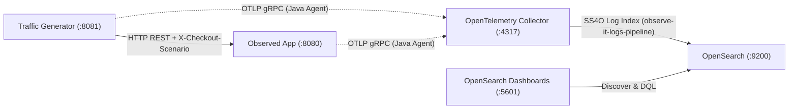

# Observe-It Documentation

Observe-It is an open-source observability reference system and local sandbox for Kotlin/Spring Boot backend
applications using OpenTelemetry and OpenSearch. Rather than a toy "hello world" or a tutorial that duplicates vendor
documentation, it pairs a realistic multi-service system—an **Observed App** processing customer **Order** workflows and
a continuous **Traffic Generator** driving normal, warning, and failure **Checkout Scenario** paths across every **Order
State**—with zero-code OpenTelemetry instrumentation and an **SS4O Log Index** in OpenSearch.

## System at a Glance



## Quick Start

Prerequisites: JDK 25 (or Gradle toolchain auto-provisioning) and Docker with Compose (~3 GB RAM).

Build the container images (with the Paketo OpenTelemetry Java Agent baked in) and start the stack:

```bash
make up
```

Or run the underlying Gradle and Docker Compose commands directly:

```bash
./gradlew bootBuildImage
docker compose up -d
```

Once all containers are healthy, open OpenSearch Dashboards at `http://localhost:5601`, navigate to **Discover**, and
open any of the 4 pre-bootstrapped saved searches (`All Order Logs`, `Warnings & Business Rejections`, `Gateway Timeouts
& Stack Traces`, or `Checkout Scenario Explorer`) to inspect live structured logs in the `ss4o_logs-*` **SS4O Log
Index**.

To stop the stack and remove volumes:

```bash
make reset
```

## Guided Reading Path

### Architecture Decision Records

Architecture Decision Records (ADRs) capture point-in-time, append-only architectural choices and their rationale,
trade-offs, and consequences. See the [ADR Index](./adr/index.md) for more.

## Observability Pillars & Roadmap

| Milestone       | Pillar               | Status  | Scope & Capabilities                                                                                                                                                                                                                                                                                                |
| :-------------- | :------------------- | :------ | :------------------------------------------------------------------------------------------------------------------------------------------------------------------------------------------------------------------------------------------------------------------------------------------------------------------ |
| **Milestone 1** | Structured Logging   | Current | SLF4J 2 fluent `.addKeyValue()` API, scoped MDC correlation (`checkout.scenario`, `order.id`, `customer.id`), zero-code OpenTelemetry Java Agent log bridge, OpenTelemetry Collector `ss4o` export, OpenSearch `observe-it-logs-pipeline` normalization, and pre-bootstrapped OpenSearch Dashboards saved searches. |
| **Milestone 2** | Metrics & Dashboards | Planned | JVM, HTTP, and domain metrics (**Order** throughput, payment latency histograms, error rates) exported via OTLP and visualized in OpenSearch Dashboards.                                                                                                                                                            |
| **Milestone 3** | Distributed Tracing  | Planned | End-to-end W3C Trace Context propagation across the **Traffic Generator** and **Observed App**, custom domain spans, and cross-signal trace-to-log correlation.                                                                                                                                                     |

## Official Upstream References

Observe-It focuses on how these tools fit together in a production-style Kotlin/Spring Boot system and delegates vendor
fundamentals to canonical upstream documentation:

- [OpenTelemetry Java Zero-Code Instrumentation](https://opentelemetry.io/docs/zero-code/java/agent/) — Java Agent
  configuration, system properties, and supported libraries.
- [OpenTelemetry Collector Documentation](https://opentelemetry.io/docs/collector/) — Receivers, processors
  (`memory_limiter`, `batch`), and exporters.
- [Simple Schema for Observability (SS4O)](https://docs.opensearch.org/latest/observing-your-data/ss4o/) — OpenSearch
  schema conventions for `ss4o_logs-*` indices.
- [OpenSearch Dashboards Query Language (DQL)](https://docs.opensearch.org/latest/dashboards/dql/) — Filtering and
  querying structured fields in Discover.
- [SLF4J 2 Fluent Logging API](https://www.slf4j.org/manual.html#fluent) — Structured `.atInfo().addKeyValue(...)`
  logging on the JVM.
- [Contributing & Git Workflow](https://github.com/PawelBalcerek/observe-it/blob/main/CONTRIBUTING.md) — Issue-first
  workflow, branch conventions, and quality gates.
