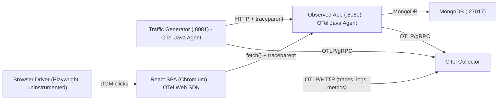

# Automated Browser Traffic Generation in Docker Compose

> Research note for [issue #182](https://github.com/PawelBalcerek/observe-it/issues/182) (parent map
> [#179](https://github.com/PawelBalcerek/observe-it/issues/179), blocking
> [#185](https://github.com/PawelBalcerek/observe-it/issues/185)). All findings are verified against primary upstream
> documentation and source repositories for Playwright, Playwright for Java, Puppeteer, Grafana k6, Chromium, Docker,
> `GoogleChrome/web-vitals`, `open-telemetry/opentelemetry-demo`, and Observe-It's `docker-compose.yml` and
> `traffic-generator` module.

## Executive Summary

1. **Recommended automation stack**: A dedicated Node.js/TypeScript container using **`playwright-core`** driving
   **`chromium-headless-shell`** (`playwright-core install chromium --only-shell --with-deps` on `node:24-slim`),
   rather than the ~2 GB multi-browser `mcr.microsoft.com/playwright` image, Playwright-Java inside the Kotlin
   **Traffic Generator**, Puppeteer, or Grafana k6 browser.
2. **Browser engine**: **Chromium (`chromium-headless-shell`)** is the only engine that combines minimal container
   dependencies (no X11/Wayland/D-Bus), first-class Linux `amd64` + `arm64` (Apple Silicon) support, and complete Core
   Web Vitals API coverage (`LCP`, `INP`, and `CLS` — Firefox and WebKit do not implement the Layout Instability API
   required for `CLS`).
3. **Container memory budget**: Observe-It's existing 8 services sum to `4,352 MiB` (~4.25 GiB) of `mem_limit`, with
   app containers budgeted at `512m`. A single headless Chromium shell + Node.js driver idles at ~150–300 MiB RSS and
   peaks at ~350–500 MiB during SPA rendering and GC. While `mem_limit: 512m` is tight for a single sequential page
   loop, **`mem_limit: 768m` with `shm_size: 256m` and `init: true`** provides reliable headroom without OOM (`exit
   137`) crashes, keeping total stack limits near ~5.0 GiB.
4. **Long-running reliability**: Reuse one `Browser` process across iterations, isolate every **Checkout Scenario** in
   a fresh `BrowserContext` (`try / finally { await context.close() }`), and recycle the `Browser` process periodically
   (every 50–100 iterations or 15–30 minutes) to reclaim native Chromium/V8 memory fragmentation.
5. **Coexistence over replacement**: Run automated browser traffic **alongside** the existing Kotlin **Traffic
   Generator** (at a low steady cadence, e.g., 1 UI journey every 5–10 seconds, with an optional toggle to disable
   browser traffic on constrained laptops) rather than replacing it. Keep the browser automation runner uninstrumented
   so distributed traces originate cleanly from the React SPA's OpenTelemetry Web SDK.

## 1. Comparison of Viable Approaches

| Approach                                                           | Est. Image Size (Uncompressed)                                                          | Steady-State RAM (1 Active Browser)                          | Threading / Concurrency Model                                      | Long-Running Daemon Fit                                                                     | Linux `arm64` Support                                | Primary Source                                                                                                                                                                                                                                                                |
| ------------------------------------------------------------------ | --------------------------------------------------------------------------------------- | ------------------------------------------------------------ | ------------------------------------------------------------------ | ------------------------------------------------------------------------------------------- | ---------------------------------------------------- | ----------------------------------------------------------------------------------------------------------------------------------------------------------------------------------------------------------------------------------------------------------------------------- |
| **Playwright Node/TS (`playwright-core` + `--only-shell`)**        | ~550–750 MB (`node:24-slim` + headless shell + deps)                                    | ~200–400 MiB (1 browser, 1 context)                          | Async event loop; multiple isolated `BrowserContext`s on 1 browser | High (native Node loop + optional HTTP health/control server)                               | First-class (`debian12-arm64` / `ubuntu24.04-arm64`) | [Playwright Browsers](https://github.com/microsoft/playwright/blob/main/docs/src/browsers.md), [`nativeDeps.ts`](https://github.com/microsoft/playwright/blob/main/packages/playwright-core/src/server/registry/nativeDeps.ts)                                                |
| **Playwright Node/TS (`mcr.microsoft.com/playwright`)**            | ~1.9–2.1 GB (~920 MB–1 GB compressed; bundles 3 browsers)                               | ~200–400 MiB (1 browser, 1 context)                          | Same as above                                                      | High, but image pull/disk overhead is ~3x larger                                            | First-class (`amd64` + `arm64`)                      | [Playwright Docker](https://github.com/microsoft/playwright/blob/main/docs/src/docker.md)                                                                                                                                                                                     |
| **Playwright-Java inside Kotlin Traffic Generator**                | ~2.0–2.2 GB (`mcr.microsoft.com/playwright/java` + JVM; breaks Paketo `bootBuildImage`) | ~550–900 MiB (JVM + Node driver subprocess + Chromium)       | **Not thread-safe**: 1 `Playwright` + `Browser` per thread         | Poor (conflicts with virtual-thread workers and 512 MiB budget)                             | Supported via Playwright Java image                  | [Playwright Java Multithreading](https://playwright.dev/java/docs/multithreading), [`driver-bundle`](https://github.com/microsoft/playwright-java)                                                                                                                            |
| **Puppeteer Node/TS (`puppeteer-core` + `chrome-headless-shell`)** | ~550–800 MB custom slim (`ghcr.io/puppeteer/puppeteer` is larger with full Chrome)      | ~200–400 MiB (1 browser, 1 context)                          | Async event loop; `browser.createBrowserContext()`                 | High, but lacks Playwright's auto-waiting locators                                          | Supported (`chrome-headless-shell` Linux builds)     | [Puppeteer Docker](https://github.com/puppeteer/puppeteer/blob/main/docs/guides/docker.md), [Headless Modes](https://github.com/puppeteer/puppeteer/blob/main/docs/guides/headless-modes.md)                                                                                  |
| **Grafana k6 Browser (`grafana/k6:latest-with-browser`)**          | ~1.0–1.5 GB (Go binary + Chromium + OS deps)                                            | ~300–600 MiB+ (docs size Kubernetes example at `4 CPU / 8G`) | VU-based finite load-test executors (Chromium-only via CDP)        | Low (built for bounded test runs with summary metrics, not an infinite controllable daemon) | Supported                                            | [k6 Browser Docs](https://github.com/grafana/k6-docs/blob/main/docs/sources/k6/v2.4.x/using-k6-browser/running-browser-tests.md), [k6 Distributed Browser](https://github.com/grafana/k6-docs/blob/main/docs/sources/k6/v2.4.x/set-up/set-up-distributed-k6/browser-tests.md) |

## 2. Detailed Evaluation of Each Approach

### 2.1 Playwright in Node.js / TypeScript (Recommended)

Playwright's official documentation splits browser installation into full Chromium (for headed use) and a standalone
`chromium-headless-shell` binary for headless automation
([Playwright Browsers](https://github.com/microsoft/playwright/blob/main/docs/src/browsers.md)). Passing `--only-shell`
avoids downloading full desktop Chromium:

```bash
npx playwright-core install chromium --with-deps --only-shell
```

Key architectural advantages for Observe-It:

- **Minimal dependency footprint**: Using `playwright-core` (without the `@playwright/test` runner) on a slim Debian
  Node image (`node:24-slim`) with `--only-shell` installs only Chromium headless shell and its Linux shared libraries,
  avoiding the ~2 GB multi-browser `mcr.microsoft.com/playwright` image that bundles Firefox, WebKit, and full desktop
  Chromium.
- **SPA click reliability**: Playwright's `Locator` API auto-waits for elements to be attached, visible, stable, and
  enabled before clicking, eliminating brittle `sleep` calls against asynchronous React state transitions and API
  responses.
- **Lightweight context isolation**: `browser.newContext()` creates an isolated incognito-like browser context sharing
  the single Chromium browser process, keeping cookies, `localStorage`, and OpenTelemetry web session state separate
  per scenario ([Playwright Browser Contexts](https://github.com/microsoft/playwright/blob/main/docs/src/browser-contexts.md)).
- **ARM64 parity**: Playwright's native dependency registry (`nativeDeps.ts`) maintains explicit dependency maps for
  `ubuntu22.04-arm64`, `ubuntu24.04-arm64`, `debian12-arm64`, and `debian13-arm64`, ensuring Apple Silicon laptops run
  native `linux/arm64` containers without Rosetta/QEMU emulation overhead
  ([`nativeDeps.ts`](https://github.com/microsoft/playwright/blob/main/packages/playwright-core/src/server/registry/nativeDeps.ts)).

### 2.2 Playwright-Java Inside the Existing Kotlin Traffic Generator (Not Recommended)

Embedding Playwright-Java into Observe-It's existing Kotlin/Spring Boot `traffic-generator` introduces three structural
mismatches verified in primary sources:

1. **Non-thread-safe client conflicts with virtual-thread workers**: Official Playwright Java documentation explicitly
   states that Playwright Java is **not thread-safe** — `Playwright`, `Browser`, `BrowserContext`, and `Page` must only
   be accessed from the thread that created them, and concurrent usage requires creating separate `Playwright` instances
   per thread ([Playwright Java Multithreading](https://playwright.dev/java/docs/multithreading); confirmed by
   `Connection.processOneMessage` race notes in
   [`upstream_not_ported.txt`](https://github.com/microsoft/playwright-java/blob/main/playwright/src/test/upstream_not_ported.txt)).
   Observe-It's [`TrafficWorkerCoordinator`](https://github.com/PawelBalcerek/observe-it/blob/main/traffic-generator/src/main/kotlin/com/observeit/trafficgenerator/traffic/infrastructure/TrafficWorkerCoordinator.kt)
   runs a configurable pool of Java 25 virtual threads (`concurrency: 3` by default). Spawning one `Playwright` +
   Chromium instance per worker would immediately triple browser RAM consumption.
2. **Triple runtime memory tax**: Playwright-Java's `driver-bundle` JAR embeds Node.js binaries (~100+ MB across
   platforms) and spawns a Node.js driver subprocess at runtime, which in turn spawns Chromium subprocesses. Running a
   Spring Boot JVM + OTel Java Agent + Node.js driver + Chromium inside a single container makes Observe-It's `512m`
   `mem_limit` untenable.
3. **Breaks Paketo `bootBuildImage` pipeline**: Observe-It builds `traffic-generator` via Spring Boot's
   `bootBuildImage` using `urn:cnb:builder:paketo-buildpacks/java`
   ([`spring.gradle.kts`](https://github.com/PawelBalcerek/observe-it/blob/main/build-logic/conventions/src/main/kotlin/conventions/spring.gradle.kts)).
   Paketo's minimal run image does not include Chromium's Linux graphics, font, and NSS libraries, forcing a switch to a
   ~2.0–2.2 GB `mcr.microsoft.com/playwright/java` base image and breaking uniform Gradle container builds.

### 2.3 Puppeteer in Node.js / TypeScript (Viable Runner-Up)

Puppeteer (`v20+`) manages **Chrome for Testing** (new headless mode, `headless: true`) and **`chrome-headless-shell`**
(`headless: 'shell'`) and supports isolated contexts via `browser.createBrowserContext()`
([Puppeteer Supported Browsers](https://github.com/puppeteer/puppeteer/blob/main/docs/supported-browsers.md),
[Browser Management](https://github.com/puppeteer/puppeteer/blob/main/docs/guides/browser-management.md)).

However, compared to Playwright:

- Puppeteer's official Docker image (`ghcr.io/puppeteer/puppeteer`) recommends `--cap-add=SYS_ADMIN` to run Chrome's
  sandbox ([Puppeteer Docker Guide](https://github.com/puppeteer/puppeteer/blob/main/docs/guides/docker.md)).
- Puppeteer's Alpine recipe has documented Chromium timeout regressions on newer Alpine releases (e.g., Alpine 3.20
  in [Puppeteer Troubleshooting](https://github.com/puppeteer/puppeteer/blob/main/docs/troubleshooting.md)).
- Playwright provides stronger built-in actionability/auto-waiting locators (`getByRole`, `getByTestId`) and richer
  failure diagnostics, reducing maintenance for synthetic React SPA clicks.

### 2.4 Grafana k6 Browser (Poor Fit for Continuous Synthetic Daemon)

Grafana's `k6/browser` module drives Chromium over CDP and ships in `grafana/k6:latest-with-browser`
([k6 Browser Running Tests](https://github.com/grafana/k6-docs/blob/main/docs/sources/k6/v2.4.x/using-k6-browser/running-browser-tests.md)).
While effective for bounded load-testing scripts:

- **Finite test-run ergonomics**: k6 executes scenarios for a bounded duration or iteration count and aggregates
  end-of-run summary metrics, making an indefinite, pause/resume/trigger-controllable Compose daemon awkward compared
  to a small Node.js service.
- **High sizing baseline & sandbox trade-off**: Official k6 distributed browser docs recommend starting with
  desktop-class container limits (`4 CPU` and `8G` memory in their Kubernetes manifest example)
  ([k6 Distributed Browser Tests](https://github.com/grafana/k6-docs/blob/main/docs/sources/k6/v2.4.x/set-up/set-up-distributed-k6/browser-tests.md)),
  and `grafana/k6:*-with-browser` launches Chrome with `--no-sandbox` by default
  ([k6 Browser Env Options](https://github.com/grafana/k6-docs/blob/main/docs/sources/k6/v2.4.x/shared/browser/env-var-options.md)).

### 2.5 Upstream Reference: `open-telemetry/opentelemetry-demo`

The official OpenTelemetry Demo (`open-telemetry/opentelemetry-demo`) runs Locust with Playwright/Chromium browser
traffic enabled via `LOCUST_BROWSER_TRAFFIC_ENABLED`. Because browser automation dominates local Docker Compose RAM
consumption, the demo explicitly documents setting `LOCUST_BROWSER_TRAFFIC_ENABLED=false` to fall back to lightweight
HTTP traffic on memory-constrained developer machines. Observe-It should adopt the same principle: keep browser traffic
lightweight (single sequential context) and easily toggleable (via environment variable or Compose profile).

## 3. Browser Engine Selection: Chromium vs. Firefox vs. WebKit

| Criterion                          | Chromium (`chromium-headless-shell`) | Chromium (New Headless `--headless=new`) | Firefox                               | WebKit                               |
| ---------------------------------- | ------------------------------------ | ---------------------------------------- | ------------------------------------- | ------------------------------------ |
| **Core Web Vitals (`web-vitals`)** | Full (`LCP`, `INP`, `CLS`)           | Full (`LCP`, `INP`, `CLS`)               | Partial (`LCP`, `INP`; **no `CLS`**)  | Partial (`LCP`, `INP`; **no `CLS`**) |
| **OS Dependency Footprint**        | Minimal (no X11/Wayland/D-Bus)       | Moderate (full `//chrome` deps)          | Heavy (Gecko + GTK/X11 deps)          | Heavy (WebKitGTK + GStreamer deps)   |
| **Memory & CPU Overhead**          | Lowest of the four                   | Slightly higher than headless shell      | Comparable or higher under long loops | Higher crash rate in Linux Docker    |
| **Linux `arm64` Support**          | First-class                          | First-class                              | Supported                             | Supported, heavier build deps        |

Primary-source findings:

1. **Complete Core Web Vitals telemetry**: Per [`GoogleChrome/web-vitals`](https://github.com/GoogleChrome/web-vitals),
   only Chromium-based browsers implement the Layout Instability API required for `onCLS()` (Cumulative Layout Shift);
   Firefox and Safari/WebKit support `onLCP()` and `onINP()` but never emit `CLS`. Because Observe-It aims to
   demonstrate full frontend observability (including Web Vitals), Chromium is the clear choice.
2. **`chromium-headless-shell` vs. New Headless**: Per Chrome's official documentation
   ([Chrome Headless Shell](https://developer.chrome.com/blog/chrome-headless-shell)), `chrome-headless-shell` is a
   standalone wrapper around Chromium's `//content` module stripped of UI, X11, Wayland, and D-Bus dependencies,
   yielding lower CPU/RAM overhead and smaller container layers than full `--headless=new`. New Headless is only needed
   when testing Chrome extensions or browser-chrome UI features, neither of which applies to Observe-It's React SPA.

## 4. Docker Compose Memory Budget & Long-Running Reliability

### 4.1 Fit Against Observe-It's Container Budget

Observe-It's current [`docker-compose.yml`](https://github.com/PawelBalcerek/observe-it/blob/main/docker-compose.yml)
allocates `4,352 MiB` (~4.25 GiB) across 8 steady-state containers (`opensearch: 1g`, `data-prepper: 768m`,
`opensearch-dashboards: 512m`, `mongodb: 512m`, `observed-app: 512m`, `traffic-generator: 512m`, `prometheus: 256m`,
`otel-collector: 256m`).

- A single `chromium-headless-shell` instance with 1 active tab + Node.js driver consumes **~150–300 MiB RSS at idle**
  and **~350–500 MiB during active SPA rendering and GC**.
- **512 MiB** (`mem_limit: 512m`) is feasible only for a strictly sequential, single-context loop with aggressive
  browser recycling, and leaves narrow margin before Linux OOM kills (`exit code 137`).
- **`mem_limit: 768m`** is the recommended Docker Compose budget for the browser traffic container (plus ~64–128 MiB
  for a static React SPA server container), keeping the entire stack around **~5.1 GiB** — well within a standard
  16 GB developer laptop.

### 4.2 Shared Memory (`/dev/shm`), Cgroups, and Process Reaping

Docker defaults `/dev/shm` to **64 MiB** ([Docker `run` reference](https://docs.docker.com/reference/cli/docker/container/run/)).
Chromium relies on `/dev/shm` for IPC between browser and renderer processes and crashes (`Target closed` / tab crash)
when 64 MiB fills up. Crucially, Docker's official memory documentation confirms that `tmpfs` mounts (including
`/dev/shm`) **count against the container's `mem_limit` cgroup** — raising `shm_size` does not grant extra RAM beyond
`mem_limit`.

| Mitigation                                    | Compose Config / Flag                         | Trade-Off                                                                                                                                  |
| --------------------------------------------- | --------------------------------------------- | ------------------------------------------------------------------------------------------------------------------------------------------ |
| **Explicit `shm_size` (Recommended)**         | `shm_size: 256m` (inside `mem_limit: 768m`)   | Eliminates 64 MiB `/dev/shm` crashes while preserving container IPC isolation and capping shared memory within the cgroup budget.          |
| **Host IPC (`ipc: host`)**                    | `ipc: host`                                   | Recommended by Playwright Docker docs for CI, but shares the host IPC namespace (less isolated than `shm_size`).                           |
| **Disk fallback (`--disable-dev-shm-usage`)** | Chromium launch arg `--disable-dev-shm-usage` | Redirects shared memory to `/tmp`; useful as a defensive fallback if `shm_size` cannot be configured, at the cost of extra disk/tmpfs I/O. |

In addition, **both** Playwright and Puppeteer official Docker guides mandate **`init: true`** (Docker's `tini` init
process as PID 1) so terminated Chromium renderer and utility child processes are reaped instead of accumulating as
zombies ([Playwright Docker](https://github.com/microsoft/playwright/blob/main/docs/src/docker.md),
[Puppeteer Docker](https://github.com/puppeteer/puppeteer/blob/main/docs/guides/docker.md)).

### 4.3 Long-Running Loop Hygiene

To run continuously for hours without memory leaks or wedged pages:

1. **Single browser, fresh context per scenario**: Launch one `chromium.launch({ args: ['--disable-gpu'] })` instance
   and create a fresh `browser.newContext()` per **Checkout Scenario**, always closing it in a `finally` block.
2. **Periodic browser process recycling**: Close and relaunch the `Browser` instance every `N` scenarios (e.g., 50–100
   runs or every 15–30 minutes) to reclaim native Chromium/V8 memory fragmentation that `context.close()` alone cannot
   release.
3. **Bounded timeouts & self-healing**: Set explicit navigation/action timeouts (e.g., 10–15s), listen to
   `browser.on('disconnected')` to trigger clean relaunch, and catch transient errors with exponential backoff so
   restarting `observed-app` or the frontend container never kills the synthetic loop.
4. **Low steady-state cadence**: Drive 1 sequential journey every ~5–10 seconds (0.1–0.2 scenarios/sec) to keep CPU
   usage near ~5–15% of one core while continuously populating frontend spans, logs, and Web Vitals.

## 5. Trace Topology: Browser Traffic Alongside vs. Instead of Direct API Traffic



Comparing **coexistence** against **replacing** the Kotlin **Traffic Generator**:

1. **Keep the browser driver uninstrumented**: Do **not** attach an OpenTelemetry SDK to the Playwright Node process.
   When Playwright clicks buttons in the React SPA, the SPA's OpenTelemetry Web SDK initiates the root span
   (`documentLoad`, `click`, `fetch`) and injects W3C `traceparent` into requests to **Observed App**. The APM Service
   Map then shows authentic `frontend -> observed-app -> mongodb` edges without a synthetic `playwright` service node.
2. **Coexistence preserves throughput, control API, and edge-case coverage**:
   - A single headless Chromium tab sustains ~0.1–0.3 multi-step **Checkout Scenarios** per second, whereas the Kotlin
     **Traffic Generator**'s virtual-thread HTTP workers sustain 1–10+ requests/sec for rate spikes and RED metric
     contrast.
   - Replacing **Traffic Generator** would discard its existing `/api/traffic/{status,pause,resume,rate,trigger}` API,
     custom metrics, and direct ability to exercise backend-only edge cases (such as `INVALID_STATE_TRANSITION` if the
     UI disables the Pay button on a cancelled **Order**).
   - Coexisting lets learners compare server-to-server (`traffic-generator -> observed-app`) and browser-to-server
     (`frontend -> observed-app`) distributed traces side-by-side in the **Observability Workspace**.
3. **Clean trace boundaries**: Closing and recreating `BrowserContext` per scenario guarantees every UI journey starts
   with a clean page load and independent `traceId`, preventing unrelated scenarios from stitching into a single long
   trace.

## 6. Recommendation for Decision #185

- **Runtime**: Standalone Node.js/TypeScript service using **`playwright-core`** + **`chromium-headless-shell`**
  (`--only-shell`) on `node:24-slim` (no Playwright-Java in `traffic-generator`, no k6, no ~2 GB multi-browser image).
- **Docker Compose config**: `mem_limit: 768m`, `shm_size: 256m`, `init: true`, single sequential `BrowserContext` per
  scenario, periodic `Browser` recycling every 50–100 iterations.
- **Traffic strategy**: **Coexist** with the existing Kotlin **Traffic Generator** (low-cadence real browser journeys
  complementing direct API traffic), with an opt-out toggle or Compose profile for ultra-low-RAM environments.
