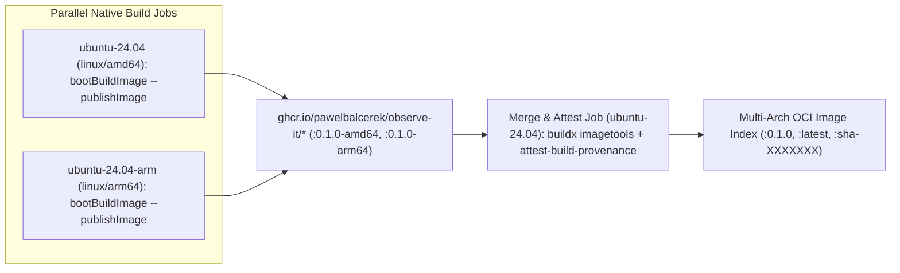

# Paketo `bootBuildImage` Multi-Arch GHCR Publishing and Release Automation

Research for wayfinder ticket "Paketo bootBuildImage multi-arch GHCR publishing and GitHub Actions release automation".
Throwaway branch, never merged.

## Context & Research Scope

This research document investigates how Spring Boot 4.1.2 (`bootBuildImage` with Paketo Cloud Native Buildpacks and
`docker.io/paketobuildpacks/opentelemetry:2.31.0`) and GitHub Actions support building and publishing container images
for the **Observed App** (`observed-app`) and **Traffic Generator** (`traffic-generator`) to GitHub Container Registry
(`ghcr.io`). Specifically, it covers:

1. Direct registry publishing (`bootBuildImage --publishImage` vs. local Docker daemon build + `docker push`),
   authentication with `GITHUB_TOKEN` (`packages: write`), and image naming/tagging conventions (`0.1.0`, `latest`, git
   SHA).
2. Multi-architecture (`linux/amd64` and `linux/arm64`) image builds and `imagePlatform` behavior with Paketo Java and
   OpenTelemetry buildpacks on GitHub Actions runners.
3. GitHub Release automation options (tag-triggered workflow with `gh release create --generate-notes` and
   `.github/release.yml` vs. `googleapis/release-please-action`), SLSA build provenance attestations
   (`actions/attest-build-provenance`), and how
   [`docker-compose.yml`](https://github.com/PawelBalcerek/observe-it/blob/main/docker-compose.yml) can support both
   pre-built GHCR images and local `bootBuildImage` builds.

All claims below are verified against primary sources (official Spring Boot 4.1.2 bytecode and reference documentation,
Paketo Buildpacks repositories, GitHub Docs, `actions/attest-build-provenance`, `googleapis/release-please-action`, and
the Docker Compose Specification).

## 1. Direct GHCR Publishing, Authentication, and Tagging

### How `bootBuildImage` Builds, Tags, and Publishes Under the Hood

Inspection of `org.springframework.boot.gradle.tasks.bundling.BootBuildImage`,
`org.springframework.boot.buildpack.platform.build.Builder`, and
`org.springframework.boot.buildpack.platform.build.Lifecycle` in `spring-boot-gradle-plugin:4.1.2` and
`spring-boot-buildpack-platform:4.1.2` establishes the exact lifecycle execution flow:

1. **Daemon-bound CNB lifecycle export**: `Lifecycle.createPhase()` and `Lifecycle.exportPhase()` unconditionally invoke
   `configureDaemonAccess(phase)`, which binds `/var/run/docker.sock` (or `DOCKER_HOST`) into the Cloud Native
   Buildpacks (CNB) lifecycle container. The CNB `creator` (or `exporter` when `trustBuilder` is false) always exports
   the resulting image into the local Docker daemon under `imageName` (`BuildRequest.getName()`). `BootBuildImage` does
   not use CNB registry-direct daemonless export.
2. **Additional tags (`tags`)**: After `Lifecycle.execute()` finishes, `Builder.build(BuildRequest)` invokes
   `Builder.tagImage(request.getName(), request.getTags())`, calling the Docker Engine API (`DockerApi.ImageApi.tag`) to
   apply each tag in `BootBuildImage.getTags()` to the locally exported image.
3. **Registry push (`publish` / `--publishImage`)**: When `publish.set(true)` is configured in the Gradle DSL or
   `--publishImage` is passed on the command line (`@Option(option = "publishImage")`), `Builder.build(BuildRequest)`
   invokes `Builder.pushImages(request.getName(), request.getTags())`. This method pushes the primary `imageName` first
   and then iterates through every reference in `tags`, calling `DockerApi.ImageApi.push` (`POST
   /v1.xx/images/{name}/push`) for each reference.

Because `bootBuildImage --publishImage` pushes via the local Docker daemon API after exporting to the daemon, there is
no architectural difference in layer construction between `bootBuildImage --publishImage` and running `bootBuildImage`
followed by `docker push`:

| Aspect                             | `./gradlew bootBuildImage --publishImage`                                                                                               | `./gradlew bootBuildImage` + `docker push` / `docker buildx imagetools`                                            |
| :--------------------------------- | :-------------------------------------------------------------------------------------------------------------------------------------- | :----------------------------------------------------------------------------------------------------------------- |
| **Lifecycle export target**        | Local Docker daemon (`/var/run/docker.sock`), then pushed via `DockerApi.ImageApi.push`                                                 | Local Docker daemon (`/var/run/docker.sock`), then pushed via Docker CLI                                           |
| **Registry credential resolution** | `docker.publishRegistry` DSL or automatic fallback to `~/.docker/config.json` (`DockerRegistryConfigAuthentication`)                    | `~/.docker/config.json` populated by `docker/login-action@v4` or `docker login`                                    |
| **CLI overrides**                  | Supports `--imageName`, `--publishImage`, `--imagePlatform`, `--builder`, `--runImage`, `--pullPolicy`; **no** `@Option` for `tags`     | Any number of tags or manifest merges can be applied with `docker tag`, `docker push`, or `docker buildx`          |
| **Image digest output**            | Logs digest to stdout (`BuildLog`), but does not expose a structured Gradle task output property for downstream GitHub Actions steps    | `docker inspect --format='{{index .RepoDigests 0}}'` or `docker buildx imagetools` provides exact `sha256:` digest |

### Registry Authentication with `GITHUB_TOKEN` and `packages: write`

In `org.springframework.boot.gradle.tasks.bundling.DockerSpec`, `customizePublishAuthentication` configures publish
authentication using `DockerSpec.getPublishRegistry()` and falls back to
`DockerRegistryAuthentication.configuration(DockerRegistryAuthentication.EMPTY_USER)`
(`DockerRegistryConfigAuthentication`) when `publishRegistry` has no properties set (`hasEmptyAuth() == true`).
`DockerRegistryConfigAuthentication` reads `$DOCKER_CONFIG/config.json` or `~/.docker/config.json` (including `auths`,
`credsStore`, and `credHelpers`).

Consequently, authenticating to `ghcr.io` in GitHub Actions supports two primary patterns:

1. **Docker config authentication via `docker/login-action@v4` (zero credential DSL in Gradle)**: Logging in with
   `docker/login-action@v4` writes credentials for `ghcr.io` into `~/.docker/config.json`. Both `./gradlew
   bootBuildImage --publishImage` (via `DockerRegistryConfigAuthentication`) and subsequent `docker` / `docker buildx`
   CLI commands automatically use those credentials without exposing secrets in Gradle build scripts.
2. **Explicit Gradle `docker.publishRegistry` DSL**: Setting `username`, `password`, and `url` (or `token`) on
   `bootBuildImage.docker.publishRegistry` from environment variables (`GITHUB_ACTOR` and `GITHUB_TOKEN`). Note that in
   `DockerSpec.getRegistryAuthentication`, providing partial credentials throws a `GradleException` (`"Invalid Docker
   publish registry configuration, either token or username/password must be provided"`), so `publishRegistry` should
   only be populated when credentials are present in the environment.

For `ghcr.io` authentication in GitHub Actions:

- **Job permissions**: The workflow or job must grant `packages: write` (and `contents: read`) so the automatic
  `GITHUB_TOKEN` is authorized to push container packages associated with the repository.
- **Package visibility & repository linking**: When a workflow pushes a container image to
  `ghcr.io/<owner>/<image-name>` using `GITHUB_TOKEN`, GitHub Container Registry automatically links the package to the
  source repository and inherits visibility/access settings according to the repository's package configuration.

### GHCR Naming Rules and Tagging Conventions

GitHub Container Registry namespaces packages under `ghcr.io/OWNER/IMAGE_NAME`, where `IMAGE_NAME` may include
additional slash-separated path segments (such as `ghcr.io/pawelbalcerek/observe-it/observed-app` and
`ghcr.io/pawelbalcerek/observe-it/traffic-generator`):

- **Strict lowercase requirement**: Both the OCI Distribution Specification and GHCR require repository namespaces and
  image names to be all lowercase. Because the GitHub repository owner `PawelBalcerek` contains uppercase letters,
  `${{ github.repository }}` (`PawelBalcerek/observe-it`) **must** be lowercased in GitHub Actions workflows (for
  example, `ghcr.io/pawelbalcerek/observe-it/${project.name}` in Gradle or `${GITHUB_REPOSITORY,,}` in `bash`) before
  building or pushing.
- **Dual-prefix tagging (local + GHCR)**: In
  [`build-logic/conventions/src/main/kotlin/conventions/spring.gradle.kts`](https://github.com/PawelBalcerek/observe-it/blob/main/build-logic/conventions/src/main/kotlin/conventions/spring.gradle.kts),
  keeping `imageName` defaulted to `observe-it/${project.name}:${project.version}` preserves compatibility with Gate 1
  of [`scripts/verify-m1.sh`](https://github.com/PawelBalcerek/observe-it/blob/main/scripts/verify-m1.sh) (which runs
  `docker image inspect observe-it/observed-app:0.1.0` and `docker image inspect observe-it/traffic-generator:0.1.0`),
  while `tags` (or `--imageName` in CI release jobs) can attach the `ghcr.io/pawelbalcerek/observe-it/${project.name}`
  references:
  - Semantic version tag: `0.1.0` (matching `project.version` and `OTEL_RESOURCE_ATTRIBUTES=service.version=0.1.0`).
  - Rolling release tag: `latest` (updated only on stable tagged releases, never on branch/PR builds).
  - Immutable revision tag: `sha-<7-char-commit>` (traceable to the exact commit SHA).

### Primary Sources (Section 1)

- [Spring Boot Gradle Plugin Reference — Packaging OCI Images](https://docs.spring.io/spring-boot/gradle-plugin/packaging.html#packaging-oci-images)
- [Spring Boot 4.1.2 API — `BootBuildImage`](https://docs.spring.io/spring-boot/api/java/org/springframework/boot/gradle/tasks/bundling/BootBuildImage.html)
- [Spring Boot 4.1.2 API — `DockerSpec`](https://docs.spring.io/spring-boot/api/java/org/springframework/boot/gradle/tasks/bundling/DockerSpec.html)
- [GitHub Docs — Working with the Container registry (`ghcr.io`)](https://docs.github.com/en/packages/working-with-a-github-packages-registry/working-with-the-container-registry)
- [GitHub Docs — Publishing and installing a package with GitHub Actions](https://docs.github.com/en/packages/managing-github-packages-using-github-actions-workflows/publishing-and-installing-a-package-with-github-actions)

## 2. Multi-Architecture (`linux/amd64` and `linux/arm64`) Builds with Paketo Buildpacks

### Paketo Builder, Java 25, and OpenTelemetry Buildpack Architecture Support

In Spring Boot 4.1.2, `BuildRequest.DEFAULT_BUILDER_IMAGE_REF` is
`paketobuildpacks/builder-noble-java-tiny:latest` (Ubuntu 24.04 Noble Numbat tiny stack):

1. **Builder and Run Images (`paketobuildpacks/builder-noble-java-tiny`)**: Published as multi-architecture OCI
   manifest lists supporting both `linux/amd64` and `linux/arm64`.
2. **Java Buildpack (`urn:cnb:builder:paketo-buildpacks/java`)**: Bundled inside `builder-noble-java-tiny` and uses
   `paketo-buildpacks/bellsoft-liberica` by default, which provisions BellSoft Liberica JRE/JDK 25 (`BP_JVM_VERSION=25`)
   natively for both `linux/amd64` and `linux/arm64`.
3. **OpenTelemetry Buildpack (`docker.io/paketobuildpacks/opentelemetry:2.31.0`)**: Published as a multi-architecture
   OCI buildpack image for both `linux/amd64` and `linux/arm64` targeting `io.buildpacks.stacks.noble` (and Jammy/Bionic
   stacks). Because the OpenTelemetry Java Agent (`opentelemetry-javaagent.jar`) is architecture-independent JVM
   bytecode, the buildpack layer is identical in behavior on `amd64` and `arm64`.

### How `imagePlatform` Works in `BootBuildImage` and Its Single-Platform Limitation

`BootBuildImage.getImagePlatform()` (configurable via `imagePlatform.set("linux/arm64")` or `--imagePlatform`) passes an
`ImagePlatform` (`os/architecture[/variant]`) into `Builder.build(BuildRequest)`. Bytecode inspection of
`Builder.build` and `Lifecycle.createContainer` in `spring-boot-buildpack-platform:4.1.2` shows that when
`imagePlatform` is set:

1. `Builder.ImageFetcher.fetchImage` pulls the builder image, run image (pinned by its platform-specific primary
   digest), and external buildpack images (`docker.io/paketobuildpacks/opentelemetry:2.31.0`) for the requested
   `ImagePlatform`.
2. `Lifecycle.createContainer` passes that `ImagePlatform` to `DockerApi.ContainerApi.create` for every lifecycle phase
   container (`creator` or `analyzer`/`detector`/`restorer`/`builder`/`exporter`).

**Critical limitation**: `BootBuildImage` accepts a single `Property<String>` for `imagePlatform` and exports a single
single-architecture image into the local Docker daemon per invocation. Neither `BootBuildImage` nor the underlying CNB
daemon exporter can produce a multi-architecture OCI Image Index (`application/vnd.oci.image.index.v1+json`) or Docker
Manifest List (`application/vnd.docker.distribution.manifest.list.v2+json`) in a single task run.

### Native Runners (`ubuntu-24.04` + `ubuntu-24.04-arm`) vs. QEMU Emulation

To publish a multi-architecture image to `ghcr.io` from GitHub Actions, each architecture must be built separately and
combined into a manifest list / OCI index. There are two execution strategies on GitHub Actions:

| Strategy                                                                  | Runner Labels                        | Execution Mechanism                                                                                                                               | Trade-offs                                                                                                                                                                                                   |
| :------------------------------------------------------------------------ | :----------------------------------- | :------------------------------------------------------------------------------------------------------------------------------------------------ | :----------------------------------------------------------------------------------------------------------------------------------------------------------------------------------------------------------- |
| **Native Matrix Runners + `docker buildx imagetools create` (Preferred)** | `ubuntu-24.04` & `ubuntu-24.04-arm`  | Each runner compiles and runs `bootBuildImage --publishImage` natively for its host CPU, pushing `-amd64` / `-arm64` tags; a merge job joins them | Fast native JVM/CNB execution (no QEMU overhead); `ubuntu-24.04-arm` (4 vCPU, 16 GB RAM) is free for public repositories; **caveat**: standard `ubuntu-24.04-arm` runners are not available on private repos |
| **Single Runner + QEMU (`docker/setup-qemu-action`) + `imagePlatform`**   | `ubuntu-24.04`                       | Installs `binfmt_misc` QEMU handlers and runs `bootBuildImage --imagePlatform=linux/arm64` inside emulated ARM64 lifecycle containers             | Works in private repositories without ARM64 runners, but running the JVM and CNB lifecycle under QEMU user-mode emulation is significantly slower and prone to higher memory/timeout pressure                |

Because `PawelBalcerek/observe-it` is a public repository, native matrix builds across `ubuntu-24.04` (`linux/amd64`)
and `ubuntu-24.04-arm` (`linux/arm64`) followed by `docker buildx imagetools create` avoid QEMU emulation entirely:



### Primary Sources (Section 2)

- [Paketo Buildpacks — Builders Reference (`builder-noble-java-tiny`)](https://paketo.io/docs/concepts/builders/)
- [Paketo OpenTelemetry Buildpack Repository (`paketo-buildpacks/opentelemetry`)](https://github.com/paketo-buildpacks/opentelemetry)
- [Paketo OpenTelemetry Buildpack `v2.31.0` Release](https://github.com/paketo-buildpacks/opentelemetry/releases/tag/v2.31.0)
- [Spring Boot Issue #25872 — Support `imagePlatform` in `bootBuildImage`](https://github.com/spring-projects/spring-boot/issues/25872)
- [GitHub Docs — About GitHub-hosted runners (Standard Linux ARM runners)](https://docs.github.com/en/actions/using-github-hosted-runners/using-github-hosted-runners/about-github-hosted-runners#standard-github-hosted-runners-for-public-repositories)
- [Docker Docs — `docker buildx imagetools create`](https://docs.docker.com/reference/cli/docker/buildx/imagetools/create/)

## 3. GitHub Release Automation, Provenance Attestations, and Dual-Mode Compose

### Option A vs. Option B for GitHub Release Automation

| Dimension                     | Option A: Tag-Triggered Workflow + `gh release create --generate-notes`                                                                  | Option B: `googleapis/release-please-action@v4`                                                                                                                                                                                               |
| :---------------------------- | :--------------------------------------------------------------------------------------------------------------------------------------- | :-------------------------------------------------------------------------------------------------------------------------------------------------------------------------------------------------------------------------------------------- |
| **Trigger mechanism**         | Maintainer pushes a git tag (`v0.1.0`) or dispatches workflow; `on: push: tags: ['v*']` triggers build + release                         | Every push to `main` updates a persistent Release PR; merging the Release PR tags the commit and creates the GitHub Release                                                                                                                   |
| **Version bump management**   | Manual (or scripted) update of `version` in `spring.gradle.kts` / `docker-compose.yml` before tagging                                    | Automated via `release-please-config.json` with `release-type: "simple"` and `extra-files` (`x-release-please-version` inline markers in `.kts` and `.yml` files)                                                                             |
| **Changelog generation**      | Server-side GitHub release notes categorized by PR labels via `.github/release.yml`                                                      | Conventional Commits (`feat:`, `fix:`) parsed into `CHANGELOG.md` and the GitHub Release body                                                                                                                                                 |
| **`GITHUB_TOKEN` limitation** | Pushing a tag from local git CLI (or creating a tag in the UI) directly triggers the `on: push: tags` workflow using `GITHUB_TOKEN`      | Tags/releases created by `release-please` using `GITHUB_TOKEN` **do not** trigger separate `on: push: tags` or `on: release` workflows; publish jobs must run in the same workflow file or use a PAT/App                                      |
| **Fit for Observe-It**        | Minimal moving parts; aligns with milestone-driven releases (`0.1.0`, `0.2.0`, `0.3.0`) without automated bot PR churn on every merge    | Best if frequent automated SemVer bumps and a committed `CHANGELOG.md` are desired; matches the repository's `feat:` / `fix:` commit convention in [`CONTRIBUTING.md`](https://github.com/PawelBalcerek/observe-it/blob/main/CONTRIBUTING.md) |

#### Option A Configuration: `.github/release.yml` + `gh release create --generate-notes`

With `.github/release.yml`, GitHub automatically groups merged pull requests and excludes bot noise when
`gh release create <tag> --generate-notes` runs:

```yaml
changelog:
  exclude:
    labels:
      - wontfix
    authors:
      - dependabot
  categories:
    - title: Features & Observability Capabilities
      labels:
        - enhancement
        - feat
    - title: Bug Fixes
      labels:
        - bug
        - fix
    - title: Documentation & Guides
      labels:
        - documentation
        - docs
    - title: Other Changes
      labels:
        - "*"
```

#### Option B Configuration: `googleapis/release-please-action@v4` with `extra-files`

If `release-please` is chosen instead, `release-type: "simple"` reads `version.txt` and can update
`build-logic/conventions/src/main/kotlin/conventions/spring.gradle.kts`, `docker-compose.yml`, and
`scripts/verify-m1.sh` via `extra-files` generic updaters whenever lines are annotated with
`// x-release-please-version` or `# x-release-please-version`. Because events created with `GITHUB_TOKEN` do not trigger
new workflow runs, the container build and publish jobs must be wired as downstream `needs: [release-please]` jobs in
the same workflow gated on `if: ${{ needs.release-please.outputs.release_created == 'true' }}`.

### Artifact Provenance Attestations (`actions/attest-build-provenance@v4`)

`actions/attest-build-provenance@v4` generates a SLSA v1.0 build provenance predicate, signs it via Sigstore Fulcio
using GitHub Actions' OIDC token (`id-token: write`), records the signature in the public transparency log (for public
repositories), and—when `push-to-registry: true` is set—pushes the attestation directly to `ghcr.io` as an OCI Referrers
manifest attached to the image digest:

- **Required permissions**: `id-token: write`, `attestations: write`, `packages: write`, and `contents: read`.
- **Attesting a multi-arch OCI Image Index**: After `docker buildx imagetools create` publishes the merged multi-arch
  manifest index for `observed-app` and `traffic-generator`, inspect or capture the root index `sha256:...` digest and
  pass it to `actions/attest-build-provenance@v4`:
  - `subject-name`: `ghcr.io/pawelbalcerek/observe-it/observed-app` (must **not** include a `:tag` suffix).
  - `subject-digest`: `sha256:<64-hex-digest>` of the multi-arch manifest index.
  - `push-to-registry`: `true`.
- **Consumer verification**: Anyone pulling the image can verify its provenance with the GitHub CLI:

```bash
gh attestation verify oci://ghcr.io/pawelbalcerek/observe-it/observed-app:0.1.0 --owner PawelBalcerek
gh attestation verify oci://ghcr.io/pawelbalcerek/observe-it/traffic-generator:0.1.0 --owner PawelBalcerek
```

### Reference GitHub Actions Workflow (`.github/workflows/release.yml`)

The following workflow illustrates the complete multi-arch native build, GHCR manifest index merge, SLSA provenance
attestation, and GitHub Release creation flow:

```yaml
name: Release & Publish Images

on:
  push:
    tags:
      - 'v*'
  workflow_dispatch:
    inputs:
      publish-release:
        description: 'Create GitHub Release (false for dry-run image publish)'
        type: boolean
        default: false

env:
  REGISTRY: ghcr.io
  IMAGE_PREFIX: ghcr.io/pawelbalcerek/observe-it

permissions:
  contents: read

jobs:
  build-arch-images:
    name: Build & Push (${{ matrix.arch }})
    runs-on: ${{ matrix.runner }}
    permissions:
      contents: read
      packages: write
    strategy:
      fail-fast: false
      matrix:
        include:
          - arch: amd64
            runner: ubuntu-24.04
            platform: linux/amd64
          - arch: arm64
            runner: ubuntu-24.04-arm
            platform: linux/arm64
    steps:
      - name: Checkout repository
        uses: actions/checkout@3d3c42e5aac5ba805825da76410c181273ba90b1 # v7.0.1

      - name: Set up JDK 25 (Temurin)
        uses: actions/setup-java@b843ebf9b913146b38da2eaa7aeddf76074ae1ad # v6.1.0
        with:
          java-version: '25'
          distribution: temurin

      - name: Setup Gradle
        uses: gradle/actions/setup-gradle@8da46b539cd8fe6ab27ca75128919a18d757604c # v6.4.1

      - name: Log in to GitHub Container Registry
        uses: docker/login-action@v4
        with:
          registry: ${{ env.REGISTRY }}
          username: ${{ github.actor }}
          password: ${{ secrets.GITHUB_TOKEN }}

      - name: Build and push architecture-specific images
        env:
          SHORT_SHA: ${{ github.sha }}
        run: |
          SHA_TAG="sha-${SHORT_SHA::7}-${{ matrix.arch }}"
          ./gradlew :observed-app:bootBuildImage \
            --imageName="${IMAGE_PREFIX}/observed-app:${SHA_TAG}" \
            --imagePlatform="${{ matrix.platform }}" \
            --publishImage
          ./gradlew :traffic-generator:bootBuildImage \
            --imageName="${IMAGE_PREFIX}/traffic-generator:${SHA_TAG}" \
            --imagePlatform="${{ matrix.platform }}" \
            --publishImage

  merge-and-attest:
    name: Merge Multi-Arch Index & Attest
    needs: build-arch-images
    runs-on: ubuntu-24.04
    permissions:
      contents: write
      packages: write
      id-token: write
      attestations: write
    steps:
      - name: Checkout repository
        uses: actions/checkout@3d3c42e5aac5ba805825da76410c181273ba90b1 # v7.0.1

      - name: Log in to GitHub Container Registry
        uses: docker/login-action@v4
        with:
          registry: ${{ env.REGISTRY }}
          username: ${{ github.actor }}
          password: ${{ secrets.GITHUB_TOKEN }}

      - name: Create and push multi-arch OCI image indices
        id: merge
        env:
          SHORT_SHA: ${{ github.sha }}
          REF_NAME: ${{ github.ref_name }}
          REF_TYPE: ${{ github.ref_type }}
        run: |
          SHA_PREFIX="sha-${SHORT_SHA::7}"
          VERSION="${REF_NAME#v}"

          for SERVICE in observed-app traffic-generator; do
            TAGS=(--tag "${IMAGE_PREFIX}/${SERVICE}:${SHA_PREFIX}")
            if [ "${REF_TYPE}" = "tag" ]; then
              TAGS+=(--tag "${IMAGE_PREFIX}/${SERVICE}:${VERSION}" --tag "${IMAGE_PREFIX}/${SERVICE}:latest")
            fi

            docker buildx imagetools create "${TAGS[@]}" \
              "${IMAGE_PREFIX}/${SERVICE}:${SHA_PREFIX}-amd64" \
              "${IMAGE_PREFIX}/${SERVICE}:${SHA_PREFIX}-arm64"

            DIGEST="$(docker buildx imagetools inspect "${IMAGE_PREFIX}/${SERVICE}:${SHA_PREFIX}" \
              --format '{{json .Manifest}}' | jq -r .digest)"
            echo "${SERVICE}-digest=${DIGEST}" >> "${GITHUB_OUTPUT}"
          done

      - name: Attest observed-app build provenance
        uses: actions/attest-build-provenance@v4
        with:
          subject-name: ${{ env.IMAGE_PREFIX }}/observed-app
          subject-digest: ${{ steps.merge.outputs.observed-app-digest }}
          push-to-registry: true

      - name: Attest traffic-generator build provenance
        uses: actions/attest-build-provenance@v4
        with:
          subject-name: ${{ env.IMAGE_PREFIX }}/traffic-generator
          subject-digest: ${{ steps.merge.outputs.traffic-generator-digest }}
          push-to-registry: true

      - name: Create GitHub Release
        if: github.ref_type == 'tag'
        env:
          GH_TOKEN: ${{ secrets.GITHUB_TOKEN }}
        run: |
          gh release create "${{ github.ref_name }}" \
            --title "${{ github.ref_name }}" \
            --generate-notes
```

### Dual-Mode `docker-compose.yml`: Supporting Both Pre-Built GHCR Images and Local `bootBuildImage`

Currently, [`docker-compose.yml`](https://github.com/PawelBalcerek/observe-it/blob/main/docker-compose.yml) hardcodes
`image: observe-it/observed-app:0.1.0` and `pull_policy: never`. Under the Docker Compose Specification:

- `pull_policy: never` instructs Compose to never pull from a registry and fail if the image is absent from the local
  Docker daemon.
- `pull_policy: missing` (the Compose default when `pull_policy` is omitted, aliased as `if_not_present`) uses the
  local image in the Docker daemon if it already exists and only pulls from the registry when the image is missing
  locally.
- `pull_policy: always` forces a pull from the registry even when a local image with that tag exists.
- Compose supports `${VARIABLE:-default}` parameter expansion in both `image:` and `pull_policy:`.

By configuring `build-logic/conventions/src/main/kotlin/conventions/spring.gradle.kts` to tag local builds with both
`observe-it/${project.name}:${project.version}` and `ghcr.io/pawelbalcerek/observe-it/${project.name}:${project.version}`:

```kotlin
tasks.named<BootBuildImage>("bootBuildImage") {
    imageName.set("observe-it/${project.name}:${project.version}")
    tags.set(
        listOf(
            "ghcr.io/pawelbalcerek/observe-it/${project.name}:${project.version}"
        )
    )
    // ...
}
```

and updating `docker-compose.yml` to use variable interpolation with `missing` as the default `pull_policy`:

```yaml
  observed-app:
    image: ${OBSERVE_IT_IMAGE_PREFIX:-ghcr.io/pawelbalcerek/observe-it}/observed-app:${OBSERVE_IT_IMAGE_TAG:-0.1.0}
    container_name: observed-app
    pull_policy: ${OBSERVE_IT_PULL_POLICY:-missing}
```

both workflows work seamlessly without duplicating Compose files:

| User / CI Workflow                             | Command                                                     | Behavior with `pull_policy: ${OBSERVE_IT_PULL_POLICY:-missing}`                                                                                                           |
| :--------------------------------------------- | :---------------------------------------------------------- | :------------------------------------------------------------------------------------------------------------------------------------------------------------------------ |
| **Zero-build Quick Start (pre-built GHCR)**    | `docker compose up -d`                                      | Image is not in local Docker daemon → Compose pulls `ghcr.io/pawelbalcerek/observe-it/*:0.1.0` for the host's native architecture (`linux/amd64` or `linux/arm64`)        |
| **Local development (`make up` / Gradle)**     | `./gradlew bootBuildImage && docker compose up -d`          | `bootBuildImage` populates `ghcr.io/pawelbalcerek/observe-it/*:0.1.0` (and `observe-it/*:0.1.0`) in the local daemon → `pull_policy: missing` uses the local image as-is  |
| **Strict offline / CI E2E verification**       | `OBSERVE_IT_PULL_POLICY=never docker compose up -d`         | Fails fast if `bootBuildImage` did not produce the local image, guaranteeing E2E tests in `.github/workflows/e2e.yml` never accidentally test a stale registry image      |
| **Force refresh from GHCR**                    | `OBSERVE_IT_PULL_POLICY=always docker compose up -d`        | Always pulls the latest manifest from `ghcr.io` even if a local build exists                                                                                              |

> [!IMPORTANT]
> If a developer runs `docker compose up -d` before `./gradlew bootBuildImage`, the pulled GHCR image satisfies
> `pull_policy: missing`, and a subsequent `./gradlew bootBuildImage` overwrites the local tag in the Docker daemon so
> `docker compose up -d` recreates the container from the newly built local image. In `.github/workflows/e2e.yml`,
> setting `OBSERVE_IT_PULL_POLICY: never` ensures PR verification strictly tests the locally built image from the PR
> commit.

### Primary Sources (Section 3)

- [GitHub Docs — Automatically generated release notes (`.github/release.yml`)](https://docs.github.com/en/repositories/releasing-projects-on-github/automatically-generated-release-notes)
- [GitHub CLI Manual — `gh release create`](https://cli.github.com/manual/gh_release_create)
- [`googleapis/release-please-action` Repository & Documentation](https://github.com/googleapis/release-please-action)
- [Release Please — Customizing / `extra-files` and Generic Updaters](https://github.com/googleapis/release-please/blob/main/docs/customizing.md)
- [GitHub Docs — Using artifact attestations to establish provenance for builds](https://docs.github.com/en/actions/security-for-github-actions/using-artifact-attestations/using-artifact-attestations-to-establish-provenance-for-builds)
- [`actions/attest-build-provenance` Repository (`v4`)](https://github.com/actions/attest-build-provenance)
- [Docker Compose Specification — `pull_policy`](https://docs.docker.com/reference/compose-file/services/#pull_policy)
- [Docker Compose Specification — Variable Interpolation](https://docs.docker.com/reference/compose-file/interpolation/)
