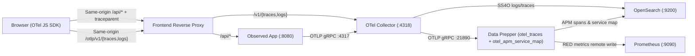

# OpenTelemetry Browser Observability with OpenSearch & OTel Collector

Research notes for Wayfinder ticket [#181](https://github.com/PawelBalcerek/observe-it/issues/181) (under map
[#179](https://github.com/PawelBalcerek/observe-it/issues/179), informing decision ticket
[#184](https://github.com/PawelBalcerek/observe-it/issues/184)).

## Executive Summary

OpenSearch 3.x has no proprietary Real User Monitoring (RUM) agent; its Observability stack is OpenTelemetry-native and
ingests browser telemetry over standard OTLP/HTTP into the same OpenTelemetry Collector → Data Prepper + Prometheus →
OpenSearch Dashboards **Observability Workspace** pipeline already deployed in Observe-It.

Key findings from primary sources and Observe-It's current configuration:

1. **OTel JS SDK v3.0.0 package consolidation**: `@opentelemetry/sdk-trace-web` was replaced by the unified
   `@opentelemetry/sdk-trace` package (introduced in v2.9.0; `sdk-trace-*` removed in v3.0.0). The dedicated
   `open-telemetry/opentelemetry-browser` SDK (`@opentelemetry/browser-sdk`) is currently `experimental`.
2. **Same-origin reverse proxy over direct Collector `:4318`**: Proxying both `/api/*` (to **Observed App**) and
   `/otlp/*` (to `otel-collector:4318`) through a single origin (matching `open-telemetry/opentelemetry-demo`) avoids
   exposing Collector port `4318`, eliminates CORS preflight overhead on both API calls and OTLP exports, and enables
   automatic same-origin `traceparent` injection without `propagateTraceHeaderCorsUrls` or backend CORS configuration.
3. **Traces & APM Service Map work out of the box**: `@opentelemetry/instrumentation-fetch` emits `SpanKind.CLIENT`
   spans and injects W3C `traceparent`, which **Observed App** extracts into child `SpanKind.SERVER` spans. Data
   Prepper's `otel_apm_service_map` correlates `CLIENT` → `SERVER` pairs into a directed edge (`frontend` →
   **Observed App** → `mongodb`) in the **APM Service Map Index** and remote-writes RED metrics to the
   **Prometheus Metrics Store**.
4. **Logs & Web Vitals fit **SS4O Log Index** cleanly**: `@opentelemetry/sdk-logs` automatically attaches active
   `traceId` and `spanId` (when `ZoneContextManager` is enabled), enabling Dashboards trace-to-log correlation. Official
   OTel Browser Semantic Conventions model Web Vitals (`browser.web_vital`) as log-based events rather than Prometheus
   metrics, avoiding Prometheus TSDB out-of-order/duplicate-sample rejections and per-tab cardinality explosions.

## 1. OpenTelemetry JS Browser SDK Landscape

### Tracing SDK (`@opentelemetry/sdk-trace` v3.x vs. legacy `@opentelemetry/sdk-trace-web`)

In June 2026, OpenTelemetry JS introduced `@opentelemetry/sdk-trace` (v2.9.0) to replace `@opentelemetry/sdk-trace-base`,
`@opentelemetry/sdk-trace-node`, and `@opentelemetry/sdk-trace-web`; as part of OTel JS SDK 3.0.0 (fall 2026),
`@opentelemetry/sdk-trace-web` was removed
([`opentelemetry-js` v3.0.0 `sdk-trace-web` README](https://github.com/open-telemetry/opentelemetry-js/blob/v3.0.0/packages/opentelemetry-sdk-trace-web/README.md)).
Meanwhile, the new browser-focused SDK repository
([`open-telemetry/opentelemetry-browser`](https://github.com/open-telemetry/opentelemetry-browser/tree/main/packages/sdk/))
marks `@opentelemetry/browser-sdk`, `@opentelemetry/browser-api`, and `@opentelemetry/browser-instrumentation` as
`experimental`.

For a stable browser setup on OTel JS v3.x:

- Use `TracerProvider` and `BatchSpanProcessor` from `@opentelemetry/sdk-trace`, passing `resource` (created via
  `resourceFromAttributes` from `@opentelemetry/resources`) and `spanProcessors` in the constructor—`addSpanProcessor()`
  and `register()` were removed from the base provider in v2.x/v3.x
  ([`opentelemetry-js` v2.x upgrade guide](https://github.com/open-telemetry/opentelemetry-js/blob/v3.0.0/doc/upgrade-to-2.x.md)).
- Register providers explicitly via `@opentelemetry/api`: `trace.setGlobalTracerProvider(provider)`,
  `context.setGlobalContextManager(new ZoneContextManager().enable())`, and `propagation.setGlobalPropagator(...)`
  ([`opentelemetry-browser-detector` README](https://github.com/open-telemetry/opentelemetry-js/blob/v3.0.0/experimental/packages/opentelemetry-browser-detector/README.md)).
- Optionally merge `detectResources({ detectors: [browserDetector] })` from
  `@opentelemetry/opentelemetry-browser-detector` to populate browser platform, brands, mobile, language, or
  `user_agent.original` resource attributes.

### OTLP/HTTP Export & W3C Propagation

- **Transport**: `@opentelemetry/exporter-trace-otlp-http` (`OTLPTraceExporter`) sends OTLP/HTTP JSON payloads
  (`Content-Type: application/json`) using the browser `fetch` API to `<endpoint>/v1/traces` (defaulting to
  `http://localhost:4318/v1/traces`)
  ([`exporter-trace-otlp-http` README](https://github.com/open-telemetry/opentelemetry-js/blob/v3.0.0/experimental/packages/exporter-trace-otlp-http/README.md)).
- **Context & Propagation**:
  - `ZoneContextManager` (`@opentelemetry/context-zone`) is required in browsers to preserve active span context across
    asynchronous callbacks (`Promise`, `setTimeout`, `fetch`) so `fetch` spans and log records inherit their parent
    user-interaction or workflow span
    ([`opentelemetry-js` Context docs](https://github.com/open-telemetry/opentelemetry-js/blob/main/doc/context.md)).
    Without a context manager, `context.active()` always returns `ROOT_CONTEXT`.
  - `CompositePropagator` with `W3CTraceContextPropagator` (and optionally `W3CBaggagePropagator`) from
    `@opentelemetry/core` injects W3C `traceparent` / `tracestate` headers matching the OpenTelemetry Java Agent default
    on **Observed App**.

### Core Browser Instrumentations

| Package                                           | Emitted Spans & Kind                             | Key Configuration & Notes                                                                                  |
| :------------------------------------------------ | :----------------------------------------------- | :--------------------------------------------------------------------------------------------------------- |
| `@opentelemetry/instrumentation-fetch`            | Outgoing `fetch()` requests (`SpanKind.CLIENT`)  | Set `ignoreUrls` to exclude OTLP export URLs; set `propagateTraceHeaderCorsUrls` for cross-origin APIs.    |
| `@opentelemetry/instrumentation-xml-http-request` | Outgoing XHR requests (`SpanKind.CLIENT`)        | Only needed if frontend libraries use XHR instead of `fetch`. Same `ignoreUrls` / CORS rules apply.        |
| `@opentelemetry/instrumentation-document-load`    | `documentLoad`, `documentFetch`, `resourceFetch` | Captures Navigation/Resource Timing; supports `applyCustomAttributesOnSpan` hooks.                         |
| `@opentelemetry/instrumentation-user-interaction` | DOM events (`click` by default)                  | Configure `eventNames` (e.g., `['click', 'submit']`); requires `ZoneContextManager` to parent async calls. |

Official docs note that `@opentelemetry/auto-instrumentations-web` bundles all web instrumentations, but installing
individual packages avoids inflating the browser bundle
([OpenTelemetry JS Libraries](https://opentelemetry.io/docs/languages/js/libraries/)).

## 2. Browser Errors, Logs & Web Vitals

### Browser Logs & Errors (`@opentelemetry/sdk-logs` vs. Span Events)

`@opentelemetry/sdk-logs` paired with `@opentelemetry/exporter-logs-otlp-http` (`OTLPLogExporter`, posting JSON to
`/v1/logs` via `fetch`) provides structured browser log ingestion
([`exporter-logs-otlp-http` README](https://github.com/open-telemetry/opentelemetry-js/blob/main/experimental/packages/exporter-logs-otlp-http/README.md),
[`OTLPLogExporter.ts`](https://github.com/open-telemetry/opentelemetry-js/blob/main/experimental/packages/exporter-logs-otlp-http/src/platform/browser/OTLPLogExporter.ts)):

- **Automatic trace correlation**: `Logger.emit()` synchronously captures `logRecord.context || context.active()`, and
  `LogRecordImpl` extracts `traceId`, `spanId`, and `traceFlags` via `api.trace.getSpanContext(context)` before async
  batching
  ([`Logger.ts`](https://github.com/open-telemetry/opentelemetry-js/blob/main/packages/sdk-logs/src/Logger.ts),
  [`LogRecordImpl.ts`](https://github.com/open-telemetry/opentelemetry-js/blob/main/packages/sdk-logs/src/LogRecordImpl.ts)).
  When a span is active (via `ZoneContextManager`) or passed explicitly on `LogRecord.context`, browser logs correlate
  directly with traces in OpenSearch Dashboards.
- **Page-unload flushing**: `BatchLogRecordProcessor` automatically flushes buffered records on `visibilitychange` /
  page hide by default (`disableAutoFlushOnDocumentHide?: boolean`, default `false`)
  ([`sdk-logs/src/types.ts`](https://github.com/open-telemetry/opentelemetry-js/blob/main/packages/sdk-logs/src/types.ts)).
- **Span events vs. logs**:
  - Use `span.recordException(error)` + `SpanStatusCode.ERROR` for unexpected failures inside an active operation span
    (producing a standard `exception` span event with `exception.type`, `exception.message`, `exception.stacktrace` per
    [OTel Exceptions on Spans](https://opentelemetry.io/docs/specs/semconv/exceptions/exceptions-spans/)).
  - Use `@opentelemetry/sdk-logs` for global unhandled browser errors (`window.addEventListener('error', ...)`,
    `unhandledrejection`), structured client-side audit/UI logs, and `browser.web_vital` events.
- **Observe-It SS4O log pipeline alignment**:
  [`docker/opensearch/ingest-pipeline.json`](https://github.com/PawelBalcerek/observe-it/blob/main/docker/opensearch/ingest-pipeline.json)
  (`observe-it-logs-pipeline`) promotes `body` → `message`, `severity.text` → `level`, `instrumentationScope.name` →
  `logger`, `resource['service.name']` → `service`, `resource['service.version']` → `version`,
  `resource['deployment.environment.name']` → `env`, and `attributes['exception.stacktrace']` → `exception`. Browser
  log records should always populate `severityText` (`INFO`, `WARN`, `ERROR`), `body`, and those three resource
  attributes so they query identically alongside **Observed App** and **Traffic Generator** logs in the
  **SS4O Log Index** and resolve via the existing `trace-to-logs-otel-v1-apm-span` correlation (`traceId`, `spanId`,
  `message`, `@timestamp`) in
  [`docker/opensearch/bootstrap.sh`](https://github.com/PawelBalcerek/observe-it/blob/main/docker/opensearch/bootstrap.sh).

### Web Vitals & Browser Metrics

OpenTelemetry's official Browser Semantic Conventions define Core Web Vitals (CLS, LCP, INP, FCP, TTFB) as a
**log-based event** named `browser.web_vital` rather than a raw metric stream
([OTel Semantic Conventions: Browser Events](https://opentelemetry.io/docs/specs/semconv/browser/browser-events/)):

| Attribute                           | Requirement | Type   | Example                              |
| :---------------------------------- | :---------- | :----- | :----------------------------------- |
| `browser.web_vital.name`            | Required    | string | `lcp`, `cls`, `inp`, `fcp`, `ttfb`   |
| `browser.web_vital.value`           | Required    | double | `1240.5`                             |
| `browser.web_vital.delta`           | Required    | double | `0.2`                                |
| `browser.web_vital.id`              | Required    | string | `v3-1677874579383-6381583661209`     |
| `browser.web_vital.rating`          | Recommended | string | `good`, `needs_improvement`, `poor`  |
| `browser.web_vital.navigation_type` | Recommended | string | `navigate`, `reload`, `back_forward` |

Using Google's `web-vitals` library to emit `browser.web_vital` records through `@opentelemetry/sdk-logs` routes Web
Vitals cleanly into the **SS4O Log Index** (`ss4o_logs-*`) where OpenSearch Dashboards can aggregate percentiles,
ratings, and page breakdowns without touching Prometheus.

By contrast, pushing browser metrics directly via `@opentelemetry/sdk-metrics` +
`@opentelemetry/exporter-metrics-otlp-http` (`/v1/metrics`, cumulative temporality by default per
[`exporter-metrics-otlp-http` README](https://github.com/open-telemetry/opentelemetry-js/blob/main/experimental/packages/opentelemetry-exporter-metrics-otlp-http/README.md))
hits a known **Prometheus OTLP receiver pitfall**:

- Prometheus's TSDB is append-only and rejects concurrent samples with equal or older timestamps for the same label set
  as out-of-order/duplicate samples
  ([Prometheus OTLP docs](https://prometheus.io/docs/guides/opentelemetry/)).
- Observe-It's
  [`docker/prometheus/prometheus.yml`](https://github.com/PawelBalcerek/observe-it/blob/main/docker/prometheus/prometheus.yml)
  currently promotes only `service.name`, `service.version`, and `deployment.environment.name` (no `service.instance.id`
  and no `storage.tsdb.out_of_order_time_window`).
- If multiple browser tabs push metrics without a unique `service.instance.id`, their samples collide and get dropped by
  Prometheus; if each tab generates a random UUID `service.instance.id` and Prometheus promotes it, ephemeral browser
  tabs create unbounded time-series cardinality.
- Note that Observe-It's `metrics/opensearch` pipeline also applies `cumulative_to_delta` before indexing into the
  **SS4O Metrics Index**, which assumes a stable per-process cumulative counter stream rather than short-lived browser
  tabs.

**Recommendation**: Emit Web Vitals as `browser.web_vital` OTel log events into the **SS4O Log Index** (following OTel
semconv). If Prometheus metrics for frontend traffic are desired, rely on Data Prepper's span-derived RED metrics (from
browser `CLIENT` and backend `SERVER` spans) or derive aggregated metrics in the Collector rather than pushing raw
per-tab `@opentelemetry/sdk-metrics` directly to Prometheus.

## 3. Collector Ingestion Path: Reverse Proxy vs. Direct OTLP/HTTP (`:4318`)

Currently,
[`docker/otel-collector/config.yaml`](https://github.com/PawelBalcerek/observe-it/blob/main/docker/otel-collector/config.yaml)
enables `receivers.otlp.protocols.http` on `0.0.0.0:4318`, but
[`docker-compose.yml`](https://github.com/PawelBalcerek/observe-it/blob/main/docker-compose.yml) does not expose port
`4318` to the host and `config.yaml` has no `cors:` block.



### Option A: Same-Origin Reverse Proxy (Recommended)

Matches the reference architecture in
[`open-telemetry/opentelemetry-demo`](https://github.com/open-telemetry/opentelemetry-demo) (Envoy `frontend-proxy` /
Next.js proxy):

- Serve the SPA, proxy `/api/*` → `http://observed-app:8080`, and proxy `/otlp/*` → `http://otel-collector:4318`
  (rewriting `/otlp/` → `/`) from one origin.
- **No CORS configuration** needed on either **Observed App** or OTel Collector, and zero `OPTIONS` preflight requests
  on API or OTLP calls.
- `FetchInstrumentation` automatically injects `traceparent` on same-origin `/api/*` requests without configuring
  `propagateTraceHeaderCorsUrls`.
- Keeps `otel-collector:4318` private to `observe-it-net` (not exposed on host ports).

### Option B: Direct OTLP/HTTP Exposure (`127.0.0.1:4318`) with CORS

If the frontend runs on a separate origin (e.g., standalone Vite dev server without a proxy):

1. Publish `127.0.0.1:4318:4318` on `otel-collector` in `docker-compose.yml`.
2. Add `cors:` under `receivers.otlp.protocols.http` in `docker/otel-collector/config.yaml`
   ([`opentelemetry-collector` v0.164.0 `confighttp` README](https://github.com/open-telemetry/opentelemetry-collector/blob/v0.164.0/config/confighttp/README.md)):

   ```yaml
   receivers:
     otlp:
       protocols:
         http:
           endpoint: 0.0.0.0:4318
           cors:
             allowed_origins:
               - "http://localhost:3000"
             allowed_headers:
               - "*"
             max_age: 7200
   ```

   > [!WARNING]
   > Never set `allowed_origins: ["*"]` in the OTel Collector HTTP receiver. Collector's `confighttp` returns
   > `Access-Control-Allow-Credentials: true`, which causes browsers to reject a plain `*` wildcard per the Fetch/CORS
   > standard; list explicit origins (or scheme wildcards like `http://*`) instead
   > ([`confighttp` README](https://github.com/open-telemetry/opentelemetry-collector/blob/v0.164.0/config/confighttp/README.md)).

3. Configure CORS on **Observed App** to allow the frontend origin and explicitly include `traceparent` and `tracestate`
   in `Access-Control-Allow-Headers`.
4. Configure `propagateTraceHeaderCorsUrls` in `FetchInstrumentation` to match **Observed App**'s URL (same-origin
   requests propagate automatically, cross-origin requests do not unless explicitly matched).

## 4. OpenSearch 3.x & Data Prepper Integration

### Native RUM vs. OTel-Native APM

OpenSearch 3.x does not ship a proprietary browser RUM SDK; its official APM documentation prescribes standard
OpenTelemetry SDKs sending OTLP to the OpenTelemetry Collector, processed by Data Prepper into OpenSearch and Prometheus
and visualized in OpenSearch Dashboards' **Observability Workspace**
([OpenSearch APM docs](https://docs.opensearch.org/latest/observing-your-data/apm/)).

Observe-It's existing stack already has every required OpenSearch 3.9.0 component wired:

- [`docker/opensearch-dashboards/observe-it.yml`](https://github.com/PawelBalcerek/observe-it/blob/main/docker/opensearch-dashboards/observe-it.yml)
  enables `workspace.enabled`, `explore.enabled`, `explore.discoverTraces.enabled`, `explore.discoverMetrics.enabled`,
  and `datasetManagement.enabled`.
- [`docker/opensearch/bootstrap.sh`](https://github.com/PawelBalcerek/observe-it/blob/main/docker/opensearch/bootstrap.sh)
  already registers `apm-config-observe-it` (`otel-v1-apm-span`, `otel-v2-apm-service-map`, `observe-it-prometheus`) and
  `trace-to-logs-otel-v1-apm-span` (`otel-v1-apm-span` → `ss4o_logs`).

### Data Prepper `otel_apm_service_map` & Browser Span Kinds

[`docker/data-prepper/pipelines.yaml`](https://github.com/PawelBalcerek/observe-it/blob/main/docker/data-prepper/pipelines.yaml)
routes all traces through `otel_traces` (to **APM Span Index** `otel-v1-apm-span-*`) and `otel_apm_service_map`
(`window_duration: 60s`, `group_by_attributes: [telemetry.sdk.language]`, `dependency_nodes.enabled: true`, writing to
**APM Service Map Index** `otel-v2-apm-service-map` and remote-writing RED metrics to **Prometheus Metrics Store**)
([Data Prepper `otel_apm_service_map` docs](https://docs.opensearch.org/latest/data-prepper/pipelines/configuration/processors/otel-apm-service-map/)).

How browser spans map onto Data Prepper:

- **`FetchInstrumentation` (`SPAN_KIND_CLIENT`) → **Observed App** (`SPAN_KIND_SERVER`)**: When `traceparent`
  propagates, Data Prepper correlates the browser's `CLIENT` span with **Observed App**'s child `SERVER` span within the
  60-second window and emits a directed service-map edge (`frontend` → `observed-app`) alongside latency and error-rate
  RED metrics.
- **`telemetry.sdk.language` grouping**: OTel JS sets `telemetry.sdk.language=webjs`, which naturally populates
  `group_by_attributes: [telemetry.sdk.language]` alongside `java` for backend services.
- **`CLIENT`-only browser node nuance**: `otel_apm_service_map` derives primary inbound service metrics from
  `SPAN_KIND_SERVER` spans, while `SPAN_KIND_CLIENT` spans generate outgoing call edges (and dependency nodes when they
  have no child `SERVER` span). Because a browser SPA emits `CLIENT` and `INTERNAL` spans (no `SERVER` spans), it acts
  as a caller edge source into **Observed App** (analogous to **Traffic Generator** during background scenarios), while
  `documentLoad` and `user-interaction` `INTERNAL` spans enrich trace waterfalls in the **APM Span Index** and
  **SS4O Traces Index**.

## 5. Known Pitfalls Checklist

| Pitfall                                          | Root Cause                                                                                             | Mitigation                                                                                               |
| :----------------------------------------------- | :----------------------------------------------------------------------------------------------------- | :------------------------------------------------------------------------------------------------------- |
| Importing removed `@opentelemetry/sdk-trace-web` | Removed in OTel JS SDK v3.0.0; replaced by `@opentelemetry/sdk-trace`.                                 | Use `@opentelemetry/sdk-trace` (`TracerProvider`) on v3.x (or pin v2.x if using legacy tutorials).       |
| Infinite trace recursion on OTLP exports         | `FetchInstrumentation` traces `OTLPTraceExporter`'s own `fetch()` POSTs to `/v1/traces`.               | Add `/v1/traces`, `/v1/logs`, `/v1/metrics` (or `/otlp/`) to `FetchInstrumentation` `ignoreUrls`.        |
| Broken browser-to-backend trace stitching        | Cross-origin `fetch` drops `traceparent` unless allowed on both client and server.                     | Prefer a same-origin reverse proxy; otherwise set `propagateTraceHeaderCorsUrls` + backend CORS headers. |
| Collector CORS rejection with `["*"]`            | `confighttp` sets `Access-Control-Allow-Credentials: true`, disallowing plain `*` in browsers.         | List explicit `allowed_origins` (or use a same-origin proxy and skip Collector CORS).                    |
| Disconnected async spans & logs                  | Without `ZoneContextManager`, `context.active()` returns `ROOT_CONTEXT` across `await`/`Promise` hops. | Enable `new ZoneContextManager().enable()` globally before registering instrumentations.                 |
| Missing `level`/`service` on browser logs        | `observe-it-logs-pipeline` promotes `severity.text`, `body`, and `resource['service.*']`.              | Always set `severityText`, `body`, `service.name`, `service.version`, `deployment.environment.name`.     |
| Prometheus OTLP drops / high cardinality         | Multiple browser tabs collide on identical labels or explode cardinality with per-tab `instance.id`.   | Emit Web Vitals as `browser.web_vital` OTel log events into **SS4O Log Index** instead of raw metrics.   |
