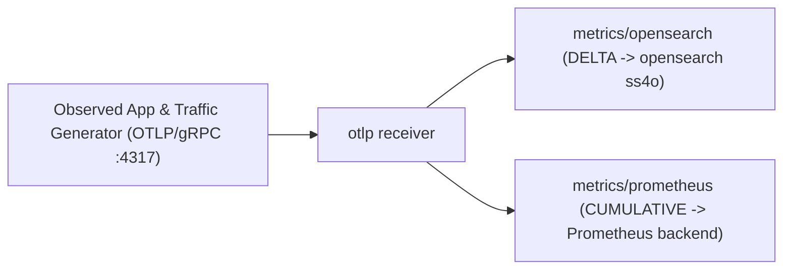

# OTel Collector Dual Metrics Export: SS4O DELTA (OpenSearch) + Cumulative (Prometheus)

Research notes for issue [#163](https://github.com/PawelBalcerek/observe-it/issues/163) (parent map
[#160](https://github.com/PawelBalcerek/observe-it/issues/160)), evaluating how `otel/opentelemetry-collector-contrib:0.164.0`
can simultaneously feed OpenSearch `ss4o_metrics-*` in `DELTA` temporality (preserving
[ADR-0007](../adr/0007-ss4o-metrics-delta-temporality-and-opensearch-normalization.md) and the classic
`Observe-It Metrics Overview` dashboard) and a Prometheus-compatible metrics backend in `CUMULATIVE` temporality for
OpenSearch Dashboards 3.9.0 Observability Metrics.

## 1. Current Baseline in Observe-It

- **Application export** ([`docker-compose.yml`](https://github.com/PawelBalcerek/observe-it/blob/main/docker-compose.yml)):
  Both `observed-app` and `traffic-generator` export OTLP/gRPC metrics every 1 second (`OTEL_METRIC_EXPORT_INTERVAL=1000`)
  with `OTEL_EXPORTER_OTLP_METRICS_TEMPORALITY_PREFERENCE=delta`.
- **Collector pipeline** ([`docker/otel-collector/config.yaml`](https://github.com/PawelBalcerek/observe-it/blob/main/docker/otel-collector/config.yaml)):
  `otel/opentelemetry-collector-contrib:0.164.0` (`mem_limit: 256m`, `memory_limiter` at `limit_mib: 200`,
  `spike_limit_mib: 50`) runs a single `metrics` pipeline: `otlp` → `[memory_limiter, filter/metrics, batch]` →
  `opensearch` (`mapping.mode: ss4o`).
- **Why OpenSearch needs `DELTA`** ([ADR-0007](../adr/0007-ss4o-metrics-delta-temporality-and-opensearch-normalization.md)):
  Classic OpenSearch Dashboards bar/line charts aggregate per-interval `sum`, `avg`, and `max` directly over
  `ss4o_metrics-*` without derivative math or restart-reset handling.
- **Current Compose memory budget**: 3.25 GB total `mem_limit` (`opensearch` 1g, `opensearch-dashboards` 512m,
  `otel-collector` 256m, `mongodb` 512m, `observed-app` 512m, `traffic-generator` 512m).

## 2. How OTel Collector Splits a Single OTLP Stream into Two Metrics Pipelines

In OpenTelemetry Collector, a single `otlp` receiver can feed multiple named `metrics` pipelines in parallel (for
example, `metrics/opensearch` and `metrics/prometheus`). When multiple pipelines consume from the same receiver and any
downstream processor mutates metrics (such as a temporality converter), the Collector clones the payload per pipeline so
the OpenSearch and Prometheus branches stay isolated.



## 3. Pipeline Options Comparison

### Option A: Keep Apps on `DELTA`, Convert to `CUMULATIVE` in Collector (`deltatocumulative`)

Applications remain unchanged (`OTEL_EXPORTER_OTLP_METRICS_TEMPORALITY_PREFERENCE=delta`). The Collector routes
`metrics/opensearch` directly to `opensearch` and routes `metrics/prometheus` through `delta_to_cumulative`
(`deltatocumulativeprocessor`) to Prometheus.

**Primary-source facts (`opentelemetry-collector-contrib` `v0.164.0`):**

- **Stability**: **`alpha`** for metrics, with a `Statefulness` warning
  ([`deltatocumulativeprocessor/README.md`](https://github.com/open-telemetry/opentelemetry-collector-contrib/blob/v0.164.0/processor/deltatocumulativeprocessor/README.md)).
- **Supported metric types**: Accumulates delta `Sum` (monotonic counters), explicit-bucket `Histogram`, and
  `ExponentialHistogram` (including dynamic scale harmonization in `internal/data/expo`) in memory into cumulative series;
  `Gauge` metrics have no aggregation temporality and pass through unchanged.
- **Memory & stream limits**: Controlled via `max_stale` (default `5m`, evicts inactive series) and `max_streams` (default
  `9223372036854775807` / max int; exceeding streams are dropped and counted in
  `otelcol_deltatocumulative_datapoints{error="limit"}`). In Observe-It's 2-service local sandbox (~tens to low hundreds
  of active series), the in-memory map uses single-digit MiB and fits comfortably inside the existing `200 MiB`
  `memory_limiter`, provided `max_streams` is explicitly capped (for example, `10000`).
- **Operational caveats**:
  - Out-of-order data points (`timestamp <= stored`) are rejected/dropped to preserve cumulative monotonicity.
  - Restarting `otel-collector` clears accumulated state and resets cumulative counters to zero (Prometheus `rate()` and
    `increase()` handle counter resets natively, though a single scrape/export interval sees a reset).

**Exporter choices for Option A (and Option B's Prometheus branch):**

| Exporter                | Target Endpoint                                                     | Temporality Requirement                                                    | Pros                                                                                                                               | Cons                                                                                                                                                     |
| ----------------------- | ------------------------------------------------------------------- | -------------------------------------------------------------------------- | ---------------------------------------------------------------------------------------------------------------------------------- | -------------------------------------------------------------------------------------------------------------------------------------------------------- |
| `otlphttp`              | Prometheus `--web.enable-otlp-receiver` (`/api/v1/otlp/v1/metrics`) | `CUMULATIVE` (native delta is experimental; see note below)                | Native OTLP push; Prometheus `otlp.promote_resource_attributes` handles resource labels cleanly; no remote-write protobuf layer    | Requires Prometheus 3.x with `--web.enable-otlp-receiver`                                                                                                |
| `prometheusremotewrite` | Prometheus `--web.enable-remote-write-receiver` (`/api/v1/write`)   | `CUMULATIVE` (explicitly drops non-cumulative monotonic/histogram/summary) | Mature push exporter with queued retry; works with any Remote Write backend                                                        | Extra OTLP-to-PRW translation; `resource_to_telemetry_conversion` is deprecated in favor of `resource_constant_labels`                                   |
| `prometheus` (scrape)   | Collector exposes `:8889/metrics`, Prometheus scrapes it            | `CUMULATIVE`                                                               | Classic Prometheus pull model                                                                                                      | Adds scrape-interval lag over 1s OTLP export; holds stale points up to `metric_expiration` (default `5m`); no `sending_queue`; requires `scrape_configs` |

> [!NOTE]
> **Why not send `DELTA` directly to Prometheus 3.x without conversion?**
> Prometheus 3.2 introduced `--enable-feature=otlp-deltatocumulative` (which embeds the same OTel
> `deltatocumulativeprocessor` behind a mutex), and Prometheus 3.4+ **deprecated** it in favor of
> `--enable-feature=otlp-native-delta-ingestion` (with `--enable-feature=st-storage` and
> `--enable-feature=use-start-timestamps` added in v3.12). However, the official Prometheus feature-flags documentation
> explicitly marks `otlp-native-delta-ingestion` as **experimental** (`prometheus/prometheus#17649`) and notes that delta
> metrics are currently given the **`unknown`** metric metadata type
> ([Prometheus Feature Flags](https://github.com/prometheus/prometheus/blob/main/docs/feature_flags.md)). That breaks
> accurate metric-type discovery on `/api/v1/metadata`, which OpenSearch's Prometheus connector relies on.

### Option B: Switch Apps to `CUMULATIVE`, Convert to `DELTA` in Collector (`cumulativetodelta`)

Applications use OpenTelemetry's default `CUMULATIVE` temporality
(`OTEL_EXPORTER_OTLP_METRICS_TEMPORALITY_PREFERENCE=cumulative` or unset). The Collector sends `metrics/prometheus`
directly via `otlphttp` to Prometheus (`--web.enable-otlp-receiver`) with zero stateful conversion, and converts
`metrics/opensearch` via `cumulative_to_delta` (`cumulativetodeltaprocessor`) before the `opensearch` (`ss4o`) exporter.

**Primary-source facts (`opentelemetry-collector-contrib` `v0.164.0`):**

- **Stability**: **`beta`** for metrics — a full maturity tier above `deltatocumulative` (`alpha`), with the same
  single-collector `Statefulness` warning
  ([`cumulativetodeltaprocessor/README.md`](https://github.com/open-telemetry/opentelemetry-collector-contrib/blob/v0.164.0/processor/cumulativetodeltaprocessor/README.md)).
- **Supported metric types**: Converts monotonic `Sum`, `Histogram`, and `ExponentialHistogram` from `CUMULATIVE` to
  `DELTA`. Non-monotonic sums are excluded; gauges and already-delta metrics are forwarded unchanged.
- **Configuration & restart semantics**:
  - `max_staleness` (default `1h`) bounds how long state entries live after last observation.
  - `initial_value` controls the first point seen after a Collector restart: `auto` (default) emits the initial point if
    `start_time` is set, occurs after Collector startup, and differs from `timestamp` (keeping counts for newly started
    apps while avoiding spikes for already-running apps); `keep` always emits; `drop` drops the first point.
- **Impact on existing Observe-It dashboards**: Because `cumulativetodelta` emits `DELTA` points to the `opensearch`
  exporter, `ss4o_metrics-*` documents retain the exact ADR-0007 schema and `Observe-It Metrics Overview` continues to
  work unchanged. Only `docker-compose.yml` app env vars and an ADR update/supersession of ADR-0007's app-side
  temporality decision are needed.

### Side-by-Side Pipeline Summary

| Dimension                       | Option A (`DELTA` apps + `deltatocumulative`)           | Option B (`CUMULATIVE` apps + `cumulativetodelta`)             |
| ------------------------------- | ------------------------------------------------------- | -------------------------------------------------------------- |
| Processor stability (`0.164.0`) | `alpha`                                                 | **`beta`**                                                     |
| Stateful conversion lives on    | Prometheus / PromQL path                                | OpenSearch `ss4o_metrics-*` path                               |
| App config change               | None (keeps ADR-0007 app env vars as-is)                | Remove/change `TEMPORALITY_PREFERENCE` to `cumulative`         |
| Collector restart impact        | Resets cumulative counters in Prometheus                | `initial_value: auto` drops at most 1 interval per series      |
| Collector memory overhead       | Low (single-digit MiB for 2 apps; set `max_streams`)    | Low (single-digit MiB for 2 apps; default `max_staleness: 1h`) |
| Alignment with OTel/Prom docs   | Non-default SDK temporality; `alpha` converter          | **Matches OTel SDK default and Prometheus OTLP guidance**      |

## 4. Backend Comparison: Prometheus vs. VictoriaMetrics

OpenSearch connects to a Prometheus-compatible backend via `POST _plugins/_query/_datasources` (`connector: "prometheus"`)
([OpenSearch Prometheus Metrics Docs](https://docs.opensearch.org/latest/observing-your-data/prometheusmetrics/)) and
executes PromQL via `POST /_plugins/_directquery/_query/{dataSource}`
([OpenSearch Direct Query API](https://docs.opensearch.org/latest/sql-and-ppl/sql-and-ppl-api/data-source-apis/execute-direct-query/))
and PPL table abstractions in `opensearch-project/sql`
([`prometheus_connector.md`](https://github.com/opensearch-project/sql/blob/main/docs/user/ppl/admin/connectors/prometheus_connector.md)).
The OpenSearch Prometheus client queries standard Prometheus HTTP API endpoints including `/api/v1/query`,
`/api/v1/query_range`, `/api/v1/labels`, `/api/v1/label/<name>/values`, `/api/v1/series`, and `/api/v1/metadata` (used
for `information_schema.tables` and OpenSearch Dashboards 3.9.0 Explore Metrics autocomplete/type discovery).

| Criterion                          | Prometheus (`prom/prometheus:v3.x`)                                                                                                                                                                  | VictoriaMetrics Single-Node (`victoriametrics/victoria-metrics`)                                                                                                                                                                                                          |
| ---------------------------------- | ---------------------------------------------------------------------------------------------------------------------------------------------------------------------------------------------------- | ------------------------------------------------------------------------------------------------------------------------------------------------------------------------------------------------------------------------------------------------------------------------- |
| OTLP HTTP ingestion                | Native `--web.enable-otlp-receiver` at `/api/v1/otlp/v1/metrics`; `otlp.promote_resource_attributes` in `prometheus.yml` ([Prometheus OTel Guide](https://prometheus.io/docs/guides/opentelemetry/)) | Native at `/opentelemetry/v1/metrics` ([VictoriaMetrics OTel Collector Docs](https://docs.victoriametrics.com/victoriametrics/data-ingestion/opentelemetry-collector/index.html))                                                                                         |
| Remote Write ingestion             | Native `--web.enable-remote-write-receiver` at `/api/v1/write`                                                                                                                                       | Native at `/api/v1/write`                                                                                                                                                                                                                                                 |
| Delta temporality handling         | Expects cumulative; `otlp-deltatocumulative` deprecated; `otlp-native-delta-ingestion` experimental (`unknown` metadata type)                                                                        | Recommends cumulative or `deltatocumulative`; v1.132.0+ can store delta as-is for `sum_over_time()`/`rate_over_sum()`, not standard PromQL `rate()` ([VM OTel Docs](https://docs.victoriametrics.com/victoriametrics/integrations/opentelemetry/index.html))              |
| `/api/v1/metadata` compatibility   | Native, authoritative implementation                                                                                                                                                                 | Added in `v1.130.0`, enabled by default since `v1.137.0` (`-enableMetadata`); stored in an **ephemeral** in-memory ring buffer not persisted across restarts ([VM README](https://github.com/victoriametrics/victoriametrics/blob/master/docs/victoriametrics/README.md)) |
| OpenSearch connector compatibility | **Reference target** for OpenSearch SQL/PPL Prometheus connector and Dashboards 3.9.0 Explore Metrics                                                                                                | Compatible with Prometheus HTTP API endpoints, but MetricsQL has subtle `rate()`/`increase()` differences from PromQL and is not OpenSearch's primary tested backend                                                                                                      |
| Local Docker RAM footprint         | ~80–150 MiB RSS at sandbox scale (2 services, short retention e.g. `--storage.tsdb.retention.time=2h` or `1d`); safe at `mem_limit: 256m` (+7.7% over 3.25 GB stack)                                 | ~40–80 MiB RSS; explicit `-memory.allowedBytes` cache cap and minimum `-retentionPeriod=24h` ([VM `vmstorage/main.go`](https://github.com/victoriametrics/victoriametrics/blob/master/app/vmstorage/main.go)); safe at `mem_limit: 128m`–`256m`                           |
| Reference-repo educational value   | Canonical Prometheus + PromQL stack                                                                                                                                                                  | Lighter footprint, but introduces a non-standard MetricsQL engine                                                                                                                                                                                                         |

## 5. Recommendation for Decision Ticket #164

1. **Choose Option B (`CUMULATIVE` apps + Collector `cumulativetodelta` (`beta`) for OpenSearch `ss4o_metrics-*` +
   direct `otlphttp` to Prometheus `--web.enable-otlp-receiver`)**:
   - Uses a `beta` processor (`cumulativetodelta`) instead of an `alpha` one (`deltatocumulative`).
   - Keeps the PromQL/Observability Metrics path completely stateless and free of Collector-restart counter-reset
     artifacts, while preserving 100% of `ss4o_metrics-*` and classic `Observe-It Metrics Overview` dashboards.
   - *(Fallback)*: If keeping ADR-0007's app-side `DELTA` setting untouched is preferred over amending ADR-0007,
     Option A (`deltatocumulative` with explicit `max_streams` -> `otlphttp`) is viable at local sandbox scale,
     accepting `alpha` processor stability.
2. **Choose Prometheus (`prom/prometheus:v3.x`) over VictoriaMetrics**:
   - Adding a `256m` Prometheus container brings the Compose total from `3.25 GB` to `3.50 GB`, while eliminating
     OpenSearch Dashboards 3.9.0 Explore Metrics compatibility risk (especially `/api/v1/metadata` and strict PromQL
     semantics) and keeping the reference architecture canonical.
   - Configure Prometheus with `--web.enable-otlp-receiver`, `--storage.tsdb.retention.time=1d` (or `2h`), and
     `otlp.promote_resource_attributes: [service.name, service.version, deployment.environment.name]` so service/env
     labels appear directly on every series without requiring `target_info` joins.

## 6. Reference Collector Configuration Sketch (Option B)

```yaml
processors:
  cumulative_to_delta:
    initial_value: auto
    max_staleness: 1h

exporters:
  opensearch:
    http:
      endpoint: "http://opensearch:9200"
      tls:
        insecure: true
    mapping:
      mode: ss4o
    dataset: observe-it
    namespace: local
    sending_queue:
      enabled: true
    retry_on_failure:
      enabled: true
  otlphttp/prometheus:
    endpoint: "http://prometheus:9090/api/v1/otlp"
    tls:
      insecure: true

service:
  pipelines:
    metrics/opensearch:
      receivers: [otlp]
      processors: [memory_limiter, filter/metrics, cumulative_to_delta, batch]
      exporters: [opensearch]
    metrics/prometheus:
      receivers: [otlp]
      processors: [memory_limiter, filter/metrics, batch]
      exporters: [otlphttp/prometheus]
```

## 7. Primary Sources

- OpenTelemetry Collector Contrib `v0.164.0` — `deltatocumulativeprocessor`:
  <https://github.com/open-telemetry/opentelemetry-collector-contrib/blob/v0.164.0/processor/deltatocumulativeprocessor/README.md>
- OpenTelemetry Collector Contrib `v0.164.0` — `cumulativetodeltaprocessor`:
  <https://github.com/open-telemetry/opentelemetry-collector-contrib/blob/v0.164.0/processor/cumulativetodeltaprocessor/README.md>
- OpenTelemetry Collector Contrib `v0.164.0` — `prometheusremotewriteexporter`:
  <https://github.com/open-telemetry/opentelemetry-collector-contrib/blob/v0.164.0/exporter/prometheusremotewriteexporter/README.md>
- OpenTelemetry Collector Contrib — `prometheusexporter`:
  <https://github.com/open-telemetry/opentelemetry-collector-contrib/blob/main/exporter/prometheusexporter/README.md>
- Prometheus — OpenTelemetry Guide (`--web.enable-otlp-receiver`):
  <https://prometheus.io/docs/guides/opentelemetry/>
- Prometheus — Feature Flags (`otlp-deltatocumulative` deprecated, `otlp-native-delta-ingestion` experimental):
  <https://github.com/prometheus/prometheus/blob/main/docs/feature_flags.md>
- Prometheus — Configuration (`otlp.promote_resource_attributes`, `storage.tsdb.retention`):
  <https://github.com/prometheus/prometheus/blob/main/docs/configuration/configuration.md>
- OpenSearch — Prometheus Metrics Data Source:
  <https://docs.opensearch.org/latest/observing-your-data/prometheusmetrics/>
- OpenSearch — Direct Query API (`/_plugins/_directquery/_query/{dataSource}`):
  <https://docs.opensearch.org/latest/sql-and-ppl/sql-and-ppl-api/data-source-apis/execute-direct-query/>
- OpenSearch SQL — Prometheus Connector (`query_range`, `information_schema.tables`):
  <https://github.com/opensearch-project/sql/blob/main/docs/user/ppl/admin/connectors/prometheus_connector.md>
- VictoriaMetrics — OpenTelemetry Integration & Delta Temporality:
  <https://docs.victoriametrics.com/victoriametrics/integrations/opentelemetry/index.html>
- VictoriaMetrics — Prometheus Querying API & Metrics Metadata (`/api/v1/metadata`, `-enableMetadata`):
  <https://github.com/victoriametrics/victoriametrics/blob/master/docs/victoriametrics/README.md>
- VictoriaMetrics — `vmstorage/main.go` (`-retentionPeriod`, `-memory.allowedBytes`):
  <https://github.com/victoriametrics/victoriametrics/blob/master/app/vmstorage/main.go>
